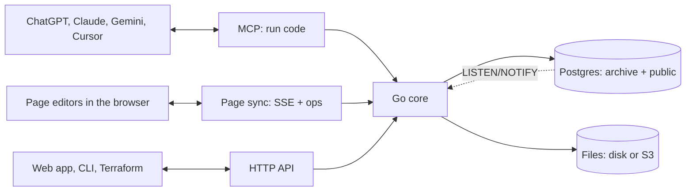

<p align="center">
  
</p>

<h1 align="center">Archive</h1>

<h3 align="center">Own your data infrastructure.</h3>

<p align="center">
  Database. File storage. Agent access.<br>
  A foundation for your digital world, built to run on your terms.
</p>

<p align="center">
  <a href="https://archive.us.org">Website</a> ·
  <a href="https://archive.us.org/docs">Docs</a> ·
  <a href="#quick-start">Quick start</a> ·
  <a href="#connect-your-agent">Connect your agent</a> ·
  <a href="#run-it-anywhere">Run it anywhere</a> ·
  <a href="docs/adr/0001-architecture.md">Architecture</a>
</p>

---

Archive is one open-source Go program on top of Postgres. Your records live in real Postgres tables and your files on disk or in S3-compatible storage. The same rules guard all of it, whether it is read by you in the web app, by your code over the HTTP API, or by your AI agent over MCP.

Archive never calls an AI model on its own. Your agent does the thinking and sends Archive code to run.

## Shape your data with an agent


Tell your agent what you keep track of, like clients, invoices and projects, and how they link. Every kind of record becomes a real Postgres table. Built-in types such as `archive.money`, `archive.phone`, `archive.email` and `archive.address` clean messy input before it is stored, read in the locale you set with `ARCHIVE_LOCALE`. Secret types like card and passport numbers are encrypted and read back masked.

You see the plan before anything changes, and statements that delete data are blocked unless you allow them. The same flow works by hand:

```sh
archive schema pull ./schema   # every table and view as a .sql file
archive schema plan ./schema   # what would change
archive schema apply ./schema  # do it
```

The live database is the only source of truth, so there is no migrations folder. Pulling and applying straight back plans nothing, so the files can live in git.

## Your agent writes code. Archive runs it.


Instead of a dozen small tool calls, your agent writes one short script. Archive runs it inside, as you, in one transaction, and sends back one result:

```ts
const unpaid = await archive.list("invoice", { where: { status: "unpaid" } });
const total = unpaid.reduce((sum, i) => sum + i.amount.amount, 0);
return { count: unpaid.length, total };
```

```json
{"result": {"count": 3, "total": 6530}, "logs": [], "error": ""}
```

All or nothing, only your spaces (even with raw SQL), no network, and a 30 second limit by default (`ARCHIVE_RUN_TIMEOUT`). The `run` tool's description is the full SDK reference plus a type for each of your tables, so your agent writes against your real schema. Scripts can also search every table and file, and edit Word, Excel and PowerPoint files and Archive's own pages in place.

## Connect it to everything else


The same data and the same permissions, whichever way in:

| Way in | Good for |
|---|---|
| MCP at `/mcp` | Claude, ChatGPT, Gemini, Cursor and other agents, through one tool: `run` |
| HTTP API at `/api` | Records, files and search from your own apps and services |
| The `archive` CLI | Scripts, scheduled jobs and quick changes from your terminal |
| [Terraform provider](apps/terraform/provider) | Your schema, spaces, tokens and roles, kept with the rest of your setup |

Upload any file and Archive pulls out its text, so one search covers every table and file you can see. Read-only connectors for mail, files, chat and business tools are designed in [ADR 0002](docs/adr/0002-connectors.md) and not built yet.

Each team, client or project gets its own space, and people and their agents only see the spaces they are in. People, spaces and tokens are real Postgres roles, and every table has row-level security, so the database itself checks every row against who is asking. Roles are `viewer`, `editor`, `admin` and `owner`, and tokens only ever narrow what their owner can do. Sign-in is by one-time email links, passkeys, or Google and Microsoft through `ARCHIVE_OIDC`.

```sh
docker exec archive archive space add finance
docker exec archive archive user add anna@example.com -name Anna
docker exec archive archive space grant finance anna@example.com editor
```

## Open source. Make it yours.


Run Archive on your own computer, your own servers or your own cloud account, and keep your data where you want it. Change it or fork it anytime, by hand or by asking Claude Code to add what you need. Or [let us run it for you](https://mulholland.ai).

## Quick start

One line starts Archive on your machine with Docker:

```sh
curl -fsSL https://raw.githubusercontent.com/Mulholland-Inc/archive/main/install.sh | ARCHIVE_ADMIN_EMAIL=you@example.com sh
```

Use your own email: you become the first owner, and your sign-in link appears in the log. Run the same line again to update. Your data stays in the `archive` volume, and Archive backs itself up before each new version.

From a clone of this repo, Docker Compose does the same:

```sh
ARCHIVE_ADMIN_EMAIL=you@example.com docker compose up -d
```

`http://localhost:8080` is the API server, not a website; `/healthz` answers `204` when it is up. The web app lives in [`apps/web`](apps/web): run `npm install && npm run dev` there and open `http://localhost:5173`.

## Connect your agent

Make a token, then add Archive to Claude Code with its secret:

```sh
docker exec archive archive token create -name "Claude Code"
claude mcp add --transport http archive http://localhost:8080/mcp --header "Authorization: Bearer <token>"
```

With no `-space`, the token gets your role in every space you are in. Narrow it with `-space finance:viewer,ops:editor`.

<details>
<summary><b>Cursor, Claude Desktop, ChatGPT</b></summary>

**Cursor**: add this to `.cursor/mcp.json`:

```json
{
  "mcpServers": {
    "archive": {
      "url": "http://localhost:8080/mcp",
      "headers": { "Authorization": "Bearer <token>" }
    }
  }
}
```

**Claude Desktop**, on the machine that runs Archive, with no token, as the person you name:

```json
{
  "mcpServers": {
    "archive": {
      "command": "docker",
      "args": ["exec", "-i", "archive", "archive", "-as", "you@example.com", "mcp"]
    }
  }
}
```

**ChatGPT and claude.ai** run in the cloud, so they need a public HTTPS address and a connector that can send the bearer header. Archive has no OAuth sign-in yet.

</details>

## Run it anywhere

| Where | How |
|---|---|
| **Docker** | [`install.sh`](install.sh), or `docker compose up -d` from the code |
| **Kubernetes** | `helm install archive apps/helm/archive --set url=https://archive.example.com --set adminEmail=you@example.com` |
| **Cloud** | Terraform for [AWS](apps/terraform/aws) (Fargate, RDS, S3), [Google Cloud](apps/terraform/gcp) (Cloud Run, Cloud SQL, Storage) and [Azure](apps/terraform/azure) (Container Apps, Postgres, Files) |
| **As code** | the [`archive` Terraform provider](apps/terraform/provider) for your schema, spaces, tokens and roles |

The image holds Postgres and the binary. With nothing set, it runs the bundled Postgres and keeps files in `/data`. Give it an outside Postgres (`DATABASE_URL`), S3-compatible storage (`ARCHIVE_BLOB_URL`) and one `ARCHIVE_SECRET_KEY`, and it keeps nothing local, so you can run as many copies side by side as you like. In production, put it behind HTTPS and set `ARCHIVE_URL`.

Every setting is an environment variable; `archive help` lists them all:

| Variable | What it does |
|---|---|
| `ARCHIVE_ADMIN_EMAIL` | First owner, created when there are no users yet |
| `ARCHIVE_URL` | Public base URL for links, cookies and passkeys |
| `ARCHIVE_DATA` | Data directory for the bundled Postgres, its key and files (default `./data`) |
| `DATABASE_URL` | Outside Postgres, as a superuser; unset starts the bundled one |
| `ARCHIVE_SECRET_KEY` | 32-byte key for secret values; required with `DATABASE_URL`, the same on every copy |
| `ARCHIVE_BLOB_URL`, `ARCHIVE_BLOB_KEY`, `ARCHIVE_BLOB_SECRET` | S3, R2, MinIO or GCS for files |
| `ARCHIVE_SMTP_URL`, `ARCHIVE_SMTP_FROM` | Mail for sign-in links; unset prints them to the log |
| `ARCHIVE_OIDC` | OIDC providers, like Google and Microsoft |
| `ARCHIVE_LOCALE` | Locale that messy input is read in |
| `ARCHIVE_RUN_TIMEOUT` | Time limit of one run (default `30s`) |
| `ARCHIVE_INSTANCE` | Prefix of this instance's Postgres roles (default `a`) |
| `ARCHIVE_PG_BIN` | Where the Postgres binaries are; unset uses `PATH` or downloads them |

## How it is built



| Path | What lives there |
|---|---|
| [`src`](src) | The Go server and CLI: API, MCP, sign-in, schema, search, files, pages, Office editing |
| [`apps/web`](apps/web) | The Svelte 5 web app |
| [`apps/site`](apps/site) | [archive.us.org](https://archive.us.org) and the docs |
| [`apps/helm`](apps/helm/archive), [`apps/terraform`](apps/terraform) | Kubernetes chart, cloud setups and the Terraform provider |
| [`demo`](demo) | A made-up personal archive: 18 tables, about 820 rows and 35 files to try it with |
| [`docs/adr`](docs/adr) | Architecture decisions |

## Develop

```sh
cd src
go build -o archive .
go test ./...                         # end-to-end tests against a real Postgres 18
ARCHIVE_DATA=../data ARCHIVE_BIN=./archive ../demo/load.sh you@example.com
ARCHIVE_DATA=../data ./archive serve  # API, sign-in and MCP on :8080
```

```sh
cd apps/web && npm install && npm run dev   # web app on :5173
```

<p align="center"><sub>Made by <a href="https://mulholland.ai">Mulholland</a>.</sub></p>
