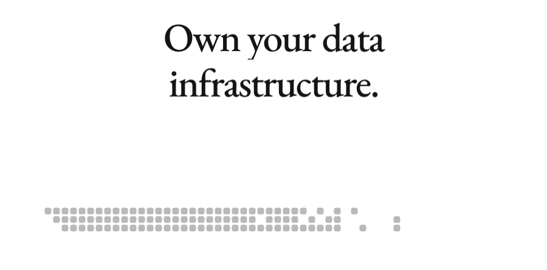
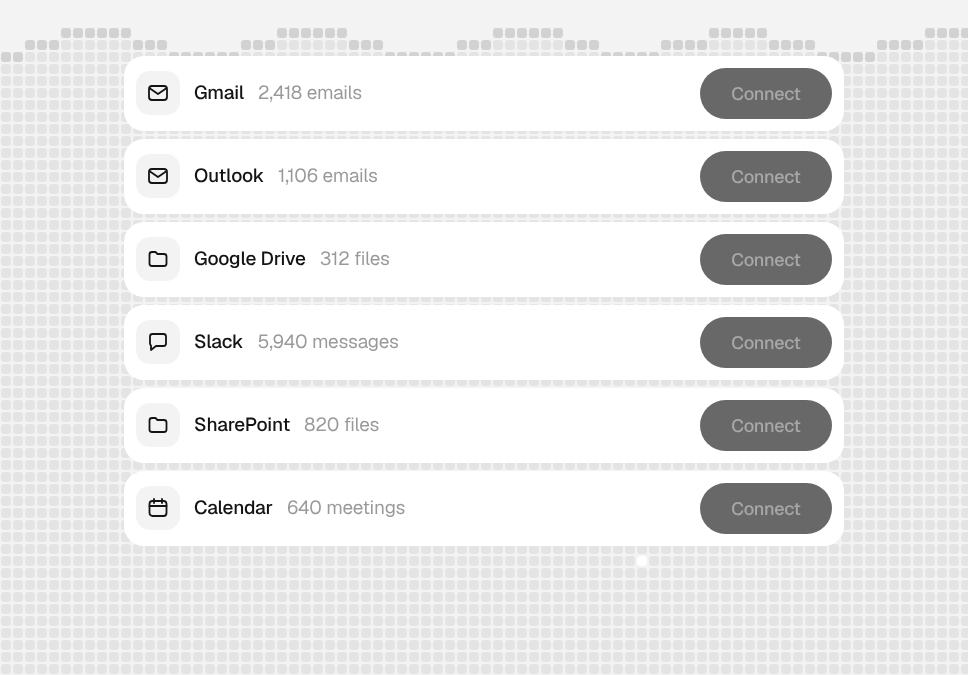
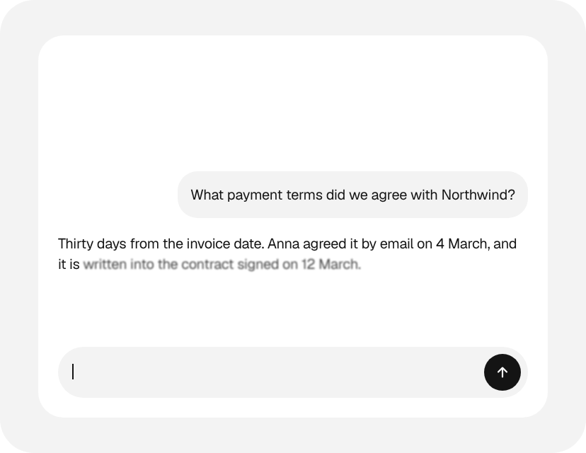
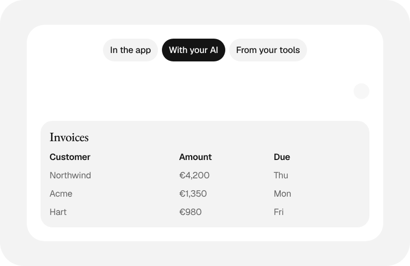
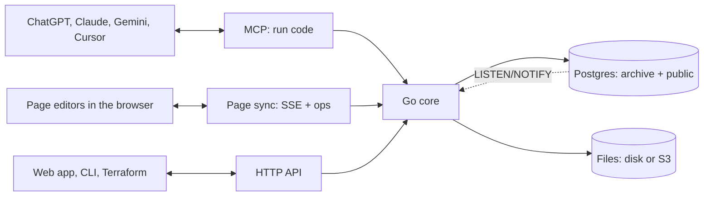
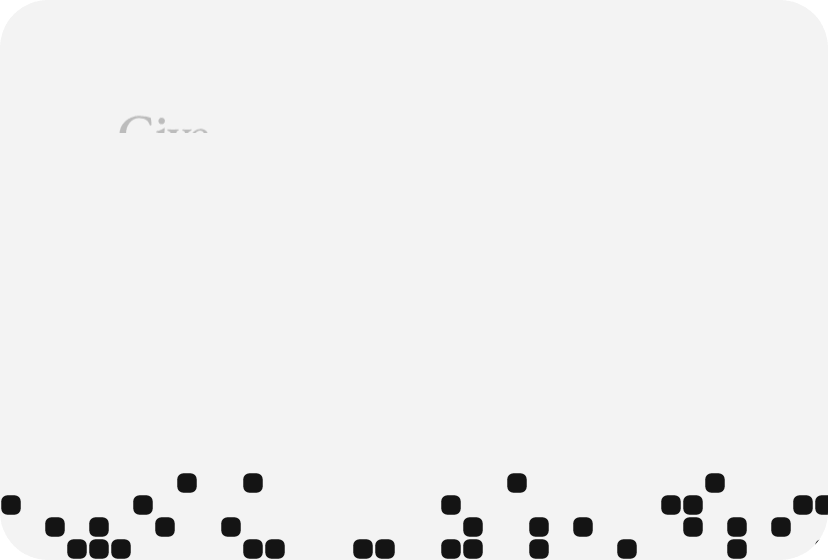

<p align="center">
  <a href="https://archive.us.org">
    <picture>
      <source media="(prefers-color-scheme: dark)" srcset=".github/readme/logo-dark.svg">
      
    </picture>
  </a>
</p>

<p align="center">
  <picture>
    <source media="(prefers-color-scheme: dark)" srcset=".github/readme/hero-dark.gif">
    
  </picture>
</p>

<p align="center">
  <b>The memory of your company.</b><br>
  One open-source server for your records, your files and every AI you work with.
</p>

<p align="center">
  <a href="https://archive.us.org">Website</a> ·
  <a href="https://archive.us.org/docs.html">Docs</a> ·
  <a href="#quick-start">Quick start</a> ·
  <a href="#connect-your-ai">Connect your AI</a> ·
  <a href="#run-it-anywhere">Run it anywhere</a> ·
  <a href="docs/adr/0001-architecture.md">Architecture</a>
</p>

<p align="center">
  
  
  
  
  
</p>

---

Archive is one Go program on top of Postgres. Your records live in real Postgres tables, your files on disk or in S3-compatible storage, and the same rules guard all of it, whether it is read by **you in the web app**, **your code over the HTTP API**, or **your AI over MCP**.

Archive never calls an AI model on its own. Your assistant does the thinking and sends Archive code to run.

## Quick start

One line starts Archive on your machine with Docker:

```sh
curl -fsSL https://raw.githubusercontent.com/Mulholland-Inc/archive/main/install.sh | ARCHIVE_ADMIN_EMAIL=you@example.com sh
```

Use your own email: you become the first owner. Run the same line again to update; your data stays in the `archive` volume, and Archive backs itself up before each new version.

> [!TIP]
> Rather have your AI do it? The **Run it yourself** button on [archive.us.org](https://archive.us.org) copies a setup prompt for Claude Code or Codex. It checks Docker, asks for your email, runs the install and connects itself.

`http://localhost:8080` is the API server, not a website. The web app lives in [`apps/web`](apps/web): run `npm run dev` there and open `http://localhost:5173`.

## Messy in, tidy out

<picture>
  <source media="(prefers-color-scheme: dark)" srcset=".github/readme/tidy-dark.gif">
  
</picture>

Every kind of record is a real Postgres table, and a row is one record. Built-in column types clean messy input before it is stored, read in your `ARCHIVE_LOCALE`:

| You send | Archive stores |
|---|---|
| `"€ 1.234,50"` | `1234.5` euros (`archive.money`) |
| `"06 12345678"` | `+31612345678` (`archive.phone`) |
| a passport number, IBAN or card number | encrypted, read back masked (secret types) |

There are types for email, phone, money, address, name, url, country, IBAN, VAT id, geo, quantity, timestamp and more: `archive types` lists them all. Upload any file and Archive pulls out its text, so one search covers every table and file you can see.

## Connect once

<picture>
  <source media="(prefers-color-scheme: dark)" srcset=".github/readme/flow-dark.gif">
  
</picture>

Every AI your team uses reads from the same place. Today data gets in through uploads, the API and your AI. Read-only connectors that pull in only what changed (Gmail, Outlook, Drive, SharePoint, Slack, Notion, Linear, HubSpot and more) are next; [ADR 0002](docs/adr/0002-connectors.md) has the plan.

## Connect your AI

<picture>
  <source media="(prefers-color-scheme: dark)" srcset=".github/readme/ask-dark.gif">
  
</picture>

Archive is an MCP server at `/mcp`, with one tool: `run`. Get a token for a space, then add it to your assistant:

```sh
docker exec archive archive token create -space finance
claude mcp add --transport http archive http://localhost:8080/mcp --header "Authorization: Bearer <token>"
```

<details>
<summary><b>Cursor, Claude Desktop, ChatGPT</b></summary>

**Cursor**: add this to `.cursor/mcp.json`:

```json
{
  "mcpServers": {
    "archive": {
      "url": "http://localhost:8080/mcp",
      "headers": { "Authorization": "Bearer <token>" }
    }
  }
}
```

**Claude Desktop**, on the machine that runs Archive, with no token, as the person you name:

```json
{
  "mcpServers": {
    "archive": {
      "command": "docker",
      "args": ["exec", "-i", "archive", "archive", "-as", "you@example.com", "mcp"]
    }
  }
}
```

**ChatGPT and claude.ai** run in the cloud, so they need a public HTTPS address and a connector that can send the bearer header. Archive has no OAuth sign-in yet.

</details>

### Code mode

Instead of a dozen small tool calls, your AI writes one short script. Archive runs it inside, as you, in one transaction, and sends back one result:

```ts
const unpaid = await archive.list("invoice", { where: { status: "unpaid" } });
const total = unpaid.reduce((sum, i) => sum + i.amount.amount, 0);
return { count: unpaid.length, total };
```

```json
{"result": {"count": 3, "total": 6530}, "logs": [], "error": ""}
```

All or nothing, only your spaces (even with raw SQL), no network, a 30 second limit. The `run` tool's description is the full SDK reference plus a type for each of your tables, so your AI writes against your real schema: `list`, `get`, `create`, `update`, `delete`, `search`, `sql`, `schema`, `apply`, `read`, `edit` and more. It also edits Word, Excel and PowerPoint files in place, and Archive's own live pages.

## Shape your data with your AI

<picture>
  <source media="(prefers-color-scheme: dark)" srcset=".github/readme/edit-dark.gif">
  
</picture>

Ask for a new field or a new kind of record. Your AI pulls the schema as plain SQL files, edits them, shows you the plan and applies it only when you say yes. Or by hand:

```sh
archive schema pull ./schema   # every table and view as a .sql file
archive schema plan ./schema   # what would change
archive schema apply ./schema  # do it
```

The live database is the only source of truth: no migrations folder. Pulling and applying straight back plans nothing, so the files can live in git. Dropping a table or column needs `-allow-drop`.

## A space for every team

<picture>
  <source media="(prefers-color-scheme: dark)" srcset=".github/readme/spaces-dark.gif">
  
</picture>

Each team, client or project gets its own space, and people and their AI only see the spaces they are in. People, spaces and tokens are real Postgres roles, and every table has row-level security, so the database itself checks every row against who is asking. The app, the API, your AI and raw SQL get the same answer.

```sh
docker exec archive archive space add finance
docker exec archive archive user add anna@example.com -name Anna
docker exec archive archive space grant finance anna@example.com editor
```

Roles are `viewer`, `editor`, `admin` and `owner`. Tokens only ever narrow what their owner can do. Sign-in is by one-time email links, passkeys, or Google and Microsoft through `ARCHIVE_OIDC`.

## Run it anywhere

<picture>
  <source media="(prefers-color-scheme: dark)" srcset=".github/readme/own-dark.gif">
  
</picture>

Your data stays yours. Run Archive yourself, or [let us run it for you](https://mulholland.ai).

| | |
|---|---|
| **Docker** | [`install.sh`](install.sh), or `ARCHIVE_ADMIN_EMAIL=you@example.com docker compose up -d` from the code |
| **Kubernetes** | `helm install archive apps/helm/archive --set url=https://archive.example.com --set adminEmail=you@example.com` |
| **Cloud** | Terraform for [AWS](apps/terraform/aws) (Fargate, RDS, S3), [Google Cloud](apps/terraform/gcp) (Cloud Run, Cloud SQL, Storage) and [Azure](apps/terraform/azure) (Container Apps, Postgres, Files) |
| **As code** | an [`archive` Terraform provider](apps/terraform/provider) for your schema, spaces, tokens and roles |

The image holds Postgres and the binary. Give it an outside Postgres (`DATABASE_URL`), S3-compatible storage (`ARCHIVE_BLOB_URL`) and one `ARCHIVE_SECRET_KEY`, and it keeps nothing local: run as many copies side by side as you like. In production, put it behind HTTPS and set `ARCHIVE_URL`. Every setting is an environment variable; the [docs](https://archive.us.org/docs.html) list them all.

## How it is built



| Path | What lives there |
|---|---|
| [`src`](src) | The Go server and CLI: API, MCP, sign-in, schema, search, files, pages, Office editing |
| [`apps/web`](apps/web) | The Svelte 5 web app, to be wrapped with Tauri 2 for desktop and mobile |
| [`apps/site`](apps/site) | [archive.us.org](https://archive.us.org) and the docs, deployed to GitHub Pages |
| [`apps/helm`](apps/helm/archive), [`apps/terraform`](apps/terraform) | Kubernetes chart, cloud setups and the Terraform provider |
| [`demo`](demo) | A made-up personal archive: 18 tables, about 820 rows and 35 files to try it with |
| [`docs/adr`](docs/adr) | Architecture decisions |

### Develop

```sh
cd src
go build -o archive .
go test ./...                         # end-to-end tests against a real Postgres 18
ARCHIVE_DATA=../data ARCHIVE_BIN=./archive ../demo/load.sh you@example.com
ARCHIVE_DATA=../data ./archive serve  # API, sign-in and MCP on :8080
```

```sh
cd apps/web && npm install && npm run dev   # web app on :5173
```

Changes go in through pull requests to `main`; CI runs `go vet` and the full test suite.

<p align="center">
  <a href="https://archive.us.org">
    <picture>
      <source media="(prefers-color-scheme: dark)" srcset=".github/readme/cta-dark.gif">
      
    </picture>
  </a>
</p>

<p align="center"><sub>Made by <a href="https://mulholland.ai">Mulholland</a>.</sub></p>
