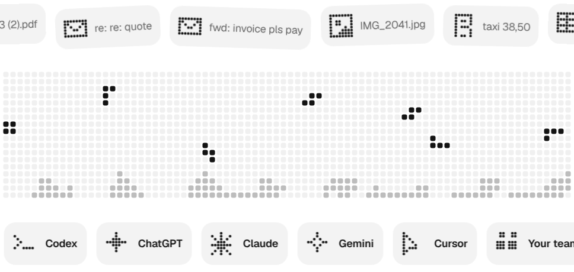
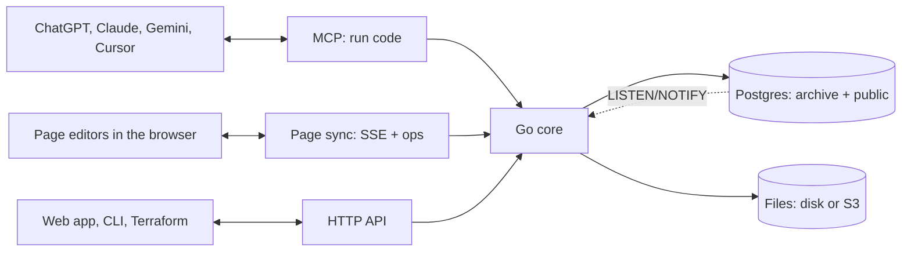

<p align="center">
  <a href="https://archive.us.org">
    <picture>
      <source media="(prefers-color-scheme: dark)" srcset=".github/readme/logo-dark.svg">
      
    </picture>
  </a>
</p>

<p align="center">
  <picture>
    <source media="(prefers-color-scheme: dark)" srcset=".github/readme/banner-dark.gif">
    
  </picture>
</p>

<h3 align="center">Own your data infrastructure.</h3>

<p align="center">
  Database, file storage and agent access in one open-source server.<br>
  Your team uses it in the app, your code over HTTP, and every AI over MCP.
</p>

<p align="center">
  <a href="https://archive.us.org">Website</a> ·
  <a href="https://archive.us.org/docs.html">Docs</a> ·
  <a href="#quick-start">Quick start</a> ·
  <a href="#connect-your-ai">Connect your AI</a> ·
  <a href="#run-it-anywhere">Run it anywhere</a> ·
  <a href="docs/adr/0001-architecture.md">Architecture</a>
</p>

---

Archive is one Go program on top of Postgres. Your records live in real Postgres tables, your files on disk or in S3-compatible storage, and the same rules guard all of it, whether it is read by **you in the web app**, **your code over the HTTP API**, or **your AI over MCP**.

Archive never calls an AI model on its own. Your assistant does the thinking and sends Archive code to run.

## Quick start

One line starts Archive on your machine with Docker:

```sh
curl -fsSL https://raw.githubusercontent.com/Mulholland-Inc/archive/main/install.sh | ARCHIVE_ADMIN_EMAIL=you@example.com sh
```

Use your own email: you become the first owner. Run the same line again to update; your data stays in the `archive` volume, and Archive backs itself up before each new version.

`http://localhost:8080` is the API server, not a website. The web app lives in [`apps/web`](apps/web): run `npm run dev` there and open `http://localhost:5173`.

## Connect your AI

Archive is an MCP server at `/mcp`, with one tool: `run`. Get a token for a space, then add it to your assistant:

```sh
docker exec archive archive token create -space finance
claude mcp add --transport http archive http://localhost:8080/mcp --header "Authorization: Bearer <token>"
```

<details>
<summary><b>Cursor, Claude Desktop, ChatGPT</b></summary>

**Cursor**: add this to `.cursor/mcp.json`:

```json
{
  "mcpServers": {
    "archive": {
      "url": "http://localhost:8080/mcp",
      "headers": { "Authorization": "Bearer <token>" }
    }
  }
}
```

**Claude Desktop**, on the machine that runs Archive, with no token, as the person you name:

```json
{
  "mcpServers": {
    "archive": {
      "command": "docker",
      "args": ["exec", "-i", "archive", "archive", "-as", "you@example.com", "mcp"]
    }
  }
}
```

**ChatGPT and claude.ai** run in the cloud, so they need a public HTTPS address and a connector that can send the bearer header. Archive has no OAuth sign-in yet.

</details>

### Code mode

Instead of a dozen small tool calls, your AI writes one short script. Archive runs it inside, as you, in one transaction, and sends back one result:

```ts
const unpaid = await archive.list("invoice", { where: { status: "unpaid" } });
const total = unpaid.reduce((sum, i) => sum + i.amount.amount, 0);
return { count: unpaid.length, total };
```

```json
{"result": {"count": 3, "total": 6530}, "logs": [], "error": ""}
```

All or nothing, only your spaces (even with raw SQL), no network, a 30 second limit. The `run` tool's description is the full SDK reference plus a type for each of your tables, so your AI writes against your real schema. Scripts can also edit Word, Excel and PowerPoint files in place, and Archive's own live pages.

## Your data, in plain Postgres

Every kind of record is a real Postgres table, and a row is one record. Built-in column types clean messy input before it is stored:

| You send | Archive stores |
|---|---|
| `"€ 1.234,50"` | `1234.5` euros (`archive.money`) |
| `"06 12345678"` | `+31612345678` (`archive.phone`) |
| a passport number, IBAN or card number | encrypted, read back masked (secret types) |

Upload any file and Archive pulls out its text, so one search covers every table and file you can see. To change your types, ask your AI, or do it by hand:

```sh
archive schema pull ./schema   # every table and view as a .sql file
archive schema plan ./schema   # what would change
archive schema apply ./schema  # do it
```

The live database is the only source of truth, so there is no migrations folder. Pulling and applying straight back plans nothing, so the files can live in git.

## A space for every team

Each team, client or project gets its own space, and people and their AI only see the spaces they are in. People, spaces and tokens are real Postgres roles, and every table has row-level security, so the database itself checks every row against who is asking.

```sh
docker exec archive archive space add finance
docker exec archive archive user add anna@example.com -name Anna
docker exec archive archive space grant finance anna@example.com editor
```

Roles are `viewer`, `editor`, `admin` and `owner`. Tokens only ever narrow what their owner can do. Sign-in is by one-time email links, passkeys, or Google and Microsoft through `ARCHIVE_OIDC`.

## Run it anywhere

Run Archive yourself, or [let us run it for you](https://mulholland.ai).

| | |
|---|---|
| **Docker** | [`install.sh`](install.sh), or `ARCHIVE_ADMIN_EMAIL=you@example.com docker compose up -d` from the code |
| **Kubernetes** | `helm install archive apps/helm/archive --set url=https://archive.example.com --set adminEmail=you@example.com` |
| **Cloud** | Terraform for [AWS](apps/terraform/aws) (Fargate, RDS, S3), [Google Cloud](apps/terraform/gcp) (Cloud Run, Cloud SQL, Storage) and [Azure](apps/terraform/azure) (Container Apps, Postgres, Files) |
| **As code** | an [`archive` Terraform provider](apps/terraform/provider) for your schema, spaces, tokens and roles |

The image holds Postgres and the binary. Give it an outside Postgres (`DATABASE_URL`), S3-compatible storage (`ARCHIVE_BLOB_URL`) and one `ARCHIVE_SECRET_KEY`, and it keeps nothing local, so you can run as many copies side by side as you like. In production, put it behind HTTPS and set `ARCHIVE_URL`. Every setting is an environment variable; the [docs](https://archive.us.org/docs.html) list them all.

<p align="center">
  <picture>
    <source media="(prefers-color-scheme: dark)" srcset=".github/readme/tidy-dark.gif">
    
  </picture>
</p>

## How it is built



| Path | What lives there |
|---|---|
| [`src`](src) | The Go server and CLI: API, MCP, sign-in, schema, search, files, pages, Office editing |
| [`apps/web`](apps/web) | The Svelte 5 web app, to be wrapped with Tauri 2 for desktop and mobile |
| [`apps/site`](apps/site) | [archive.us.org](https://archive.us.org) and the docs |
| [`apps/helm`](apps/helm/archive), [`apps/terraform`](apps/terraform) | Kubernetes chart, cloud setups and the Terraform provider |
| [`demo`](demo) | A made-up personal archive: 18 tables, about 820 rows and 35 files to try it with |
| [`docs/adr`](docs/adr) | Architecture decisions |

### Develop

```sh
cd src
go build -o archive .
go test ./...                         # end-to-end tests against a real Postgres 18
ARCHIVE_DATA=../data ARCHIVE_BIN=./archive ../demo/load.sh you@example.com
ARCHIVE_DATA=../data ./archive serve  # API, sign-in and MCP on :8080
```

```sh
cd apps/web && npm install && npm run dev   # web app on :5173
```

<p align="center">
  <picture>
    <source media="(prefers-color-scheme: dark)" srcset=".github/readme/skyline-dark.gif">
    
  </picture>
</p>

<p align="center"><sub>Made by <a href="https://mulholland.ai">Mulholland</a>.</sub></p>
