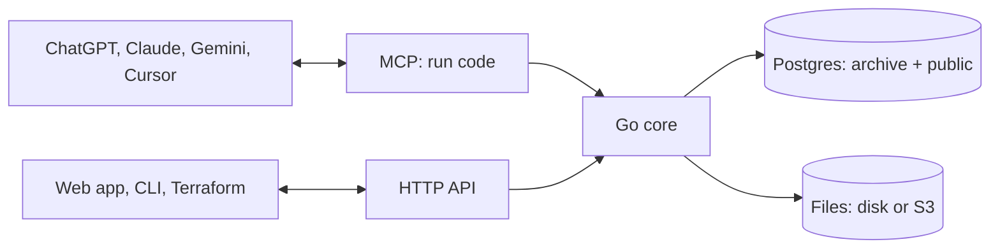

<p align="center">
  
</p>

<h1 align="center">Archive</h1>

<h3 align="center">Own your data infrastructure.</h3>

<p align="center">
  Database. File storage. Agent access.<br>
  A foundation for your digital world, built to run on your terms.
</p>

<p align="center">
  <a href="https://archive.us.org">Website</a> ·
  <a href="https://archive.us.org/docs">Docs</a> ·
  <a href="#quick-start">Quick start</a> ·
  <a href="#connect-your-agent">Connect your agent</a> ·
  <a href="#run-it-anywhere">Run it anywhere</a> ·
  <a href="docs/adr/0001-architecture.md">Architecture</a>
</p>

---

Archive is one open-source Go program on top of Postgres. Your records live in real Postgres tables and your files on disk or in S3-compatible storage. The same rules guard all of it, whether it is read by you in the web app, by your code over the HTTP API, or by your AI agent over MCP.

Archive never calls an AI model on its own. Your agent does the thinking and sends Archive code to run.

## Shape your data with an agent


Tell your agent what you keep track of, like clients, invoices and projects, and how they link. Every kind of record becomes a real Postgres table. Built-in types such as `archive.money`, `archive.phone`, `archive.email` and `archive.address` clean messy input before it is stored, read in the locale you set with `ARCHIVE_LOCALE`. Secret types like card and passport numbers are encrypted and read back masked.

You see the plan before anything changes, and statements that delete data are blocked unless you allow them. The same flow works by hand:

```sh
archive schema pull ./schema   # every table and view as a .sql file
archive schema plan ./schema   # what would change
archive schema apply ./schema  # do it
```

The live database is the only source of truth, so there is no migrations folder. Pulling and applying straight back plans nothing, so the files can live in git.

## Your agent writes code. Archive runs it.


Instead of a dozen small tool calls, your agent writes one short script. Archive runs it inside, as you, in one transaction, and sends back one result:

```ts
const unpaid = await archive.list("invoice", { where: { status: "unpaid" } });
const total = unpaid.reduce((sum, i) => sum + i.amount.amount, 0);
return { count: unpaid.length, total };
```

```json
{"result": {"count": 3, "total": 6530}, "logs": [], "error": ""}
```

All or nothing, only your spaces (even with raw SQL), and a 30 second limit by default (`ARCHIVE_RUN_TIMEOUT`). A small `fetch` calls other services. The `run` tool's description is the full SDK reference plus a type for each of your tables, so your agent writes against your real schema. Scripts can also search every table and file, and edit Word, Excel and PowerPoint files in place.

Your agent can also save a script as a workflow that Archive runs on its own: on a schedule, when rows of a table are added or changed, or when its webhook URL is called. The first line says when:

```ts
// on: cron CRON_TZ=America/New_York 0 9 * * 1-5
return await archive.sql("SELECT number, customer, due FROM invoice WHERE NOT paid AND due < current_date");
```

The agent saves them with `archive.deploy(files)`, which returns compile and trigger errors instead of saving, and tries them on real data with `archive.test`, which undoes everything it wrote. A webhook workflow gets its own `ARCHIVE_API_URL/hooks/run/<workspace>/<secret>` address. Every run's result, logs and error show on the Workflows screen in the app.

## Connect it to everything else


The same data and the same permissions, whichever way in:

| Way in | Good for |
|---|---|
| MCP at `/mcp` | Claude, ChatGPT, Gemini, Cursor and other agents, through one tool: `run` |
| HTTP API at `/api` | Records, files, search and workflows from your own apps and services |
| Webhooks at `/hooks/run/<workspace>/<secret>` | Other services starting a workflow with a POST |
| The `archive` CLI | Scripts, scheduled jobs and quick changes from your terminal |
| [Terraform provider](apps/terraform/provider) | Your schema, spaces, tokens and roles, kept with the rest of your setup |

Upload any file and Archive pulls out its text, so one search covers every table and file you can see. Read-only connectors for mail, files, chat and business tools are designed in [ADR 0002](docs/adr/0002-connectors.md) and not built yet.

Each team, client or project gets its own space, and people and their agents only see the spaces they are in. People, spaces and tokens are real Postgres roles, and every table has row-level security, so the database itself checks every row against who is asking. Roles are `viewer`, `editor`, `admin` and `owner`, and tokens only ever narrow what their owner can do. Archive is invite-only: an admin adds people by email on the Users page or with `archive user add`, and their first sign-in with Google, Microsoft, Slack or GitHub under that email, verified by the provider, links them. After that they can add a passkey to each device.

```sh
docker exec archive archive space add finance
docker exec archive archive user add anna@example.com -name Anna   # Anna can now sign in
docker exec archive archive space grant finance anna@example.com editor
```

## Open source. Make it yours.


Run Archive on your own computer, your own servers or your own cloud account, and keep your data where you want it. Change it or fork it anytime, by hand or by asking Claude Code to add what you need. Or [let us run it for you](https://mulholland.ai).

## Quick start

One line starts Archive on your machine with Docker:

```sh
curl -fsSL https://raw.githubusercontent.com/Mulholland-Inc/archive/main/install.sh | ARCHIVE_ADMIN_EMAIL=you@example.com sh
```

Use your own email: you become the first owner. Set a sign-in provider too, such as `ARCHIVE_GOOGLE_CLIENT_ID` and `ARCHIVE_GOOGLE_CLIENT_SECRET`, and sign in with it under that email; once in, add a passkey. Run the same line again to update. Your data stays in the `archive` volume, and Archive backs itself up before each new version.

From a clone of this repo, Docker Compose does the same:

```sh
ARCHIVE_ADMIN_EMAIL=you@example.com docker compose up -d
```

Open `http://localhost:8080` for the web app; `/healthz` answers `204` when it is up.

## Connect your agent

Make a token, then add Archive to Claude Code with its secret:

```sh
docker exec archive archive token create -name "Claude Code"
claude mcp add --transport http archive http://localhost:8080/mcp --header "Authorization: Bearer <token>"
```

With no `-space`, the token gets your role in every space you are in. Narrow it with `-space finance:viewer,ops:editor`.

<details>
<summary><b>Cursor, Claude Desktop, ChatGPT</b></summary>

**Cursor**: add this to `.cursor/mcp.json`:

```json
{
  "mcpServers": {
    "archive": {
      "url": "http://localhost:8080/mcp",
      "headers": { "Authorization": "Bearer <token>" }
    }
  }
}
```

**Claude Desktop**, on the machine that runs Archive, with no token, as the person you name:

```json
{
  "mcpServers": {
    "archive": {
      "command": "docker",
      "args": ["exec", "-i", "archive", "archive", "-as", "you@example.com", "mcp"]
    }
  }
}
```

**ChatGPT and claude.ai** run in the cloud, so they need a public HTTPS address and a connector that can send the bearer header. Archive has no OAuth sign-in yet.

</details>

## Run it anywhere

| Where | How |
|---|---|
| **Docker** | [`install.sh`](install.sh), or `docker compose up -d` from the code |
| **Kubernetes** | `helm install archive apps/helm/archive --set url=https://archive.example.com --set adminEmail=you@example.com` |
| **Cloud** | Terraform for [AWS](apps/terraform/aws) (Fargate, RDS, S3), [Google Cloud](apps/terraform/gcp) (Cloud Run, Cloud SQL, Storage) and [Azure](apps/terraform/azure) (Container Apps, Postgres, Files) |
| **As code** | the [`archive` Terraform provider](apps/terraform/provider) for your schema, spaces, tokens and roles |

On Google Cloud, everything is in Terraform:

```sh
cd apps/terraform/gcp && terraform init
terraform apply -var project=<project> -var admin_email=you@example.com
```

Add `-var app_domain=… -var api_domain=… -var cloudflare_zone=…` with `CLOUDFLARE_API_TOKEN` for your own domains, and `-var github_repository=owner/repo` with `GITHUB_TOKEN` to deploy every image built on main. With both domains, the web app is static files on Cloudflare's edge, deployed by the image workflow after the API, and calls the API on its own domain. The service scales to zero: Cloud Tasks wakes it at the moment a workflow or file is due, so nothing has to stay running.

The image holds Postgres and the binary. With nothing set, it runs the bundled Postgres and keeps files in `/data`. Give it an outside Postgres (`DATABASE_URL`), S3-compatible storage (`ARCHIVE_BLOB_URL`) and one `ARCHIVE_SECRET_KEY`, and it keeps nothing local, so you can run as many copies side by side as you like. In production, put it behind HTTPS and set `ARCHIVE_URL`.

One Archive serves any number of workspaces: one per organization, each its own Postgres database on the same server, with its own spaces, files and workflows, its own login role and its own data key. People are invited to workspaces (`archive user add`, or the Users page), and one sign-in reaches all of theirs. A new install starts with one. Instance admins (the admins of the first workspace) make and delete more, each with its first owner:

```sh
docker exec archive archive workspace add "Acme Inc" anna@acme.example
docker exec archive archive -workspace <uuid> space list
```

A workspace's roles can reach only its own database, so workspaces stay isolated even where Postgres has no superuser, as on Cloud SQL. A token works in the one workspace it was made in, and the web app's one session switches between all of yours. [app.archive.dev](https://app.archive.dev) is this same image, deployed with [`apps/terraform/gcp`](apps/terraform/gcp) with `app_domain` and `api_domain` set.

Every setting is an environment variable; `archive help` lists them all:

| Variable | What it does |
|---|---|
| `ARCHIVE_ADMIN_EMAIL` | First owner, created when there are no users yet |
| `ARCHIVE_URL` | Public base URL of the web app, for passkeys and where sign-in returns |
| `ARCHIVE_API_URL` | Public base URL of the API, sign-in, MCP, webhooks, file links and OAuth redirects, which holds the session cookie (default `ARCHIVE_URL`); on another origin, `/api` and `/auth` allow `ARCHIVE_URL`'s origin over CORS |
| `ARCHIVE_DATA` | Data directory for the bundled Postgres, its key and files (default `./data`) |
| `DATABASE_URL` | Outside Postgres, with CREATEROLE and CREATEDB (no superuser needed); unset starts the bundled one. Each workspace gets its own database on the same server |
| `DATABASE_DIRECT_URL` | The same Postgres without a pooler in between, for schema changes (default `DATABASE_URL`) |
| `ARCHIVE_SECRET_KEY` | 32-byte key for secret values; required with `DATABASE_URL`, the same on every copy |
| `ARCHIVE_BLOB_URL`, `ARCHIVE_BLOB_KEY`, `ARCHIVE_BLOB_SECRET` | S3, R2, MinIO or GCS for files |
| `ARCHIVE_GOOGLE_CLIENT_ID`, `ARCHIVE_GOOGLE_CLIENT_SECRET` | Sign-in with Google; each provider shows on the sign-in page when both of its variables are set, and its redirect URL is `ARCHIVE_API_URL/auth/oidc/<google\|microsoft\|slack\|github>/callback` |
| `ARCHIVE_MICROSOFT_CLIENT_ID`, `ARCHIVE_MICROSOFT_CLIENT_SECRET` | Sign-in with Microsoft, work and personal accounts |
| `ARCHIVE_SLACK_CLIENT_ID`, `ARCHIVE_SLACK_CLIENT_SECRET` | Sign-in with Slack |
| `ARCHIVE_GITHUB_CLIENT_ID`, `ARCHIVE_GITHUB_CLIENT_SECRET` | Sign-in with GitHub |
| `ANTHROPIC_API_KEY` | Key of the in-app agent; a workspace can set its own |
| `ARCHIVE_LOCALE` | Locale that messy input is read in |
| `ARCHIVE_RUN_TIMEOUT` | Time limit of one run (default `30s`) |
| `ARCHIVE_PG_BIN` | Where the Postgres binaries are; unset uses `PATH` or downloads them |

## How it is built



| Path | What lives there |
|---|---|
| [`src`](src) | The Go server and CLI: API, MCP, sign-in, schema, search, files, Office editing. `archive.sql` holds Archive's own schema and, after it, the sqlc queries; `generated` is the code sqlc makes from them |
| [`apps/web`](apps/web) | The Svelte 5 web app |
| [`apps/site`](apps/site) | [archive.us.org](https://archive.us.org) and the docs |
| [`apps/helm`](apps/helm/archive), [`apps/terraform`](apps/terraform) | Kubernetes chart, cloud setups and the Terraform provider |
| [`demo`](demo) | A made-up personal archive: 18 tables, about 820 rows and 35 files to try it with |
| [`docs/adr`](docs/adr) | Architecture decisions |

## Develop

```sh
(cd apps/web && npm install && npm run build && cp -R dist/. ../../src/web/)
cd src
go build -o archive .
go test ./...                         # end-to-end tests against a real Postgres 18
ARCHIVE_DATA=../data ARCHIVE_BIN=./archive ../demo/load.sh you@example.com
ARCHIVE_DATA=../data ./archive serve  # web app, API, sign-in and MCP on :8080
```

```sh
cd apps/web && npm run dev   # web app with hot reload on :5173
```

While `ARCHIVE_URL` is `http://localhost…` (the default), requests from the same machine are signed in as the first owner, so local development needs no sign-in provider. Anything that arrives through a proxy, or for another host name, still signs in.

<p align="center"><sub>Made by <a href="https://mulholland.ai">Mulholland</a>.</sub></p>
