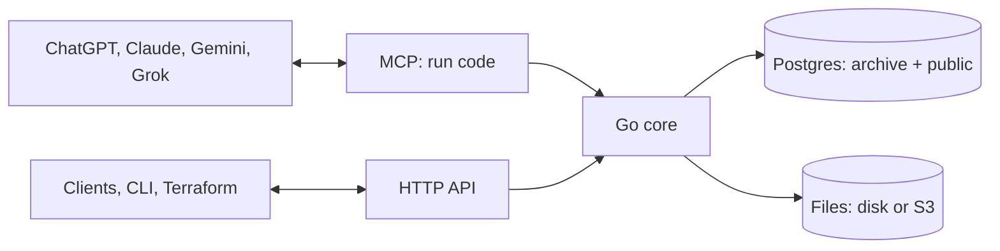

# ADR 0001: Archive architecture

- Status: Accepted
- Date: 2026-10-27
- Deciders: Marijn Brussel

## Summary

Archive is one Go binary on top of Postgres, with file bytes on disk or in S3-compatible storage. It stores each type as a real Postgres table and exposes everything over MCP, so any AI app can read and write it. Agents do the work of getting data in and keeping it clean, by writing code against Archive's SDK; Archive itself calls no LLM.

The binary is stateless when given an external Postgres and blob store: any number of instances can run side by side, scale to zero, and share all state through Postgres.



## Stack

- **Postgres 18** for all data, **Go** for the server, **a directory or S3-compatible storage** (S3, R2, MinIO, GCS) for file bytes.
- **One Dockerfile**: the image holds Postgres and the binary. Without `DATABASE_URL`, the binary starts the bundled Postgres in `/data`; with it, it uses the external database and keeps nothing local.
- **One port** serves the HTTP API (`/api`), sign-in (`/auth`) and MCP (`/mcp`).
- **Clients**: one Svelte web app is the client everywhere. It is served as the website, and wrapped with Tauri 2 for iOS, Android, macOS, Windows and Linux; Capacitor is the fallback for iOS and Android if Tauri's mobile side proves rough. It is a client of the HTTP API. `apps/web` is its start: Svelte 5 and Vite, in the look of archive.family's app (Geist and EB Garamond, a dark shell, cream pills, rounded panels). It has sign-in, files, and a page for every table and view, each with the icon and description from its comment; it is not yet wrapped in Tauri.

## Data model

Two Postgres schemas. Tables are named in the singular, and every id is a UUIDv7.

| Schema | Holds |
|---|---|
| `archive` | Archive's own tables: `space`, `user`, `token`, `chat`, `workflow`, `workflow_run`, `revision`, `file`, `upload` and `secret`. It also holds the built-in types, as domains (`archive.email`, `archive.iban`, `archive.phone`, …) and composite types (`archive.money`, `archive.address`, `archive.timestamp`, …) |
| `public` | One table per type, where the table is the type and a row is the entity, and the views over them |

Each workspace (see [Workspaces](#workspaces)) has a database of its own with these two schemas. Only the main database's `user` and `token` are used, since people and their secrets are the instance's, not a workspace's; it also holds the instance's own tables: `workspace`, `due` and `setting`.

There is no `type` or `entity` table: Postgres already is that. Archive reads types, columns, foreign keys and `COMMENT ON` descriptions from the catalog.

Every type table carries the same columns, row-level security and search column, and a plan without them is rejected:

```sql
CREATE TABLE house (
  id         uuid PRIMARY KEY DEFAULT uuidv7(),
  space      uuid NOT NULL REFERENCES archive.space,
  created_at timestamptz NOT NULL DEFAULT now(),
  updated_at timestamptz NOT NULL DEFAULT now(),
  address    text NOT NULL,
  price      archive.money,
  owner      uuid REFERENCES person,
  search     tsvector GENERATED ALWAYS AS (to_tsvector('simple', coalesce(address, ''))) STORED
);
CREATE INDEX house_search ON house USING gin (search);
ALTER TABLE house ENABLE ROW LEVEL SECURITY;
ALTER TABLE house FORCE ROW LEVEL SECURITY;
CREATE POLICY member ON house USING (space = ANY (archive.my_spaces()));
COMMENT ON TABLE house IS 'A house you own or rent
icon: house';
```

- **Comments carry settings**: the first lines of a `COMMENT ON TABLE` or `COMMENT ON VIEW` are the description; trailing `key: value` lines are settings. `icon` (a Lucide icon name, checked against the list in `src/icons.json`) goes on tables and views; `layout` (`table`, `board` or `calendar`) and `by` (one of the view's columns) go on views. An unknown key, icon, layout or column fails the plan. The catalog (`GET /api/types`, `archive.tables()`, the code mode docs) shows the description without those lines, plus `kind`, `icon`, `layout` and `by`; the generated DDL keeps the whole comment. Parsing is `catalogComment` in `src/catalog.go`. Column comments may use the same convention later.
- **Views** are Postgres views in `public`, written in the same DDL: a filtered, grouped or calendar way to look at a table, with its layout in its comment. Every view needs `WITH (security_invoker = true)`, so row-level security applies to whoever reads it, and an `id uuid` column. Views show in the catalog next to tables with `kind: "view"`; list, get and search read them, and writes to them fail with 405. They hold no space of their own: row-level security on the tables they read filters their rows.

```sql
CREATE VIEW task_board WITH (security_invoker = true) AS SELECT * FROM task;
COMMENT ON VIEW task_board IS 'Tasks by progress
layout: board
by: status
icon: kanban';
```

- **Built-in types**: Postgres enforces their format through domains. A Go normalizer per domain cleans messy input first (read in `ARCHIVE_LOCALE`), so the same thing is stored the same way whatever source it came from.
- **References** are foreign keys to the target table. **Lists** are arrays. There is no type inheritance.
- **Across tables**: search and "everything in a space" are a `UNION ALL` over the `public` tables, which Archive generates from the catalog.

## Schema changes

The schema is declarative and DDL only, with no migrations folder and no stored schema files: **the live database is the only source of truth** for users' types.

- **Reading**: `archive.schema()`, `GET /api/schema` and `archive schema pull [dir]` generate the DDL on demand, one `<name>.sql` per table or view. They load Archive's own schema from `archive.sql` into an empty temp database and plan with pg-schema-diff from there to the live database, keeping the statements about `public`. Each file holds the table with its indexes, foreign keys, row-level security, policies, triggers and `COMMENT ON` statements. An enum, domain or function goes in the first table file that uses it; a view always gets its own file. pg-schema-diff diffs views, their options and their comments, so a changed view comment plans one `COMMENT ON VIEW`.
- **Normalized text**: the generated DDL is in pg-schema-diff's style, with quoted, schema-qualified names and spelled-out policies. `--` comments and layout are not kept; `COMMENT ON` is.
- **Writing**: `archive.apply(files)`, `POST /api/schema/plan|apply` and `archive schema plan|apply <dir>` take the whole desired set. Leaving a table out drops it, which is blocked unless explicitly allowed; leaving a view out drops it without asking, since a view holds no data. The invariant is that `apply(schema())` plans nothing, so files can be pulled, kept in git and applied back.

How an apply runs:

1. **Load**: the files are loaded into a temp database, whole files first, retrying until a round makes no progress. Files still stuck are split into single statements and retried one by one, so tables that reference each other load in any order. At least one foreign key in each cycle must be an `ALTER TABLE … ADD FOREIGN KEY`.
2. **Plan**: [pg-schema-diff](https://github.com/dilame/pg-schema-diff) (the dilame fork, pinned in `go.mod`, since upstream lacks domains) compares the temp database with the live one and returns the statements to run, each with its hazards.
3. **Apply**: statements run under one advisory lock with lock timeouts. Indexes are built concurrently, and foreign keys are added `NOT VALID` and then validated. A statement that deletes data is blocked unless the caller allows it.
4. **Renames** are not detected by the diff, so they are passed explicitly: `archive.apply(files, { renames: ["ALTER TABLE house RENAME COLUMN city TO town"] })` runs them first, in the same transaction, then plans the edited files, so no data is lost.
5. **Other instances**: every apply inserts an `archive.revision` row, and each instance reloads its catalog when the latest revision differs from its own.

**Archive's own schema** (`src/archive.sql`) is embedded in the binary. The same file holds Archive's sqlc queries after the DDL; sqlc generates `src/generated` from it, and only the part before the first `-- name:` line is the schema. At startup, under the same advisory lock, Archive does three things:
- it creates its Postgres roles;
- it drops tables of earlier versions;
- if the hash of that schema differs from the last revision, it plans the schema together with the user's tables generated from the database.

The plan therefore only touches Archive's own objects, and it is never allowed to delete data at startup. Instances starting at once take turns on the lock; the first migrates and the rest find nothing to do.

## Code mode

Agents get one MCP tool, `run`, which takes a TypeScript script and runs it inside Archive. Code is cheaper and more capable than many small tool calls: one script can query, loop, transform and write in a single turn.

- **Runtime**: esbuild strips the types and goja runs the JavaScript, both inside the Go binary. Scripts have no file access beyond the SDK. A small `fetch` (method, headers, a string or JSON body; `ok`, `status`, `headers`, `text()`, `json()`) calls other services synchronously, since goja has no event loop; it shares the run's timeout and caps responses at 5 MB. Scripts run with a timeout (`ARCHIVE_RUN_TIMEOUT`) and caps on result and log size, and a global `input` holds what a workflow trigger passed.
- **As the user**: the script runs as the calling user's Postgres role, so row-level security applies. It also runs as one transaction, so a script that throws changes nothing. Side effects that leave Postgres, such as file processing, happen only after that transaction commits.
- **SDK**: one word per verb:
  - rows: `sql`, `list`, `get`, `create`, `update`, `delete`, `search`;
  - schema: `schema`, `apply`, `tables`;
  - files and documents: `files`, `file`, `read`, `edit`;
  - workflows: `workflows`, `deploy`, `test`, `start`, `runs`;
  - `spaces`.

  `create(table, data)` inserts a row; `create("Name.docx" | ".xlsx" | ".pptx")` makes an empty document. Writes clean input per domain in Go before Postgres checks it.
- **Documentation**: the tool's description is the SDK's `sdk.d.ts`, plus an interface per table generated from the catalog, so agents write against the real schema.

The same SDK runs from `POST /api/run` and `archive run script.ts`. The HTTP API offers the same operations as REST under `/api`. Every request carries a user's session or token.

## Workflows

A workflow is a saved script, `<name>.ts`, that Archive runs by itself. Clients never write code: their agent writes, tests and fixes every workflow, and the app only shows them.

- **Storage**: `archive.workflow` holds each user's scripts (unique by user and name), with the trigger, a webhook token, the next due time and a table cursor. `archive.workflow_run` keeps the last 100 runs of each, with result, logs, error and duration. Like `archive.chat`, only the system role reads them, always filtered by the user.
- **Triggers**: the script's first line, `// on: <trigger>`. None means it runs only when started. `cron <spec>` uses robfig/cron's standard parser, with descriptors and `CRON_TZ=`, only to compute the next time. `<table>` passes the rows created or changed since the last run as `input.rows`, up to 100 a run. `webhook` gives the workflow a URL with a random token.
- **Deploy and test**: `archive.deploy(files)` replaces the user's whole set, like `apply` does for the schema. It compiles each file and checks its name and trigger, returns the errors instead of throwing, and saves nothing if there are any. Redeploying keeps webhook tokens and table cursors by name. `archive.test` runs a saved workflow or a draft inside a savepoint that is always rolled back, in its own goja VM and within the outer run's remaining time; `archive.start` runs one for real inside the current transaction and records it once that commits.
- **As its owner**: a workflow runs through the same path as `POST /api/run`, as the role that deployed it (the user, or the token they used, so a token never gains rights), under row-level security and the run timeout.
- **Background work is pushed, never polled**: every workspace writes its next due time to `archive.due` in the main database: a deploy, a run that moves `next_at`, a write, and opening the workspace all keep it up to date. Whenever a time there gets sooner, Archive schedules one wake-up for exactly that time. With `ARCHIVE_TASKS_QUEUE` set, that is a Cloud Tasks task, named from the workspace, kind and time so duplicates collapse, that calls `POST ARCHIVE_API_URL/tasks` with a Google OIDC token; the handler checks the token, claims that workspace's due row, does the work inside the request and schedules the next wake-up, so the service can scale to zero. Otherwise `archive serve` keeps one timer at the earliest time in `archive.due`, and every process tells it about sooner times with `NOTIFY archive_due`. Either way the due row is leased past the run timeout, the workspace opens, and its due workflows are claimed with `FOR UPDATE SKIP LOCKED`, up to 16 a turn. A cron workflow then gets its next time. A table workflow wakes when a transaction as a user commits a write: its rows whose `(greatest(created_at, updated_at), id)` are past the cursor are passed in, as the owner; a run that works moves the cursor and checks once more, one that finds nothing or fails waits for the next write. Rows whose timestamp equals one of the workflow's own run transaction times are skipped, so its own writes never trigger it again. `updated_at` moves on `archive.update`, not on raw SQL.
- **Webhooks**: `POST /hooks/run/<workspace>/<token>` on `ARCHIVE_API_URL` sits beside the connectors' `/hooks/<provider>` (ADR 0002), outside the authenticated `/api` mux. The token is the only credential. The body is passed as parsed JSON or raw text with the method, query and headers, and the response is the run's result as JSON, or 500 with the error.
- **API**: `GET /api/workflows`, `GET /api/workflows/{name}/runs` and `POST /api/workflows/{name}/run`; the app's Workflows screen lists them in plain words, with their runs and webhook URL, and never shows code.

## Agent workflows

These run in the agent, as code against the SDK. The ones that recur can be saved as workflows that Archive runs on its own.

- **Intake and classification**: the agent reads new files, decides their type, and writes rows.
- **Jev classifier**: a small model agents can use to pick the type for an input.
- **Dataset preparation and training**: rows become labelled examples, exported per table, to retrain Jev.
- **Skill library**: reusable agent instructions stored as rows of a `skill` table.

## Apps

Archive is listed in ChatGPT, Claude, Gemini and Grok as one remote MCP server. The apps read and write the user's entities through it.

## Users and permissions

- **Spaces**: every user gets a private space, and shared spaces can be made for a household or a team. Every row and file belongs to one space.
- **Roles are Postgres roles**: users, space roles (`owner`, `admin`, `editor`, `viewer`) and tokens are real Postgres roles, prefixed by the workspace's UUID (`"<id>_…"`), and row-level security filters every query. A bug in one surface cannot leak another user's data, and plain SQL as a user role gets the same access as the app.
- **One identity per person**: a user is one row of `archive.user` in the main database, with the workspaces they belong to. In each of those workspaces they have a Postgres role and a personal space, made when they are added (`archive user add`) and dropped when they are removed (`archive user remove`).
- **Tokens** belong to a user and one workspace, and can only narrow that user's rights there. Agents get their own tokens. Tokens and sessions are `arc_<secret>`, kept as hashes in the main database's `archive.token`; a session belongs to the person and works in all their workspaces.
- **Sign-in is invite-only**: Google, Microsoft and Slack (OpenID Connect) and GitHub (OAuth), each turned on by its two variables, `ARCHIVE_<PROVIDER>_CLIENT_ID` and `ARCHIVE_<PROVIDER>_CLIENT_SECRET`, plus passkeys. Archive sends no mail and makes no sign-in links. An admin invites someone by email (`archive user add`, or the Users page and `/auth/users`); their first provider sign-in under that email links the provider's account to them, and later sign-ins match that link. An invite only ever matches an email the provider says is verified: `email_verified` for Google, Slack and Microsoft (or Microsoft's `xms_edov`, which stops a tenant from claiming someone else's domain), and GitHub's primary address with `verified`. Anyone else, and anyone removed from every workspace, is refused. After a provider sign-in the web app offers to add a passkey to the device. The first owner is whoever is added first with `archive user add`; with no provider set, the server says in its log that nobody can sign in. One sign-in reaches every workspace the person is in.
- **Secret fields**: values of secret types such as `iban` or `us_ssn` are encrypted in `archive.secret` with the workspace's data key. They are hidden from anyone not granted that type.

## Workspaces

Every install serves many workspaces ([ADR 0003](0003-hosting.md)). A workspace is one customer's Archive: its own Postgres database on the same server, named `archive_<id>` by its UUID, its roles prefixed by that UUID, and its own data key, wrapped by `ARCHIVE_SECRET_KEY` in `archive.workspace`. The main database (`DATABASE_URL`, or the bundled one) is workspace one. A workspace's own login role (`"<id>_authenticator"`, password derived from its data key) can connect only to its own database, so no shared login crosses workspaces, and that works without a database superuser (as on Cloud SQL and AlloyDB); the archive tables the system writes use row-level security enabled but not forced, so the owning role bypasses it for background and admin work while tenant roles stay filtered.

- **Opening**: `src/workspace.go` holds the process's `Hub`: the main pool, the root key, the blob store and the open workspaces. A workspace's `Archive` (its pools, catalog, data key and run slots) opens on first use and closes 10 minutes after its last use, on a timer of its own; pools are small (8 app, 4 system, 2 DDL connections) and close idle connections after a minute. Opening applies `archive.sql` under the advisory lock and revision check. Startup opens only the main database, so it takes the same time however many workspaces there are.
- **Finding it**: an API token belongs to one workspace, and a request naming another is refused. The web app's one session cookie works in all of the person's workspaces, and each request names the current one in `Archive-Workspace`, the way `Archive-Space` names the space; the server checks that the person is in it. Webhooks and file links carry the workspace UUID in their path.
- **Limits**: each workspace runs at most 8 scripts at once, and waits 10 s for a slot before answering 429.
- **Admins**: nobody makes a workspace for themselves. Instance admins, the admins of workspace one, list, create and delete workspaces, each with its first owner (`archive workspace add|list|delete`, `/auth/workspaces`); deleting a workspace drops its database and roles.
- **Anthropic key**: a workspace may set its own (`PATCH /auth/workspace`), which the chat agent uses instead of `ANTHROPIC_API_KEY`.

## Files

File bytes are content-addressed by SHA-256 in `$ARCHIVE_DATA/blobs` or in S3-compatible storage (`ARCHIVE_BLOB_URL`), under a prefix per workspace.

- **Uploads**: a plain `POST /api/files` for small files, or resumable tus uploads for large ones. A tus upload's state lives in `archive.upload` and its chunks are stored as blob objects, so consecutive chunks can land on different instances. The last chunk assembles the file from blob storage, without a local copy.
- **Processing in the request**: Archive pulls metadata, extracts text (PDF, HTML, plain text and JSON) and makes image thumbnails inside the request that stored the file. A file is therefore `done` when its upload, edit or create returns, and nothing has to run between requests. A file left `pending` is due in `archive.due` 10 s later, as a safety net only.
- **Links**: `POST /api/files/{id}/link` makes a short-lived signed URL, `ARCHIVE_API_URL/files/<workspace>/<id>`, for downloads such as image previews. GPS data can be stripped from photos on the way out.

## Documents

Archive's documents are Office files (docx, xlsx, pptx): standard files that open anywhere. Agents edit them one edit at a time, by splicing the file's bytes.

**One API**: `archive.create(name)` makes an empty document of the type its extension names. `archive.read(id)` returns the document as a model, and `archive.edit(id, edits)` applies a list of edits, all or nothing. Agents use them from code mode; nothing else is needed.

**Edits splice bytes; nothing is rebuilt.** docx, xlsx and pptx are zips of XML parts. `office.go` edits all three using only Go's standard library:

1. Parts an edit does not touch are copied raw with `zip.Writer.Copy`, so they stay byte-identical.
2. For the part an edit does touch, `encoding/xml`'s decoder records the byte range of every paragraph, run, table, cell and shape.
3. An edit replaces one byte range with a small new fragment, or inserts one, written with the prefixes the part already declares. Everything around it stays as it was, including namespaces, revision ids and extensions Archive has never heard of. The part is never re-encoded.
4. The part is parsed again after the edit, to check it is still well-formed.

Details of how it behaves:

- **The model** is built from that index:
  - docx: paragraphs with styles and lists, and tables;
  - xlsx: sheets, cells, formulas, merged ranges and Excel tables;
  - pptx: slides, shapes and their text.

  Edits outside the model are not possible, by design.
- **Edits**: replace text (across runs, keeping the first run's formatting), insert or delete a paragraph, set a table cell, set a value or formula, clear a cell, append a row to an Excel table, and replace a shape's text. Inserting rows, columns, slides or shapes, and changing formatting, are not possible yet.
- **Formulas without an engine**: a cell value is written as an inline string, so the shared strings are never touched. A formula is written with its cached value removed, and every xlsx edit marks the workbook to recalculate when it is opened.
- **New files**: `archive.create("Budget.xlsx")` writes a minimal blank file with the standard library:
  - a docx with one empty paragraph and the Normal, Title, Heading1–3 and ListParagraph styles;
  - an xlsx with an empty Sheet1;
  - a pptx with one title slide.
- **Concurrency**: an edit locks the file row (`SELECT … FOR UPDATE`), then splices the latest bytes, so concurrent agents take turns and no edit is lost. Paragraph ids are positions: if another agent inserts a paragraph between your read and your edit, an id can point at a paragraph that moved. Within one `edit` call, ids keep pointing at the paragraphs as read, even after inserts and deletes.
- **Search text**: Office files are not yet text-extracted.

**Not chosen**:
- An embedded office suite (Collabora, ONLYOFFICE): their value is the editor UI, which Archive does not use, and running them in a closed SaaS needs paid editions.
- Office libraries (excelize, go-docx, unioffice): they load a document into their own structures and write it back out, which loses what they do not model, and some are AGPL or commercial.
- Live co-editing inside Archive: people edit Office files together in Google Docs and Sheets through an integration (planned). A CRDT model of OOXML would mean converting in both directions.
- Version numbers on `archive.edit`: tried and dropped as too complex for agents; the row lock prevents lost updates instead.
- React Native for clients: a web app in Tauri or Capacitor shells runs the same code everywhere. Electron covers desktop only.

## Deployment

The same image runs in two ways, each serving any number of workspaces.

- **Self-hosted**: `install.sh` or `compose.yaml` runs the image with one `/data` volume on port 8080. The bundled Postgres, the blobs and `secret.key` all live in `/data`, and Archive backs up the database before a version upgrade.
- **Stateless** (Cloud Run, Kubernetes, any container platform): set `DATABASE_URL` to a managed Postgres, `ARCHIVE_BLOB_URL` to S3-compatible storage, and `ARCHIVE_SECRET_KEY`, the same on every instance. Archive refuses to start with `DATABASE_URL` but without the key. Nothing else is local:
  - schema: generated from the database;
  - uploads: in Postgres and blob storage;
  - file processing: inside the request;
  - background work, sync jobs and coordination: through Postgres locks (`SKIP LOCKED` on `archive.due`, an advisory lock for schema), woken by Cloud Tasks or `NOTIFY`.

  A pooler such as PgBouncer or Cloud SQL's managed connection pooling can sit in `DATABASE_URL`, in transaction mode; schema changes and creating workspaces connect through `DATABASE_DIRECT_URL`, since they hold a session-level advisory lock. Archive sets each database's default `search_path` and `timezone`, so a pooler may drop those startup parameters.

  It runs on request-based billing and scales to zero: no CPU is needed between requests. With `ARCHIVE_TASKS_QUEUE` and `ARCHIVE_TASKS_SERVICE_ACCOUNT` set, Cloud Tasks calls `/tasks` at each due time, so scheduled and table-triggered workflows and pending files start an instance when they need one. Without them, due work runs only while `archive serve` is up.
- **Helm** (`apps/helm`) covers Kubernetes and refuses an external database without a secret key. The **`archive` Terraform provider** (`apps/terraform`) manages schema DDL (tables and views), spaces, tokens and access rules as code. It compares configured DDL with the database through the plan endpoint, so normalized output never shows as drift.

Not verified yet: a managed Postgres without a true superuser (Cloud SQL's `cloudsqlsuperuser`), and GCS through its S3 API.

## Planned

Designed but not built:

- **File versions**: an `archive.file_version` row per save (hash, size, saved by, saved at), so any version can be opened or restored.
- **Sharing with people without an account**: `archive.share` rows (token hash, access, emails, password, expiry, revocation, uses) behind `/s/<token>`. There would be SDK calls `share`, `shares` and `unshare`, and the share page would read through a system role that sees only the shared file.
- **Rendering**: Gotenberg (LibreOffice) as an optional container that renders docx, xlsx and pptx to PDF for previews and computes formula values. It would only ever produce derived output, never save users' files.
- **Office text extraction** for search, and legacy and ODF conversion to OOXML on request.
- **More Office edits**: rows, columns, slides and formatting.
- **Google Docs and Sheets integration** for people editing Office files.
- **Connectors** that sync mail, files, chat and business data in, read-only and by delta: see [ADR 0002](0002-connectors.md).
- **Clients**: the Svelte app, as the website and in Tauri 2 shells for iOS, Android and desktop (Capacitor as the fallback on mobile). Every shell runs it in the platform's own web view (WKWebView, Android WebView, WebView2, WebKitGTK).

## Not doing

These were in earlier designs and are cut to keep Archive small:
- raw, provenance, links, changes, proposals, and type and entity tables;
- JSONB records, spec versions and change review, and type inheritance;
- built-in LLM calls, intake, confidence scoring, confidence calibration and the review queue;
- OCR, transcription and embeddings;
- folder connectors and `.eml` text extraction (connectors are now [ADR 0002](0002-connectors.md));
- IMAP and the external connector protocol;
- stored schema files;
- pages, Archive's own live documents.

Any of them can come back when a real user needs it.
