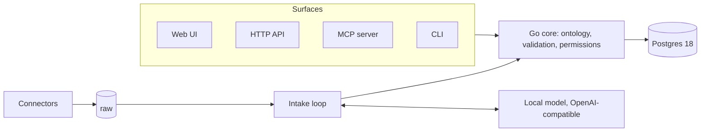

# ADR 0001: Archive architecture

- Status: Proposed
- Date: 2026-10-23
- Deciders: Marijn Brussel
- Source: [Archive: architecture proposal](https://claude.ai/artifact/6vhFrsNjkDbEDogBV1ScD5)

## Summary

Build Archive as one Go binary on top of Postgres, with a web dashboard built into it and local LLMs reached over an OpenAI-compatible HTTP endpoint. Postgres does the heavy data work, so the application language mostly needs to be good at concurrent I/O, easy to ship as one static file, and easy for outside contributors to write connectors in. Go wins on all three.

The product has four layers: a **raw layer** that keeps every source record untouched, a **canonical layer** of user-defined types (the ontology), an **intake loop** that maps raw into canonical with calibrated confidence, and **access surfaces** (UI, API, MCP, CLI) that all call the same core. For businesses, the same ontology can sit over their existing systems as a semantic layer instead of copying data in.

## How the parts fit

_Archive architecture: four surfaces, one core, one database._

Connectors pull from platforms into the raw layer, the intake loop calls a local model to map raw records into canonical types, and every surface reads and writes through the same core, so permissions and the ontology are enforced once.

## Data model and ontology

The ontology is the product. Types, fields, normalization rules and relations live as data in a versioned spec, and records are stored as JSONB documents validated against that spec. The physical Postgres schema stays small and fixed, so changing the ontology never needs a database migration. Every id in every table is a UUIDv7 from Postgres' built-in uuidv7(), so ids sort by creation time and keep indexes compact.

| Table | Holds |
|---|---|
| `types` | Type definitions: fields, field types, constraints, normalizers, relations, descriptions; versioned |
| `changes` | Proposed and applied diffs, who proposed them (person or agent), and their status |
| `raw` | Source, external id, content hash, fetch time, untouched payload as JSONB |
| `records` | Id, type, spec version, canonical data as JSONB |
| `provenance` | Entity, field path, raw records it came from, method, confidence |
| `links` | Identity resolution and relations between entities |

- **Spec format**: a JSON Schema-compatible core plus Archive extensions, readable and writable through the API, MCP and CLI, and stored and exported as JSON (JSONB in Postgres, a `spec.json` file for git).
- **Semantic types and normalization**: field types like money, email, phone, address, timestamp or unit quantity are themselves defined in the spec library, each with a validator and a normalizer (E.164 phones, ISO 4217 currencies, UTC timestamps). They are reused across ontologies and are what the intake loop targets.
- **Validation** runs in the Go core on every write, so every surface gets the same checks. Each entity records the spec version it was validated against.
- **Ontology changes** are changesets that apply instantly because storage is JSONB. Existing records are re-validated in the background and flagged, or migrated by a transform defined in the changeset.
- **Speed**: a GIN index on the data column covers general queries. Fields marked `indexed` in the spec get expression indexes automatically, and each type can expose a generated SQL view with normal columns for BI tools and analysts.
- **Trade-off**: Postgres no longer enforces column types and foreign keys itself. The core service and the `links` table take over that job, which is a fair price for a schema users and agents can change freely.
- **Search**: Postgres full-text search plus `pgvector`, no extra service.
- **Views**: the Notion-like tables, boards and calendars are saved queries over entities. Row-level security handles sharing.

## Built-in type library

Archive ships a standard library of semantic types so the same thing is always stored the same way, whatever source it came from. Users can override any of them, compose new types from them, or publish their own packs.

Every type defines the same six parts:

1. **Canonical form**: exactly how the value is stored in JSONB.
2. **Validator**: format, checksum and range rules.
3. **Normalizer**: turns messy input into the canonical form. When the input is ambiguous (`03/04/2025`, a phone number with no country), it returns ranked candidates with confidence, which the intake loop uses directly.
4. **Formatter**: locale-aware display, for example `€1.234,50` or `$1,234.50` from the same stored value.
5. **Sort and index key**: so money sorts by amount within a currency and timestamps sort in UTC.
6. **Sensitivity**: `public`, `personal` or `secret`. Secret types are encrypted at rest and masked by default.

The original input is always kept next to the normalized value, so a bad normalization can be fixed later without losing data.

| Category | Type | Canonical form | Standard and checks |
|---|---|---|---|
| Time | `date` | `2026-10-23` | ISO 8601 |
| Time | `timestamp` | UTC instant + original IANA zone | RFC 3339; tzdata embedded in the binary |
| Time | `time` | `14:30:00` + zone | ISO 8601 |
| Time | `duration` | `PT1H30M` | ISO 8601 durations |
| Time | `interval` | start and end, either open | ISO 8601 intervals |
| Time | `timezone` | `Europe/Amsterdam` | IANA tz database |
| Time | `recurrence` | `FREQ=WEEKLY;BYDAY=MO` | RFC 5545 RRULE |
| Money | `money` | decimal string amount + currency, `{"amount":"1234.50","currency":"EUR"}` | ISO 4217 minor units; never floats |
| Money | `currency` | `EUR` | ISO 4217 |
| Money | `percentage` | decimal fraction, `0.21` |  |
| Finance | `iban` | `NL91ABNA0417164300` | ISO 13616, mod-97 check |
| Finance | `bic` | `ABNANL2A` | ISO 9362 |
| Finance | `card` | token + brand + last 4 | Luhn check; secret; full number never stored by default |
| Finance | `us_routing` | 9 digits | ABA checksum |
| Finance | `lei` | 20 characters | ISO 17442, mod-97 |
| Finance | `isin` | 12 characters | ISO 6166 check digit |
| Tax | `vat_id` | country prefix + number | Per-country format rules; EU VIES lookup optional |
| Tax | `us_ein` | `12-3456789` | IRS prefix rules |
| Identity | `us_ssn` | 9 digits, shown `***-**-6789` | Invalid ranges rejected (000, 666, 9xx); secret |
| Identity | `nl_bsn` | 9 digits | Elfproef (11-check); secret |
| Identity | `national` | country + scheme + value | Pluggable per country; secret |
| Identity | `passport` | issuing country + number | ISO 3166 country; secret |
| Contact | `email` | lowercase domain, punycode for international domains | RFC 5322 syntax |
| Contact | `phone` | `+31612345678` | E.164 via libphonenumber metadata |
| Contact | `address` | structured parts + country | Per-country layouts; ISO 3166-1 and 3166-2 |
| Contact | `name` | given, family, prefixes, full original | Keeps the original, since name order varies by culture |
| Contact | `url` | normalized URL | WHATWG URL rules |
| Place | `country` | `NL` | ISO 3166-1 alpha-2 |
| Place | `region` | `NL-NH` | ISO 3166-2 |
| Place | `postcode` | per-country format | Validated against the country |
| Place | `geo` | latitude and longitude | WGS 84 |
| Language | `locale` | `nl-NL` | BCP 47 |
| Measure | `quantity` | value in SI base unit + original unit | UCUM unit codes; covers length, mass, volume, temperature and more |
| Product | `gtin` | 14 digits | GS1 check digit; accepts EAN-13, UPC-A |
| Product | `isbn` | 13 digits | ISBN-13 check digit; converts ISBN-10 |
| Technical | `uuid` | lowercase, hyphenated | RFC 9562 |
| Technical | `ip` | canonical v4 or v6 text | RFC 5952 for v6 |
| Technical | `domain` | lowercase, punycode | IDNA 2008 |
| Technical | `mime` | `application/pdf` | IANA media types |
| Technical | `file` | content hash + name + MIME type | SHA-256 |
| Basic | `text`, `richtext`, `integer`, `decimal`, `boolean`, `enum`, `reference` |  | Building blocks for custom types |

Industry packs can come later as separate, optional bundles, for example healthcare codes (ICD-10, LOINC) or logistics codes (HS codes, UN/LOCODE). In Go, the money, phone, Unicode and timezone parts all have mature libraries, so most of this library is careful rules and tests rather than new algorithms.

## Files and media

Files are first-class: every document, PDF, image, video or audio file is a record that can be searched, previewed, linked to other records, and read by the intake loop. The bytes live in a blob store, and Postgres keeps only metadata, so the database stays small and fast.

- **Storage**: files are content-addressed by SHA-256, so duplicates are stored once. The default backend is the `/data` volume; S3, GCS, Azure Blob, R2 and MinIO are one setting away. A `files` table holds hash, name, MIME type, size, metadata and the record it belongs to.
- **Uploads**: resumable uploads (tus protocol) for large files, streaming downloads and range requests so video seeks instantly. Links are signed and expire.
- **Processing on upload**, in background workers:
  - Detect the real file type and pull metadata: EXIF, dimensions, page count, duration, camera, location.
  - Make previews: image thumbnails in several sizes (libvips, including HEIC and RAW), PDF page images, video poster frames (ffmpeg), Office documents converted to PDF for preview.
  - Extract text: the PDF text layer, OCR for scans and photos through the local vision model, and speech-to-text for audio and video (a local Whisper model).
  - Index it: full-text search over extracted text, and embeddings for semantic search across text and images, such as "photos of whiteboards" or "the lease for the Utrecht flat".
- **Intake**: a file can be pushed straight into the intake loop, so a folder of receipts, invoices or payslips becomes clean records with links back to the exact page and region each value came from.
- **Views**: a gallery view (grid, by date from EXIF, and on a map from GPS), a document viewer with page thumbnails and highlighted search hits, and `file` as a field type on any record.
- **Privacy**: location data in photos is marked `personal`, can be stripped on export or share, and files can be encrypted at rest with per-instance keys.

Trade-off: libvips, ffmpeg and LibreOffice are large, so the default image stays slim: Alpine's own `postgresql18` package (without its separate JIT package, which alone is about 180 MB) plus the static Archive binary, about 100 MB in total. A `full` image adds the media tools for previews, video, audio and Office documents, and the core binary stays the same in both.

## Connectors and the semantic layer

Connectors write into the raw layer and never touch canonical types directly. Mapping raw to canonical is a separate, inspectable step, either a declarative mapping or the intake loop.

- **Two kinds of connector**: built-in ones compiled into the Go binary for the most common platforms, and external ones that run as a separate process and speak a JSON-lines protocol over stdin and stdout. The external protocol lets the community write connectors in any language.
- **Borrow the long tail**: making the external protocol compatible with the Airbyte or Singer message format gives access to hundreds of existing connectors on day one, instead of writing "every platform" from scratch.
- **Sync engine**: incremental cursors, retries, rate limits and a schedule per source, all as Go goroutines with state stored in Postgres.
- **Write-back**: later, connectors can push changes back to the source, which matters for data ownership (export and delete as well as import).

For businesses there are two modes, chosen per source:

| Mode | How it works | When to use it |
|---|---|---|
| Mirror | Data is synced into the raw layer and mapped into canonical types | Fast queries, offline use, sources with rate limits |
| Federate | Canonical types are mapped onto the source in place, via `postgres_fdw` or connector queries | Large or sensitive systems a business won't copy; the "semantic layer, not a migration" promise |

## Intake loop

The intake loop turns any raw input into canonical records and attaches a confidence that means what it says: values scored 0.9 should be right about 90% of the time. A model's own claim of how sure it is cannot be trusted for this, so confidence is measured and calibrated.

1. **Prepare**: parse the raw record (text, PDF, email, HTML, CSV row), split it if needed, and pull in the target type's spec from the registry.
2. **Extract**: call a local model with constrained decoding against the spec's JSON Schema (llama.cpp grammars, vLLM or Ollama structured output), so output is always valid JSON of the right shape.
3. **Validate**: run the spec's rules (types, formats, enums, cross-field checks, lookups against existing entities). Hard failures are retried or rejected.
4. **Score**: combine signals per field: token log-probabilities, agreement across several samples, validator results, and agreement with other sources for the same entity.
5. **Calibrate**: map that raw score to a real probability using a small labeled set per type and field (isotonic regression or Platt scaling), and report calibration error so users can see how trustworthy the scores are.
6. **Route**: above a threshold the value is accepted, in the middle it goes to a review queue, below it is dropped. Thresholds are set per field, since a wrong invoice total costs more than a wrong tag.
7. **Learn**: every review decision becomes a labeled example, which improves calibration and gives few-shot examples for the next run.

Models are pluggable through one OpenAI-compatible endpoint setting, so the same loop runs on Ollama, llama.cpp, vLLM or LM Studio locally, or a hosted API if the user allows it. Archive itself stays model-agnostic and never ships weights in the core image.

## Access surfaces

All four surfaces are thin wrappers over one core service layer, so a feature added once shows up everywhere and permissions are enforced in one place.

| Surface | What it offers |
|---|---|
| Web UI | Svelte dashboard in `apps/web`, built to static files and embedded in the binary: tables, boards and calendars per type, saved views, record pages with provenance, files, search, sources, the ontology editor with change review, spaces, members and tokens |
| HTTP API | REST with an OpenAPI spec generated from the registry, so every user type gets typed endpoints; webhooks on change |
| MCP server | Tools to describe the ontology, query, upsert, propose schema changes and run intake, so agents work with the user's data and its meaning |
| CLI | The same binary: `archive serve`, `archive spec push spec.json`, `archive query`, `archive connect gmail`, `archive intake ./inbox` |

Auth is scoped API tokens mapped to Postgres roles, with row-level security doing the actual enforcement. Agents get their own tokens, so a schema change proposed by an agent is attributable and can require human approval.

### Editing the ontology from anywhere

Because the spec is data, every surface can change it, not just read it. A user can sit in Claude Code and say "split contacts into people and companies and add a VAT field", and the agent does it live, safely.

The loop every surface follows:

1. **Describe**: read the current types, fields, built-in types and sample records.
2. **Propose**: send a change (add, rename, retype or remove fields; add, split or merge types; add a transform for existing data).
3. **Preview**: a dry run reports how many records it touches, which would fail validation, and before-and-after samples.
4. **Apply**: applied at once, or held for approval if the token's policy says so.
5. **Revert**: every applied change can be rolled back, because changes are versioned in `changes`.

| Surface | How it edits the ontology |
|---|---|
| MCP | Tools: `describe`, `propose`, `preview`, `apply`, `revert`, `sample` |
| API | `GET /types`, `POST /changes`, `POST /changes/{id}/preview`, `POST /changes/{id}/apply` |
| CLI | `archive spec pull` writes `spec.json`; edit it by hand or with an agent; `archive spec push` previews and applies the diff |
| Terraform | `archive_type` resources, applied through the same change path |
| UI | Visual schema editor that shows the same preview before applying |

The CLI's pull-edit-push flow suits Claude Code especially well: the ontology becomes files in a repo, every change is a reviewable diff, and Archive checks it against real data before it lands.

## Object model and CRUD API

Archive is object-oriented. A type is a class, a record is an object of exactly one type, and fields are typed properties drawn from the built-in type library. The ontology defines the classes; the API, MCP, CLI and UI all work on objects of those classes in the same way.

- **Inheritance:** a type can extend another type and inherits its fields, for example `person` and `company` both extend `contact`. A subtype can add fields or narrow a parent field. Asking for a parent type also returns objects of its subtypes, so listing `contact` returns people and companies.
- **References:** a `reference` field points at an object of another type, such as `employer: {type: reference, to: company}`. The core checks that the target exists and is of the right class, and records the relation in `links`.
- **Validation:** every create and update is validated against the object's own class, with the same normalizers the intake loop uses. Filters are normalized too, so searching for phone `06 12345678` finds `+31612345678`.

Every type gets the same CRUD API, generated from the ontology, so a new type is usable the moment it is applied:

| Method | Path | What it does |
|---|---|---|
| GET | /api/{type} | List objects of the type and its subtypes, filtered by field, paginated |
| POST | /api/{type} | Create an object; returns it with its new id |
| GET | /api/{type}/{id} | Read one object |
| PUT | /api/{type}/{id} | Replace the whole object |
| PATCH | /api/{type}/{id} | Set some fields; null clears a field |
| DELETE | /api/{type}/{id} | Delete the object, with its provenance and links |
| GET | /api/{type}/{id}/provenance | Where each field came from, and how sure Archive is |

Invalid input returns 422 with one problem per field. The ontology is a resource of its own at /api/types/{name}, read with GET and changed through the preview-and-apply flow described above. The other surfaces use the same verbs: `archive list|get|create|set|update|delete <type>` on the CLI, matching MCP tools, and Terraform resources.

## Users and permissions

Every instance supports many users, from a family sharing one Archive to a company with hundreds of people. Data is grouped into spaces, and access is granted per space, so the same instance can hold private and shared data side by side.

- **Spaces**: every user gets a private space, and shared spaces can be made for a household, a team or a project. Every record and file belongs to exactly one space and can be moved or shared with another.
- **Roles** per space: `owner`, `admin`, `editor`, `viewer`. Instance admins manage users, sources and billing.
- **Ontology**: types are shared across the instance, so everyone speaks the same language. Changing them needs the `admin` role, or approval of a proposed change.
- **Sensitive fields**: values of `secret` types such as `us_ssn` or `card` are hidden from anyone not granted that type explicitly, even inside a shared space.
- **Agents act as someone**: every token belongs to a user and can only narrow that user's rights, never widen them. An agent's edits show up as "Claude, on behalf of Marijn".
- **Sign-in**: email magic links and passkeys for everyone; Google and Microsoft sign-in; OIDC and SAML single sign-on plus SCIM provisioning for companies.
- **Enforcement**: the Go core sets the current user on each database session, and Postgres row-level security filters every query by space membership. A bug in one surface cannot leak another user's data.

New tables, all short: `users` (email, name, sign-in methods), `spaces` and `tokens`. Membership is not a table: it is Postgres role grants, described below.

How row-level security works in practice:

- `records`, `raw`, `files`, `provenance` and `links` each carry a `space` column, indexed, and every policy is the same rule: the row's space must be one the current user is a member of.
- The core connects as a login-only `authenticator` role and starts each transaction with `SET LOCAL ROLE` to the user's own Postgres role (see below). That role has no `BYPASSRLS`, and tables use `FORCE ROW LEVEL SECURITY`, so not even the table owner skips the check.
- A link between two records is visible only when both ends are.
- RLS works on whole rows, not on keys inside JSONB, so values of `secret` types are stored in a separate `secrets` table with its own stricter policy. The record holds only a reference.

### Roles are Postgres roles

Users, space roles and tokens are real Postgres roles, so the database itself is the permission system. Anyone connecting with plain SQL, from psql or a BI tool, gets exactly the same access as in the app.

- **Users**: each user is a Postgres role. Direct SQL login is optional and off by default.
- **Space roles**: each space gets four group roles, such as `s_<space>_owner`, `_admin`, `_editor` and `_viewer`, nested so that owner includes admin, admin includes editor, and so on. Joining a space is a `GRANT`, leaving is a `REVOKE`, and Postgres' own `pg_auth_members` is the membership list.
- **Privileges**: viewers get `SELECT`, editors add `INSERT`, `UPDATE` and `DELETE`, and RLS policies check membership with `pg_has_role`.
- **Tokens**: each token is its own role granted a subset of its user's space roles, which is how a token can only narrow rights, never widen them.
- **Speed**: policies call one cached `STABLE` function, `my_spaces()`, wrapped in a subselect so Postgres runs it once per query, not once per row.
- **Catch**: Postgres roles are shared by the whole database cluster, not one database. Every role name carries the instance prefix, and the managed platform gives each instance its own cluster or Cloud SQL instance.

## Language and stack

**Recommendation: Go for the server, CLI and built-in connectors; Svelte, built to static files and embedded in the binary, for the web dashboard; Postgres for everything stateful.** Query speed comes from Postgres, not from the app layer, so the language is chosen for concurrency, shipping and contributors rather than raw speed.

| Option | Strengths for Archive | Weaknesses for Archive | Verdict |
|---|---|---|---|
| Go | Goroutines fit thousands of concurrent syncs; one static binary; fast builds; mature Postgres driver (`pgx`); official MCP SDK; large pool of contributors who can write connectors | Less expressive type system; GC pauses (irrelevant at this workload) | Recommended |
| Rust | Top performance and memory safety; good fit for parsing and embedded inference | Slower to build features and harder for outside connector authors; compile times | Use later for hot paths if profiling demands it |
| Elixir / Erlang | Best-in-class supervision and concurrency; LiveView for real-time UI | Heavier runtime in the container; small contributor pool; weaker CLI story | Strong but niche; not worth the hiring and community cost |
| TypeScript (Node or Bun) | One language front to back; huge ecosystem | Single-threaded event loop for CPU work; heavier runtime; weaker single-binary story | Not needed for the server; the dashboard is Svelte compiled to static files at build time, so no Node runs in production |
| C++ | Raw speed | Slow to build, unsafe, hard for contributors | No |

Supporting choices: Go 1.27 (released 19 August 2026, brings generic methods and JSON v2); Postgres 18 (18.6), the newest version Google Cloud SQL supports, which also brings the built-in uuidv7(), with `pgvector`; a few fixed SQL migrations for the core tables; the dashboard is built with Vite and embedded with go:embed; local inference reached over HTTP so Python never enters the core.

Policy: track the latest stable Go within a month of each release. Postgres follows the newest major version that Cloud SQL supports, so self-hosted and managed setups always run the same version. Sources: [Go 1.27 release](https://go.dev/blog/go1.27), [PostgreSQL release notes](https://releasebot.io/updates/postgresql).

## Deployment

`curl -fsSL https://raw.githubusercontent.com/Mulholland-Inc/archive/main/install.sh | sh` is the whole install. The script (`install.sh` in the repo) checks for Docker, pulls `ghcr.io/mulholland-inc/archive`, runs it with one `archive` volume on port 8080, waits until it is healthy, and on a rerun replaces the container to update. Under it, the plain `docker run -v archive:/data -p 8080:8080 ghcr.io/mulholland-inc/archive` still works. The image holds Postgres and the Archive binary; the binary starts and supervises Postgres, runs migrations, then serves the API, MCP and the dashboard on one port.

- **One volume** (`/data`) holds the Postgres data directory, uploaded files and config, so backup is one directory or one `pg_dump`.
- **External Postgres** is a config switch for businesses that already run managed Postgres; the binary then skips the bundled one.
- **Models stay outside** the core image. A compose file adds Ollama as an optional second service, and a separate `archive:with-llm` image can bundle llama.cpp for people who truly want one container.
- **Upgrades** are pulling a new image; schema migrations and Postgres major-version upgrades run on start with an automatic backup first.

### Run anywhere

The same image runs on a laptop, a VPS or any cloud, because it needs only a container runtime, a volume and one port. In the cloud, the bundled Postgres is swapped for the provider's managed Postgres with one setting.

| Target | Compute | Postgres |
|---|---|---|
| Local or VPS | Docker or Podman | Bundled |
| Kubernetes (any cloud) | Helm chart | Bundled, or an external one |
| AWS | ECS Fargate or App Runner | RDS or Aurora PostgreSQL |
| GCP | Cloud Run | Cloud SQL for PostgreSQL |
| Azure | Container Apps | Azure Database for PostgreSQL |
| Fly.io, Railway, Render | Native container deploy | Their managed Postgres |

Archive targets the newest Postgres major that Cloud SQL supports, which is 18 today, and also supports the major before it for AWS and Azure if they lag. `pgvector` is available on all three big clouds.

### Terraform provider

Archive has its own Terraform provider, `archive`, written in Go with the official plugin framework and published to both the Terraform and OpenTofu registries. It manages what lives inside an Archive instance, so a business can keep its whole setup as code and review it in pull requests:

- `archive_type`: ontology types and their fields
- `archive_source`: connectors and their sync schedules
- `archive_view`: saved views
- `archive_token`: scoped API and agent tokens
- `archive_policy`: access rules

Alongside it, ready-made Terraform modules handle the infrastructure on each cloud (`archive-aws`, `archive-gcp`, `archive-azure`), so `terraform apply` gives you a running instance with its ontology in place.

## Partnerships and app listings

One remote MCP server with OAuth covers most AI assistants, so a single build gets Archive listed in nearly every AI app store. Data platforms need a classic integration listing on their marketplace instead.

| Partner | Where Archive is listed | Direction | Notes |
|---|---|---|---|
| Claude (Anthropic) | Connectors directory; Claude Code plugin marketplace | Assistant reads and writes Archive | Remote MCP + OAuth |
| ChatGPT (OpenAI) | ChatGPT apps directory | Assistant reads and writes Archive | Apps SDK, built on MCP |
| Gemini (Google) | Gemini extensions; Gemini CLI extensions | Assistant reads and writes Archive | MCP |
| Grok (xAI) | No public store yet; remote MCP through the API | Assistant reads and writes Archive | Revisit when xAI opens a directory |
| Microsoft Copilot | Microsoft 365 agent store | Assistant reads and writes Archive | MCP connector |
| Le Chat (Mistral) | Connectors directory | Assistant reads and writes Archive | MCP; good fit for EU users |
| Google Workspace | Workspace Marketplace (Gmail, Drive, Calendar, Contacts) | Archive pulls data | Restricted Gmail scopes need Google's verification and a yearly security assessment |
| Microsoft 365 | AppSource (Outlook, OneDrive, Teams) | Archive pulls data | Microsoft Graph |
| Figma | Figma Community plugin | Both | Pull design metadata; push Archive data into designs |
| Notion | Notion integrations gallery | Archive pulls data | Easy import path for Notion users |
| Slack | Slack Marketplace | Both | Messages in; Archive lookups from Slack |
| Zapier, Make, n8n | Their app directories | Both | Covers the long tail of SaaS tools quickly |
| Cursor, VS Code | MCP directories; VS Code Marketplace | Assistant reads and writes Archive | Developer and agent workflows |

One design problem to solve early: stores expect one fixed URL, but every self-hosted Archive has its own. The fix is a small hosted relay that handles the OAuth handshake and points each user to their own instance. After setup, the assistant talks to the user's instance directly, so their data does not pass through us. The relay is also a natural paid feature.

Store names and requirements here are from memory and need checking before we apply to each one.

## Managed platform and brand

The marketing site and the managed platform live at archive.us.org (registered on Porkbun). The brand is aimed at consumers first: warm, playful and personal, in the spirit of [Poke](https://poke.com/). Businesses still get docs, security pages and an enterprise path, but nothing about Archive should feel like enterprise software.

| Address | What it is |
|---|---|
| `archive.us.org` | Marketing site, pricing, sign-up (TODO) |
| `app.archive.us.org` | Managed Archive: one isolated instance per user or company |
| `connect.archive.us.org` | Sign-in relay that lets app store listings reach any instance, managed or self-hosted |
| `archive.us.org/docs` | Docs for self-hosting, the API, MCP, the CLI and the Terraform provider (TODO) |
| `status.archive.us.org` | Uptime and incidents |

Brand direction, taking the cues that work on Poke:

- **Tone**: talk about what Archive does for you ("all your stuff, finally yours"), not about databases. Warm, short and a little cheeky.
- **Look**: a warm off-white background, one bold accent colour, friendly rounded type and soft illustrations. No stock photos of servers or dashboards.
- **Show, don't tell**: short clips of real moments, like dropping in a pile of receipts and watching them become clean records, or asking Claude about your own data.
- **Logo walls**: a wall of the platforms Archive connects to, which doubles as the partnership story.
- **Simple pricing**: Free (self-hosted, always), a personal managed plan, and a team plan, plus "we install it for you" for businesses.
- **Same feel in the product**: the site, docs and app should feel like one thing. All three are TODO.

Registrar note: DNS can stay on Porkbun, or move to Cloudflare for the managed platform's per-instance subdomains and TLS.

## First milestone and open questions

The suggested first milestone is a thin vertical slice that proves the differentiator: define a type in JSON, point Archive at a folder of messy files, run the intake loop on a local model, and get canonical records with provenance and calibrated confidence, queryable from the CLI and an MCP client. The web UI and platform connectors come after this works.

- Go binary that boots bundled Postgres and applies migrations
- Ontology spec with semantic types, normalizers and JSON apply; JSONB entities validated against it
- Raw layer plus a file-folder source
- Intake loop against an Ollama endpoint, with a small labeled set for calibration
- CLI query and a minimal MCP server

Open questions:

- **License**: AGPL protects against cloud resale and fits the paid-install model; Apache 2.0 invites more business adoption.
- **First user**: individuals and businesses want different first connectors and different defaults.
- **First connectors**: which three platforms matter most for the first users.
- **Name and repository**: no repository exists yet; one is needed before code starts.
