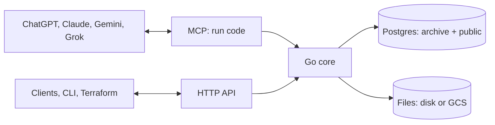
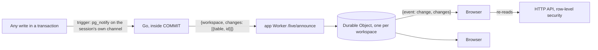

# ADR 0001: Archive architecture

- Status: Accepted
- Date: 2026-10-27
- Deciders: Marijn Brussel

## Summary

Archive is one Go binary on top of Postgres, with file bytes on disk or in Google Cloud Storage. It stores each type as a real Postgres table and exposes everything over MCP, so any AI app can read and write it. Agents do the work of getting data in and keeping it clean, by writing code against Archive's SDK; Archive itself calls no LLM.

The binary is stateless when given an external Postgres and blob store: any number of instances can run side by side, scale to zero, and share all state through Postgres.



## Stack

- **Postgres 18** for all data, **Go** for the server, **Google Cloud Storage** for file bytes (a directory in local development).
- **One image**: ko builds the API image from the Go module alone (the binary on a minimal base, about 44 MB); the web app is static files, built by Vite. The binary never runs Postgres: it always connects through `DATABASE_URL`, and locally Postgres is its own `postgres:18-alpine` container.
- **One port** serves the HTTP API (`/api`), sign-in (`/auth`) and MCP (`/mcp`).
- **Clients**: one Svelte web app is the client everywhere. It is served as the website, and wrapped with Tauri 2 for iOS, Android, macOS, Windows and Linux; Capacitor is the fallback for iOS and Android if Tauri's mobile side proves rough. It is a client of the HTTP API. `apps/web` is its start: Svelte 5 and Vite, with its own design system (Inter and EB Garamond, light and dark themes, a rail of archives and a sidebar). It has sign-in with passkeys and providers, chat, the library, the database with each table's columns, links, rows and DDL, workflows and their runs, and access. Screens the API cannot back yet keep made-up data from `src/lib/mock`, which lists them; it is not yet wrapped in Tauri.

## Data model

Two Postgres schemas. Tables are named in the singular, and every id is a UUIDv7.

| Schema | Holds |
|---|---|
| `archive` | Archive's own tables: `member`, `user`, `token`, `chat`, `workflow`, `workflow_run`, `revision`, `file`, `upload` and `secret`. It also holds the built-in types, as domains (`archive.email`, `archive.us_ein`, `archive.phone`, …) and composite types (`archive.money`, `archive.address`, `archive.timestamp`, …) |
| `public` | One table per type, where the table is the type and a row is the entity, and the views over them |

Each workspace (see [Workspaces](#workspaces)) has a database of its own with these two schemas. Only the main database's `user` and `token` are used, since people and their secrets are the instance's, not a workspace's; it also holds the instance's own tables: `workspace`, `due` and `setting`.

There is no `type` or `entity` table: Postgres already is that. Archive reads types, columns, foreign keys and `COMMENT ON` descriptions from the catalog.

Every type table carries the same columns, row-level security and search column, and a migration that leaves a table without them is rejected. A migration may leave them out, and Archive adds them (see [Schema changes](#schema-changes)); written out in full, a table is:

```sql
CREATE TABLE house (
  id         uuid PRIMARY KEY DEFAULT uuidv7(),
  access     text,
  created_at timestamptz NOT NULL DEFAULT now(),
  updated_at timestamptz NOT NULL DEFAULT now(),
  address    text NOT NULL,
  price      archive.money,
  owner      uuid REFERENCES person,
  search     tsvector GENERATED ALWAYS AS (to_tsvector('simple', coalesce(address, ''))) STORED
);
CREATE INDEX house_search ON house USING gin (search);
ALTER TABLE house ENABLE ROW LEVEL SECURITY;
ALTER TABLE house FORCE ROW LEVEL SECURITY;
CREATE POLICY access ON house USING (archive.can(access)) WITH CHECK (archive.can(access));
COMMENT ON TABLE house IS 'A house you own or rent
icon: house';
```

- **Comments carry settings**: the first lines of a `COMMENT ON TABLE` or `COMMENT ON VIEW` are the description; trailing `key: value` lines are settings. `icon` (a Lucide icon name, checked against the list in `src/icons.json`) goes on tables and views; `layout` (`table`, `board` or `calendar`) and `by` (one of the view's columns) go on views. An unknown key, icon, layout or column fails the migration. The catalog (`GET /api/types`, `archive.schema()`, the code mode docs) shows the description without those lines, plus `kind`, `icon`, `layout` and `by`; the generated DDL keeps the whole comment. Parsing is `catalogComment` in `src/catalog.go`. Column comments may use the same convention later.
- **Views** are Postgres views in `public`, written in the same DDL: a filtered, grouped or calendar way to look at a table, with its layout in its comment. Every view needs `WITH (security_invoker = true)`, so row-level security applies to whoever reads it, and an `id uuid` column. Views show in the catalog next to tables with `kind: "view"`; list, get and search read them, and writes to them fail with 405. They hold no access of their own: row-level security on the tables they read filters their rows.

```sql
CREATE VIEW task_board WITH (security_invoker = true) AS SELECT * FROM task;
COMMENT ON VIEW task_board IS 'Tasks by progress
layout: board
by: status
icon: kanban';
```

- **Built-in types**: Postgres enforces their format through domains. A Go normalizer per domain cleans messy input first, read as US input, so the same thing is stored the same way whatever source it came from.
- **References** are foreign keys to the target table. **Lists** are arrays. There is no type inheritance.
- **Across tables**: search is a `UNION ALL` over the `public` tables, which Archive generates from the catalog.

## Schema changes

Users' tables change through migrations: Postgres DDL, run in order. There is no stored schema, no schema files and no diff of the user's tables: **the live database is the only source of truth**, and each migration is a change to it. Agents know Postgres DDL, so they write renames, type changes and backfills as they would anywhere.

- **Writing**: `archive.migrate(sql, { confirm })` in a run, `POST /api/schema/migrate` (`sql`, `name`, `confirm`), `archive schema migrate <file.sql|dir|-> [-confirm hash]` and the Terraform `archive_migration` resource. Without `confirm` a migration is a dry run: it runs in a savepoint, rolls back, and reports its statements, its `changes` and its `drops`, with a `confirm`: the sha256 of the statements, Archive's own schema hash and a fingerprint of the schemas before. With that `confirm` it runs for real; with any other, as after another migration, it fails with `conflict`. The CLI runs a directory's migrations in one transaction, each on the ones before, and confirms them with one hash of theirs. A named migration (the CLI uses the file name) runs once; running it again skips it, so a directory of migrations can live in git.
- **What a migration may hold**: `CREATE`, `ALTER` or `DROP` of a table, view, index, type, domain, function, trigger, sequence or policy, and `COMMENT ON`. Rows change through `archive.create`, `update` and `delete`, as the user, so row-level security applies; `archive.query` only reads, in a read-only savepoint. `SECURITY DEFINER`, `OWNER TO`, `SET SCHEMA`, `CREATE TABLE … AS` and languages other than `sql` and `plpgsql` are rejected, and a migration that changes anything in the `archive` schema (its snapshot, taken before and after) fails.
- **Derived parts**: every table has `id`, `access`, `created_at`, `updated_at`, a `search` column over its text columns with a gin index, row-level security with the `access` policy, and grants to the viewer and editor roles. A migration may leave any of them out. After each `CREATE TABLE` Archive adds the missing columns, so a later `REFERENCES` or `SELECT *` view sees them; after the last statement it adds the rest. A table whose `search` is the derived one (`archive.search_doc(VARIADIC ARRAY[…])` over exactly its text columns) keeps it so: when a migration drops or retypes one of its columns, Archive first empties the expression, since Postgres keeps a column a generated column uses, and sets it again at the end with `ALTER COLUMN search SET EXPRESSION`. A `search` written differently is left as it is.
- **Changes and drops**: `src/pgschema.go` snapshots the `archive` and `public` schemas from `pg_catalog` before and after the statements: each table, view, sequence, type, domain and function, and each column, constraint, index, trigger and policy, as Postgres renders it (`format_type`, `pg_get_expr`, `pg_get_constraintdef`, `pg_get_indexdef`, `pg_get_triggerdef`, `pg_get_viewdef`, `pg_get_functiondef`), with its comment, grants and row-level security. Comparing the two gives `changes`; objects match by oid, so a rename is a change, not a drop and a create. `drops` are the changes that lose or rewrite data: a dropped table, column or type attribute, and a column whose type changed in a table that was rewritten.
- **Reading**: `archive.schema(name?)`, `GET /api/schema?name=` and `archive schema show [name]` render the DDL on demand from the same snapshot of `public`, by table or view, without owners and grants; `archive.schema` and the API add each one's columns as the catalog has them. A type, domain, function or sequence goes with the one table that uses it (or the one view, when no table does), and otherwise stands on its own. `--` comments are not kept and `COMMENT ON` is.

How a migration runs:

1. **In the caller's transaction**: a run's migration is part of the run, so a run that throws later undoes it, and later calls see the new tables (the run reads its catalog from its own transaction once it migrated). The run's role cannot run DDL, so Archive inserts a random key bound to the run's backend pid through its own connection, and the statements go through `archive.ddl(key, statement)`, a `SECURITY DEFINER` function that runs nothing without that key.
2. **Statements**: in a savepoint under a transaction-scoped advisory lock, with `search_path` set to `public` and a 10 second lock timeout, one at a time, so an error names the statement.
3. **Check**: the derived parts are added, then the catalog checks (`Catalog.Check` in `src/catalog.go`) run over every table and view: the columns every table has, row-level security and the policy, view options and comment settings.
4. **History and other instances**: every migration inserts an `archive.revision` row with its author, name and statements; `archive.revisions()` lists them. Each instance reloads its catalog when the latest revision differs from its own.

**Archive's own schema** (`src/archive.sql`) is embedded in the binary. The same file holds Archive's sqlc queries after the DDL; sqlc generates `src/generated` from it, and only the part before the first `-- name:` line is the schema. At startup, under the same advisory lock, Archive does three things:
- it creates its Postgres roles;
- it drops tables of earlier versions;
- if the hash of that schema differs from the last revision, it applies `archive.sql` to a scratch database on the same instance (a random name, dropped after, even on error), reads both with the snapshot reader in `src/pgschema.go`, and runs `pgPlan`'s difference in one transaction.

The plan only touches Archive's own objects (the `archive` schema and the default privileges on `public`), and handles only what `archive.sql` uses: it creates what is missing, alters columns, domains (default, `NOT NULL`, constraints) and composite types, adds enum values, replaces functions and views, recreates changed constraints, indexes, triggers and policies, and sets comments and grants. It never drops and recreates a type or domain, since user tables use them, and refuses anything else with an error naming the object. It is never allowed to delete data at startup: a dropped table, column or attribute, or a type change that is not a safe widening, makes Archive say so and leave the schema as it is. `TestArchiveSQLMigratesFromEveryVersion` migrates every version of `archive.sql` in `src/testdata/archive_sql` to the next, and the first to the last, and checks the result matches a fresh apply; add each new version there. Instances starting at once take turns on the lock; the first migrates and the rest find nothing to do.

## Code mode

Agents get one MCP tool, `run`, which takes a TypeScript script and runs it inside Archive. Code is cheaper and more capable than many small tool calls: one script can query, loop, transform and write in a single turn.

- **Runtime**: esbuild strips the types and goja runs the JavaScript, both inside the Go binary. Scripts have no file access beyond the SDK. A small `fetch` (method, headers, a string or JSON body; `ok`, `status`, `headers`, `text()`, `json()`) calls other services synchronously, since goja has no event loop; it shares the run's timeout and caps responses at 5 MB. Scripts run with a 30 second timeout and caps on result and log size, and a global `input` holds what a workflow trigger passed.
- **As the user**: the script runs as the calling user's Postgres role, so row-level security applies. It also runs as one transaction, so a script that throws changes nothing. Side effects that leave Postgres, such as file processing, happen only after that transaction commits.
- **SDK**: one word per verb:
  - rows: `sql`, `list`, `get`, `create`, `update`, `delete`, `search`;
  - schema: `schema`, `migrate`, `revisions`, `tables`;
  - files and documents: `files`, `file`, `read`, `edit`;
  - workflows: `run`; workflows and their runs are the tables `workflow` and `workflow_run`, written and read with the row verbs.

  `create(table, data)` inserts a row, and members are rows too: `create("member", { email, role, groups })`; `create("Name.docx" | ".xlsx" | ".pptx")` makes an empty document. Writes clean input per domain in Go before Postgres checks it.
- **Documentation**: the tool's description is the SDK's `sdk.d.ts`, plus an interface per table generated from the catalog, so agents write against the real schema. In the in-app chat the two are split for the prompt cache: the run tool's description is `sdk.d.ts` alone, the same bytes in every workspace, so every workspace shares one cache entry; the workspace's interfaces open the system prompt with a breakpoint of their own, and the date and the user follow uncached.

The same SDK runs from `POST /api/run` and `archive run script.ts`. The HTTP API offers the same operations as REST under `/api`. Every request carries a user's session or token.

## Workflows

A workflow is a saved script that Archive runs by itself. Clients never write code: their agent writes, runs and fixes every workflow, and the app only shows them. A page is a view and a write is an action, so a workflow is a row, written and read like any other; its truth beyond the row (who it runs as, its schedule, its webhook secret, its cursor) is kept by a write hook, not by verbs of its own.

- **Storage**: `archive.workflow` holds each user's workflows (unique by user and name): `name`, `source`, `on`, and what Archive keeps of it, the role it runs as, `trigger` (on as the scheduler keys it), a webhook token, the next due time and a table cursor, all keyed by id. `archive.workflow_run` keeps the last 100 runs of each, with result, logs, error and duration. Both are in the catalog as the tables `workflow` and `workflow_run`, beside `member`, so `list`, `get` and `query` read them and runs join to workflows. Row-level security shows each person their own workflows and their runs: `archive.mine(member)` checks the caller is in that member's group role, which the member's role and their tokens are. `workflow_run` is granted only `SELECT`: only Archive writes it. Internal columns stay out of `list` and `get`, and the webhook token reads as `url`.
- **Triggers**: `on` is `{ cron, tz? }`, `{ table, events }`, `{ webhook: true }` or null, which runs only with `archive.run`. `cron` uses robfig/cron's standard parser, with descriptors, and `tz` an IANA zone, only to compute the next time. `table` passes the rows created (`created_at = updated_at`, as `archive.create` leaves them) or updated since the last run, as `input.created` and `input.updated`, up to 100 a run; deletes run nothing. `webhook` gives the workflow a URL with a random token.
- **Write hooks**: `archive.create`, `update` and `delete` on `workflow` go to `workflowSave` and `workflowDelete` in Go, inside the caller's transaction, as the caller, so a save is undone with the run it is in. A save compiles `source` with esbuild, the same check a run gets and no other, checks `name` and `on` (the table exists, the cron parses, the zone loads), and is refused as a normal validation error, one entry per problem with line and column for compile errors. An edit that keeps the trigger keeps the next time and the cursor; a new schedule gets its next time, a new table starts from now. The webhook token never changes. `workflow_saved`, a `BEFORE` trigger, sets the role to whoever saved it, so a token that saves a workflow, even someone else's edit of theirs, never gains rights. Delete takes the runs, the schedule and the cursor with the row.
- **Running one**: `archive.run(name, input)` runs a saved workflow for real inside the current transaction, in a savepoint undone when it fails, and records it in `workflow_run` once the outer run commits. It is the app's Run button too, through `POST /api/run`.
- **From before rows**: workflows saved when the trigger was a `// on:` first line get `on` from it, lose that line, and get their member, when the workspace opens (`workflowUpgrade`); names, tokens, cursors and next times stay as they were.
- **As its owner**: a workflow runs through the same path as `POST /api/run`, as the role that saved it (the user, or the token they used, so a token never gains rights), under row-level security and the run timeout.
- **Background work is pushed, never polled**: every workspace writes its next due time to `archive.due` in the main database: a save or delete of a workflow, a run that moves `next_at`, a write, and opening the workspace all keep it up to date. Whenever a time there gets sooner, Archive schedules one Cloud Tasks task for exactly that time, named from the workspace, kind and time so duplicates collapse, that calls `POST <API>/tasks` with an OIDC token; the handler checks the token, claims that workspace's due row, does the work inside the request and schedules the next wake-up, so the service can scale to zero. On Cloud Run, Cloud Tasks is the only way due work arrives. Anywhere else, as in local development, `archive serve` sets an in-process timer for each wake-up instead and, when it starts, wakes every row in `archive.due`, so no emulator is needed; the end-to-end tests cover both. The due row is leased past the run timeout, the workspace opens, and its due workflows are claimed with `FOR UPDATE SKIP LOCKED`, up to 16 a turn. A cron workflow then gets its next time. A table workflow wakes when a transaction as a user commits a write: its rows whose `(greatest(created_at, updated_at), id)` are past the cursor are passed in, as the owner; a run that works moves the cursor and checks once more, one that finds nothing or fails waits for the next write. Rows whose timestamp equals one of the workflow's own run transaction times are skipped, so its own writes never trigger it again. `updated_at` moves on `archive.update`, not on raw SQL.
- **Webhooks**: `POST /hooks/run/<workspace>/<token>` on the API sits beside the connectors' `/hooks/<provider>` (ADR 0002), outside the authenticated `/api` mux. The token is the only credential. The body is passed as parsed JSON or raw text with the method, query and headers, and the response is the run's result as JSON, or 500 with the error.
- **API**: the rows' own: `GET`, `POST`, `PATCH` and `DELETE /api/workflow`, and `GET /api/workflow_run`; the app's Workflows screen lists them in plain words, with their runs and webhook URL, and never shows code.

## Live data

Everything the web app shows updates by itself when it changes anywhere: another tab, another person, the assistant, a workflow run, MCP, the CLI or the HTTP API. Nothing polls. A write says what it moved, and every app looking at that workspace reads that data again through the API.



- **Where it starts: Postgres.** Every table a workspace writes has an `AFTER` trigger, `archive.moved()`. Archive's own tables (`chat`, `file`, `member`, `workflow`, `workflow_run`, `revision`) fire it per row and name the row's id; every public table gets a statement trigger, `archive_moved`, which `archive.migrate` adds to new tables and a workspace adds to older ones when it opens. It is plumbing, like row-level security, so `schema show` and a migration's changes leave it out. The trigger calls `pg_notify('archive_moved_<pid>', '<table> <id>')`: a channel named for the writing session, which only that session listens on (every pooled connection runs `LISTEN` on its own channel when it connects). Postgres delivers a notification only when its transaction commits, drops it with a rolled-back savepoint (so `archive.test` announces nothing), and folds repeats within a transaction into one. The notification comes back on the connection that wrote, inside the `COMMIT`, in the goroutine that committed. So every write path is live with no code of its own, and a new table or feature is too. Writes from outside Archive (psql) are not heard.
- **The main database's rows** (`archive.user`, `archive.token`, `archive.workspace`) are shared by every workspace and written outside a workspace's store, so those few writes announce themselves from Go: a token made or revoked, a person added or removed (who is also told on every workspace they are in, since their list of workspaces moved), a workspace renamed or deleted (told to all its members, once the deletion is done).
- **What it carries**: the table that moved (`invoice`, or `archive.chat` for Archive's own) and, for Archive's own rows, the id. Never row data, so a frame tells a reader nothing it could not read anyway; a browser reads again through the API, so row-level security decides what each person sees.
- **Coalescing**: Go holds changes per workspace for 100 ms and sends them as one announce, at most 20 ids per table (past that, the table alone). Every request sends what it moved before it ends, after its answer, because Cloud Run takes the CPU away once a request is done; a long request (a chat answer, a run) sends every 100 ms as it goes.
- **Where it goes**: with `ARCHIVE_LIVE_KEY`, one authenticated POST to the app Worker's `/live/announce`, which relays it to the workspace's Durable Object and on to every socket there ([ADR 0003](0003-hosting.md#live-data-at-the-edge)). Without it, `archive serve` is its own edge: it holds the sockets in process at `/live` with the same frames, and other `archive` commands on the machine (the CLI) POST their announces to it. On Cloud Run without a key, live data is off rather than holding sockets that keep instances awake.
- **The protocol**: a WebSocket to `<API>/live?workspace=<id>`, authenticated by the session cookie. The server sends `{"event":"ready","workspace":…}` once, then `{"event":"change","changes":[{"table":…,"id":…}]}` per announce; the client may send `ping`, answered `pong`. A person removed from the workspace has their sockets closed (code 4003). Frames from the client beyond `ping` are reserved for presence and drafts later.
- **WebSockets, not server-sent events**: the Durable Object accepts sockets through the WebSocket hibernation API, so a socket with nothing to hear costs nothing and the object sleeps between announces; an open SSE response would keep the object awake, and billed, for as long as any tab is open. A WebSocket also lets the browser send frames later (presence, typing, drafts) on the same connection.
- **The client** (`apps/web/src/lib/stream.svelte.js`): one socket per tab for the open workspace, and one primitive, `resource({tables, load})`. A screen declares the data it shows with `r.use()` (or `r.use(() => id)` for one chat, one workflow's runs, one table's rows). While it is mounted, a change to one of its tables reads it again; data nobody has on screen is only marked stale and read when a screen next uses it; a hidden tab marks what it shows stale and reads it when it is shown. A change naming a row reads only the resource for that row. Switching workspace closes the socket and opens the new one; signing out closes it.
- **Reconnecting**: backoff from 1 s doubling to 30 s, jittered, forgiven only after a socket held for 10 s, so a socket that opens and drops cannot become a reconnect loop. A socket that comes back may have missed changes, so what is on screen is read once more, at most once every 15 s, and the rest is marked stale. That is the only read a reconnect causes; there is no sweep on a timer and no re-read of everything on connect.

## Agent workflows

These run in the agent, as code against the SDK. The ones that recur can be saved as workflows that Archive runs on its own.

- **Intake and classification**: the agent reads new files, decides their type, and writes rows.
- **Jev classifier**: a small model agents can use to pick the type for an input.
- **Dataset preparation and training**: rows become labeled examples, exported per table, to retrain Jev.
- **Skill library**: reusable agent instructions stored as rows of a `skill` table.

## Apps

Archive is listed in ChatGPT, Claude, Gemini and Grok as one remote MCP server. The apps read and write the user's entities through it.

## Users and permissions

- **Roles**: each workspace has three, `viewer` (reads every table), `editor` (also writes) and `owner` (also changes the schema with `archive.migrate`, manages members, sees every row whatever its access, and reveals secret fields). They are the Postgres roles `"<id>_viewer"`, `"<id>_editor"` and `"<id>_owner"`, each granted the one before. The owners of workspace one are the instance admins.
- **Groups**: a group such as `hr` or `parents` is the Postgres role `"<id>_g_<name>"`, with a name of 1 to 24 lowercase letters, digits or `_`. It exists while at least one member is in it; there is nothing else to create or delete.
- **Access**: every table has an `access text` column. Null means the whole workspace sees the row; `'hr'` means only the hr group and the owners do. Every table carries exactly one policy, `CREATE POLICY access ON <t> USING (archive.can(access)) WITH CHECK (archive.can(access))`, with row-level security enabled and forced, and a migration that leaves a table without it is rejected. `archive.can(g)` is true when `g` is null, when `current_user` is in group `g` (`pg_has_role`), or when `current_user` is an owner. It relies on role membership, never on a session setting, because people run raw SQL. So a non-owner writes only rows whose access is null or one of their groups, and a table only HR sees is `access text NOT NULL DEFAULT 'hr' CHECK (access = 'hr')`. Files have the same `access` column and policy.
- **Members**: `archive.member` (email, role, groups) in each workspace database lists its people. It is the catalog type `member`, so the usual calls manage it: `list("member")`, `create("member", { email, role, groups })`, `update("member", id, { groups: ["hr"] })`, `delete("member", id)`, the same under `/api/member`, and `archive set member <id> '{"groups":["hr"]}'`. Everyone reads it and only owners write it. A `SECURITY DEFINER` trigger turns each change into `CREATE ROLE`, `GRANT` and `REVOKE`: a member's identity role `"<id>_u<member id>"` is granted exactly one of viewer, editor or owner, plus their member role `"<id>_m<member id>"`, which holds their groups. Adding or removing the person in the main database happens in Go after the transaction commits. The last owner cannot be removed or demoted, and an email cannot change.
- **Real Postgres roles**: row-level security filters every query, so a bug in one surface cannot leak rows, and plain SQL as a member gets the same access as the app.
- **One identity per person**: a user is one row of `archive.user` in the main database, with the workspaces they belong to. Adding a member row (`archive user add`, or the Users page and `/auth/users`) invites them to that workspace; deleting it (`archive user remove`) takes them out, with their tokens.
- **Tokens** belong to a user and one workspace, and act as that user there. A token can be viewer-only: it gets a role of its own granted `"<id>_viewer"` and the user's member role `"<id>_m<member id>"`, so it keeps their groups as they change and never has more than they do. A viewer-only token cannot make or revoke tokens or manage workspaces. Agents get their own tokens. Tokens and sessions are `arc_<secret>`, kept as hashes in the main database's `archive.token`; a session belongs to the person and works in all their workspaces.
- **Sign-in is invite-only**: Google, Microsoft and Slack (OpenID Connect) and GitHub (OAuth), each turned on by its one variable, `ARCHIVE_<PROVIDER>=https://<client id>:<client secret>@<provider host>` with the id and secret URL-escaped, plus passkeys. Archive sends no mail and makes no sign-in links. An owner invites someone by email; their first provider sign-in under that email links the provider's account to them, and later sign-ins match that link. An invite only ever matches an email the provider says is verified: `email_verified` for Google, Slack and Microsoft (or Microsoft's `xms_edov`, which stops a tenant from claiming someone else's domain), and GitHub's primary address with `verified`. Anyone else, and anyone removed from every workspace, is refused. After a provider sign-in the web app offers to add a passkey to the device. The first person added with `archive user add` is an owner; with no provider set, the server says in its log that nobody can sign in. One sign-in reaches every workspace the person is in.
- **Secret fields**: values of secret types such as `card` or `us_ssn` are encrypted in `archive.secret` with the workspace's data key. Their columns read back masked, and only owners can reveal them.

## Workspaces

Every install serves many workspaces ([ADR 0003](0003-hosting.md)). A workspace is one customer's Archive: its own Postgres database on the same server, named `archive_<id>` by its UUID, its roles prefixed by that UUID, and its own data key, wrapped by `ARCHIVE_SECRET_KEY` in `archive.workspace`. The main database (`DATABASE_URL`) is workspace one. A workspace's own login role (`"<id>_authenticator"`, password derived from its data key) can connect only to its own database, so no shared login crosses workspaces, and that works without a database superuser (as on Cloud SQL and AlloyDB); the archive tables the system writes use row-level security enabled but not forced, so the owning role bypasses it for background and admin work while tenant roles stay filtered.

- **Opening**: `src/workspace.go` holds the process's `Hub`: the main pool, the root key, the blob store and the open workspaces. A workspace's `Archive` (its pools, catalog, data key and run slots) opens on first use and closes 10 minutes after its last use, on a timer of its own; pools are small (8 app, 4 system, 2 DDL connections) and close idle connections after a minute. Opening applies `archive.sql` under the advisory lock and revision check. Startup opens only the main database, so it takes the same time however many workspaces there are.
- **Finding it**: an API token belongs to one workspace, and a request naming another is refused. The web app's one session cookie works in all of the person's workspaces, and each request names the current one in `Archive-Workspace`; the server checks that the person is in it. Webhooks and file links carry the workspace UUID in their path.
- **Limits**: each workspace runs at most 8 scripts at once, and waits 10 s for a slot before answering 429.
- **Admins**: nobody makes a workspace for themselves. Instance admins, the owners of workspace one, list, create and delete workspaces, each with its first owner (`archive workspace add|list|delete`, `/auth/workspaces`); deleting a workspace drops its database and roles.
- **Anthropic key**: the chat agent in every workspace uses the one `ANTHROPIC_API_KEY`; a workspace cannot set its own.

## Files

File bytes are content-addressed by SHA-256 in `./data/blobs` or in GCS (`ARCHIVE_BLOB_URL`), under a prefix per workspace.

- **Uploads**: a plain `POST /api/files` for small files, or resumable tus uploads for large ones. A tus upload's state lives in `archive.upload` and its chunks are stored as blob objects, so consecutive chunks can land on different instances. The last chunk assembles the file from blob storage, without a local copy.
- **Processing in the request**: Archive pulls metadata, extracts text (PDF, HTML, plain text and JSON) and makes image thumbnails inside the request that stored the file. A file is therefore `done` when its upload, edit or create returns, and nothing has to run between requests. A file left `pending` is due in `archive.due` 10 s later, as a safety net only.
- **Links**: `POST /api/files/{id}/link` makes a short-lived signed URL, `<API>/files/<workspace>/<id>`, for downloads such as image previews. GPS data can be stripped from photos on the way out.

## Documents

Archive's documents are Office files (docx, xlsx, pptx): standard files that open anywhere. Agents edit them one edit at a time, by splicing the file's bytes.

**One API**: `archive.create(name)` makes an empty document of the type its extension names. `archive.read(id)` returns the document as a model, and `archive.edit(id, edits)` applies a list of edits, all or nothing. Agents use them from code mode; nothing else is needed.

**Edits splice bytes; nothing is rebuilt.** docx, xlsx and pptx are zips of XML parts. `office.go` edits all three using only Go's standard library:

1. Parts an edit does not touch are copied raw with `zip.Writer.Copy`, so they stay byte-identical.
2. For the part an edit does touch, `encoding/xml`'s decoder records the byte range of every paragraph, run, table, cell and shape.
3. An edit replaces one byte range with a small new fragment, or inserts one, written with the prefixes the part already declares. Everything around it stays as it was, including namespaces, revision ids and extensions Archive has never heard of. The part is never re-encoded.
4. The part is parsed again after the edit, to check it is still well-formed.

Details of how it behaves:

- **The model** is built from that index:
  - docx: paragraphs with styles and lists, and tables;
  - xlsx: sheets, cells, formulas, merged ranges and Excel tables;
  - pptx: slides, shapes and their text.

  Edits outside the model are not possible, by design.
- **Edits**: replace text (across runs, keeping the first run's formatting), insert or delete a paragraph, set a table cell, set a value or formula, clear a cell, append a row to an Excel table, and replace a shape's text. Inserting rows, columns, slides or shapes, and changing formatting, are not possible yet.
- **Formulas without an engine**: a cell value is written as an inline string, so the shared strings are never touched. A formula is written with its cached value removed, and every xlsx edit marks the workbook to recalculate when it is opened.
- **New files**: `archive.create("Budget.xlsx")` writes a minimal blank file with the standard library:
  - a docx with one empty paragraph and the Normal, Title, Heading1–3 and ListParagraph styles;
  - an xlsx with an empty Sheet1;
  - a pptx with one title slide.
- **Concurrency**: an edit locks the file row (`SELECT … FOR UPDATE`), then splices the latest bytes, so concurrent agents take turns and no edit is lost. Paragraph ids are positions: if another agent inserts a paragraph between your read and your edit, an id can point at a paragraph that moved. Within one `edit` call, ids keep pointing at the paragraphs as read, even after inserts and deletes.
- **Search text**: Office files are not yet text-extracted.

**Not chosen**:
- An embedded office suite (Collabora, ONLYOFFICE): their value is the editor UI, which Archive does not use, and running them in a closed SaaS needs paid editions.
- Office libraries (excelize, go-docx, unioffice): they load a document into their own structures and write it back out, which loses what they do not model, and some are AGPL or commercial.
- Live co-editing inside Archive: people edit Office files together in Google Docs and Sheets through an integration (planned). A CRDT model of OOXML would mean converting in both directions.
- Version numbers on `archive.edit`: tried and dropped as too complex for agents; the row lock prevents lost updates instead.
- React Native for clients: a web app in Tauri or Capacitor shells runs the same code everywhere. Electron covers desktop only.

## Deployment

The same image runs in two ways, each serving any number of workspaces.

- **Google Cloud**, always, set up by `apps/terraform/gcp`: the API on Cloud Run and the web app as static files on a Cloudflare Worker. The binary serves no web pages: the web app and the API are always on addresses of their own. Locally, `compose.yaml` runs only Postgres for development.
- **Stateless**: set `DATABASE_URL` to a managed Postgres, `ARCHIVE_BLOB_URL` to a GCS bucket, and `ARCHIVE_SECRET_KEY`, the same on every instance. Archive refuses to start with `DATABASE_URL` but without the key. Nothing else is local:
  - schema: generated from the database;
  - uploads: in Postgres and blob storage;
  - file processing: inside the request;
  - background work, sync jobs and coordination: through Postgres locks (a lease on each `archive.due` row, an advisory lock for schema), woken by Cloud Tasks.

  `DATABASE_URL` reaches Postgres directly, with no pooler in between, since schema changes and creating workspaces hold a session-level advisory lock. Archive sets each database's default `search_path` and `timezone`.

  It runs on request-based billing and scales to zero: no CPU is needed between requests. Cloud Tasks calls `/tasks` at each due time, from the queue named after the service in its project and region, signed as `<service>-tasks@`, all of which Archive reads from `K_SERVICE` or `CLOUD_RUN_JOB` and the metadata server, so scheduled and table-triggered workflows and pending files start an instance when they need one.
- The **`archive` Terraform provider** (`apps/terraform`) manages schema DDL (tables and views), members and tokens as code. Each `archive_migration` runs its DDL once, by name.

Not verified yet: a managed Postgres without a true superuser (Cloud SQL's `cloudsqlsuperuser`), and GCS through its XML API.

## Planned

Designed but not built:

- **File versions**: an `archive.file_version` row per save (hash, size, saved by, saved at), so any version can be opened or restored.
- **Sharing with people without an account**: `archive.share` rows (token hash, access, emails, password, expiry, revocation, uses) behind `/s/<token>`. There would be SDK calls `share`, `shares` and `unshare`, and the share page would read through a system role that sees only the shared file.
- **Rendering**: Gotenberg (LibreOffice) as an optional container that renders docx, xlsx and pptx to PDF for previews and computes formula values. It would only ever produce derived output, never save users' files.
- **Office text extraction** for search, and legacy and ODF conversion to OOXML on request.
- **More Office edits**: rows, columns, slides and formatting.
- **Google Docs and Sheets integration** for people editing Office files.
- **Connectors** that sync mail, files, chat and business data in, read-only and by delta: see [ADR 0002](0002-connectors.md).
- **Clients**: the Svelte app, as the website and in Tauri 2 shells for iOS, Android and desktop (Capacitor as the fallback on mobile). Every shell runs it in the platform's own web view (WKWebView, Android WebView, WebView2, WebKitGTK).

## Not doing

These were in earlier designs and are cut to keep Archive small:
- raw, provenance, links, changes, proposals, and type and entity tables;
- JSONB records, spec versions and change review, and type inheritance;
- built-in LLM calls, intake, confidence scoring, confidence calibration and the review queue;
- OCR, transcription and embeddings;
- folder connectors and `.eml` text extraction (connectors are now [ADR 0002](0002-connectors.md));
- IMAP and the external connector protocol;
- stored schema files;
- pages, Archive's own live documents.

Any of them can come back when a real user needs it.
