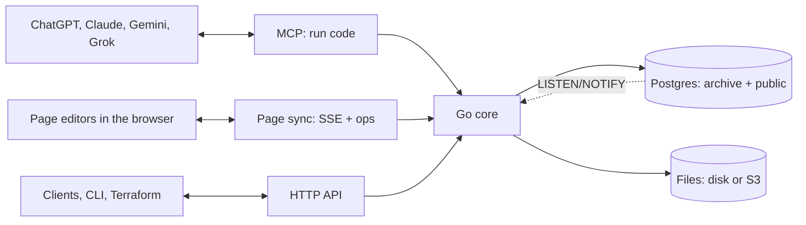

# ADR 0001: Archive architecture

- Status: Accepted
- Date: 2026-10-27
- Deciders: Marijn Brussel

## Summary

Archive is one Go binary on top of Postgres, with file bytes on disk or in S3-compatible storage. It stores each type as a real Postgres table and exposes everything over MCP, so any AI app can read and write it. Agents do the work of getting data in and keeping it clean, by writing code against Archive's SDK; Archive itself calls no LLM.

The binary is stateless when given an external Postgres and blob store: any number of instances can run side by side, scale to zero, and share all state through Postgres.



## Stack

- **Postgres 18** for all data, **Go** for the server, **a directory or S3-compatible storage** (S3, R2, MinIO, GCS) for file bytes.
- **One Dockerfile**: the image holds Postgres and the binary. Without `DATABASE_URL`, the binary starts the bundled Postgres in `/data`; with it, it uses the external database and keeps nothing local.
- **One port** serves the HTTP API (`/api`), sign-in (`/auth`) and MCP (`/mcp`).
- **Clients**: one Svelte web app is the client everywhere. It is served as the website, and wrapped with Tauri 2 for iOS, Android, macOS, Windows and Linux; Capacitor is the fallback for iOS and Android if Tauri's mobile side proves rough. It is a client of the HTTP API and the page sync endpoints. `apps/web` is its start: Svelte 5 and Vite, in the look of archive.family's app (Geist and EB Garamond, a dark shell, cream pills, rounded panels). It has sign-in, files, pages with the live editor, and a page for every table and view, each with the icon and description from its comment; it is not yet wrapped in Tauri.

## Data model

Two Postgres schemas. Tables are named in the singular, and every id is a UUIDv7.

| Schema | Holds |
|---|---|
| `archive` | Archive's own tables: `space`, `user`, `token`, `invite`, `revision`, `file`, `upload` and `secret`. It also holds the built-in types, as domains (`archive.email`, `archive.iban`, `archive.phone`, …) and composite types (`archive.money`, `archive.address`, `archive.timestamp`, …) |
| `public` | One table per type, where the table is the type and a row is the entity, and the views over them |

There is no `type` or `entity` table: Postgres already is that. Archive reads types, columns, foreign keys and `COMMENT ON` descriptions from the catalog.

Every type table carries the same columns, row-level security and search column, and a plan without them is rejected:

```sql
CREATE TABLE house (
  id         uuid PRIMARY KEY DEFAULT uuidv7(),
  space      uuid NOT NULL REFERENCES archive.space,
  created_at timestamptz NOT NULL DEFAULT now(),
  updated_at timestamptz NOT NULL DEFAULT now(),
  address    text NOT NULL,
  price      archive.money,
  owner      uuid REFERENCES person,
  search     tsvector GENERATED ALWAYS AS (to_tsvector('simple', coalesce(address, ''))) STORED
);
CREATE INDEX house_search ON house USING gin (search);
ALTER TABLE house ENABLE ROW LEVEL SECURITY;
ALTER TABLE house FORCE ROW LEVEL SECURITY;
CREATE POLICY member ON house USING (space = ANY (archive.my_spaces()));
COMMENT ON TABLE house IS 'A house you own or rent
icon: house';
```

- **Comments carry settings**: the first lines of a `COMMENT ON TABLE` or `COMMENT ON VIEW` are the description; trailing `key: value` lines are settings. `icon` (a Lucide icon name, checked against the list in `src/icons.json`) goes on tables and views; `layout` (`table`, `board` or `calendar`) and `by` (one of the view's columns) go on views. An unknown key, icon, layout or column fails the plan. The catalog (`GET /api/types`, `archive.tables()`, the code mode docs) shows the description without those lines, plus `kind`, `icon`, `layout` and `by`; the generated DDL keeps the whole comment. Parsing is `catalogComment` in `src/catalog.go`. Column comments may use the same convention later.
- **Views** are Postgres views in `public`, written in the same DDL: a filtered, grouped or calendar way to look at a table, with its layout in its comment. Every view needs `WITH (security_invoker = true)`, so row-level security applies to whoever reads it, and an `id uuid` column. Views show in the catalog next to tables with `kind: "view"`; list, get and search read them, and writes to them fail with 405. They hold no space of their own: row-level security on the tables they read filters their rows.

```sql
CREATE VIEW task_board WITH (security_invoker = true) AS SELECT * FROM task;
COMMENT ON VIEW task_board IS 'Tasks by progress
layout: board
by: status
icon: kanban';
```

- **Built-in types**: Postgres enforces their format through domains. A Go normalizer per domain cleans messy input first (read in `ARCHIVE_LOCALE`), so the same thing is stored the same way whatever source it came from.
- **References** are foreign keys to the target table. **Lists** are arrays. There is no type inheritance.
- **Across tables**: search and "everything in a space" are a `UNION ALL` over the `public` tables, which Archive generates from the catalog.

## Schema changes

The schema is declarative and DDL only, with no migrations folder and no stored schema files: **the live database is the only source of truth** for users' types.

- **Reading**: `archive.schema()`, `GET /api/schema` and `archive schema pull [dir]` generate the DDL on demand, one `<name>.sql` per table or view. They load `archive.sql` into an empty temp database and plan with pg-schema-diff from there to the live database, keeping the statements about `public` and additive unique indexes/constraints on core tables. Those extra keys are exported as `archive.<object>.sql` so public foreign keys can depend on them. Core object removals are not exported: an older database must not undo newly embedded core DDL during startup. Each file holds the table with its indexes, foreign keys, row-level security, policies, triggers and `COMMENT ON` statements. An enum, domain or function goes in the first table file that uses it; a view always gets its own file. pg-schema-diff diffs views, their options and their comments, so a changed view comment plans one `COMMENT ON VIEW`.
- **Normalized text**: the generated DDL is in pg-schema-diff's style, with quoted, schema-qualified names and spelled-out policies. `--` comments and layout are not kept; `COMMENT ON` is.
- **Writing**: `archive.apply(files)`, `POST /api/schema/plan|apply` and `archive schema plan|apply <dir>` take the whole desired set. Leaving a table out drops it, which is blocked unless explicitly allowed; leaving a view out drops it without asking, since a view holds no data. The invariant is that `apply(schema())` plans nothing, so files can be pulled, kept in git and applied back.

How an apply runs:

1. **Load**: the files are loaded into a temp database, whole files first, retrying until a round makes no progress. Files still stuck are split into single statements and retried one by one, so tables that reference each other load in any order. At least one foreign key in each cycle must be an `ALTER TABLE … ADD FOREIGN KEY`.
2. **Plan**: [pg-schema-diff](https://github.com/dilame/pg-schema-diff) (the dilame fork, pinned in `go.mod`, since upstream lacks domains) compares the temp database with the live one and returns the statements to run, each with its hazards.
3. **Apply**: statements run under one advisory lock with lock timeouts. Indexes are built concurrently, and foreign keys are added `NOT VALID` and then validated. A statement that deletes data is blocked unless the caller allows it.
4. **Renames** are not detected by the diff, so they are passed explicitly: `archive.apply(files, { renames: ["ALTER TABLE house RENAME COLUMN city TO town"] })` runs them first, in the same transaction, then plans the edited files, so no data is lost.
5. **Other instances**: every apply inserts an `archive.revision` row, and each instance reloads its catalog when the latest revision differs from its own.

**Archive's own schema** (`src/archive.sql`) is embedded in the binary. At startup, under the same advisory lock, Archive does three things:
- it creates its Postgres roles;
- it drops tables of earlier versions;
- if the hash of `archive.sql` differs from the last revision, it plans `archive.sql` together with the user's tables generated from the database.

The plan therefore only touches Archive's own objects, and it is never allowed to delete data at startup. Instances starting at once take turns on the lock; the first migrates and the rest find nothing to do.

## Code mode

Agents get one MCP tool, `run`, which takes a TypeScript script and runs it inside Archive. Code is cheaper and more capable than many small tool calls: one script can query, loop, transform and write in a single turn.

- **Runtime**: esbuild strips the types and goja runs the JavaScript, both inside the Go binary. Scripts have no file or network access beyond the SDK, and they run with a timeout (`ARCHIVE_RUN_TIMEOUT`) and caps on result and log size.
- **As the user**: the script runs as the calling user's Postgres role, so row-level security applies. It also runs as one transaction, so a script that throws changes nothing. Side effects that leave Postgres, such as live page broadcasts and file processing, happen only after that transaction commits.
- **SDK**: one word per verb:
  - rows: `sql`, `list`, `get`, `create`, `update`, `delete`, `search`;
  - schema: `schema`, `apply`, `tables`;
  - files and documents: `files`, `file`, `read`, `edit`;
  - `spaces`.

  `create(table, data)` inserts a row; `create("Name.docx" | ".xlsx" | ".pptx" | ".page")` makes an empty document. Writes clean input per domain in Go before Postgres checks it.
- **Documentation**: the tool's description is the SDK's `sdk.d.ts`, plus an interface per table generated from the catalog, so agents write against the real schema.

The same SDK runs from `POST /api/run` and `archive run script.ts`. The HTTP API offers the same operations as REST under `/api`. Every request carries a user's session or token. A client retaining work across requests can send `Archive-Expected-User: <user UUID>` to bind authenticated `/api/*` (including TUS) and `/auth/*` requests to the account it observed. Authentication runs first; malformed or repeated preconditions return 400, and an authenticated account mismatch returns 412 before the handler runs. This is optional for existing clients and grants no permissions. Clients must retain the expected UUID with queued work, stop on mismatch, and never automatically substitute the new account. Signed file links and explicit-token MCP requests do not use this HTTP precondition.

## Agent workflows

These run in the agent, as code against the SDK, not inside Archive.

- **Intake and classification**: the agent reads new files, decides their type, and writes rows.
- **Jev classifier**: a small model agents can use to pick the type for an input.
- **Dataset preparation and training**: rows become labelled examples, exported per table, to retrain Jev.
- **Skill library**: reusable agent instructions stored as rows of a `skill` table.

## Apps

Archive is listed in ChatGPT, Claude, Gemini and Grok as one remote MCP server. The apps read and write the user's entities through it.

## Users and permissions

- **Spaces**: every user gets a private space, and shared spaces can be made for a household or a team. Every row and file belongs to one space.
- **Roles are Postgres roles**: users, space roles (`owner`, `admin`, `editor`, `viewer`) and tokens are real Postgres roles, prefixed per instance (`ARCHIVE_INSTANCE`), and row-level security filters every query. A bug in one surface cannot leak another user's data, and plain SQL gets the same access as the app.
- **Tokens** belong to a user and can only narrow that user's rights. Agents get their own tokens.
- **Sign-in**: email magic links (`ARCHIVE_SMTP_URL`), passkeys, and OIDC providers such as Google or Microsoft (`ARCHIVE_OIDC`). The first owner comes from `ARCHIVE_ADMIN_EMAIL`, or a one-time setup link. `GET /auth/magic` uses a link at once; a product that shows the link as its own page first, so a mail scanner does not spend it, posts the token to `POST /auth/magic/use`. `POST /auth/signout/everywhere` ends every session of the person and spends their waiting sign-in links; their API and app tokens stay.
- **Invites**: an admin of a space invites an email address at a level no higher than their own (`POST /auth/spaces/{space}/invites` with `email`, `role` and an optional `name`), and gets back a one-time link that lasts 7 days, to send as they like. Opening it (`GET /auth/invite?token=`) only shows it, or says what it is for to a client that is not a browser; pressing its button (`POST /auth/invite`) raises the person's level in the space to the invite's. For an address with no account it makes one and signs the presser in; an address that has an account joins only when the press comes from a session of that account (409 otherwise, and the invite stays good), since the inviter holds the link too. A person's home space takes no invites. Invites are rows of `archive.invite`, which only the system role reads.
- **Secret fields**: values of secret types such as `iban` or `us_ssn` are encrypted in `archive.secret` with `ARCHIVE_SECRET_KEY`. They are hidden from anyone not granted that type.

## Files

File bytes are content-addressed by SHA-256 in `$ARCHIVE_DATA/blobs` or in S3-compatible storage (`ARCHIVE_BLOB_URL`).

- **Uploads**: a plain `POST /api/files` for small files, or resumable tus uploads for large ones. A tus upload's state lives in `archive.upload` and its chunks are stored as blob objects, so consecutive chunks can land on different instances. The last chunk assembles the file from blob storage, without a local copy.
- **Processing in the request**: Archive pulls metadata, extracts text (PDF, HTML, plain text, JSON and pages) and makes image thumbnails inside the request that stored the file. A file is therefore `done` when its upload, edit or create returns, and nothing has to run between requests. A worker loop polls for leftover `pending` files every 10 s as a safety net only.
- **Links**: `POST /api/files/{id}/link` makes a short-lived signed URL for downloads such as image previews. GPS data can be stripped from photos on the way out.

## Documents

Archive has two kinds of documents, each edited the way that suits it, behind one API.

| | Office files (docx, xlsx, pptx) | Pages (`.page`) |
|---|---|---|
| What it is | A standard file that opens anywhere | Archive's own collaborative document |
| How edits are made | Splicing the file's bytes | go-crdt operations |
| Who edits | Agents, one edit at a time | People and agents, live and at the same time |
| Paragraph ids | Positions in the version read | Permanent CRDT block ids |

**One API**: `archive.create(name)` makes an empty document of the type its extension names. `archive.read(id)` returns the document as a model, and `archive.edit(id, edits)` applies a list of edits, all or nothing. Agents use them from code mode; nothing else is needed to edit either kind.

### Office files

**Edits splice bytes; nothing is rebuilt.** docx, xlsx and pptx are zips of XML parts. `office.go` edits all three using only Go's standard library:

1. Parts an edit does not touch are copied raw with `zip.Writer.Copy`, so they stay byte-identical.
2. For the part an edit does touch, `encoding/xml`'s decoder records the byte range of every paragraph, run, table, cell and shape.
3. An edit replaces one byte range with a small new fragment, or inserts one, written with the prefixes the part already declares. Everything around it stays as it was, including namespaces, revision ids and extensions Archive has never heard of. The part is never re-encoded.
4. The part is parsed again after the edit, to check it is still well-formed.

Details of how it behaves:

- **The model** is built from that index:
  - docx: paragraphs with styles and lists, and tables;
  - xlsx: sheets, cells, formulas, merged ranges and Excel tables;
  - pptx: slides, shapes and their text.

  Edits outside the model are not possible, by design.
- **Edits**: replace text (across runs, keeping the first run's formatting), insert or delete a paragraph, set a table cell, set a value or formula, clear a cell, append a row to an Excel table, and replace a shape's text. Inserting rows, columns, slides or shapes, and changing formatting, are not possible yet.
- **Formulas without an engine**: a cell value is written as an inline string, so the shared strings are never touched. A formula is written with its cached value removed, and every xlsx edit marks the workbook to recalculate when it is opened.
- **New files**: `archive.create("Budget.xlsx")` writes a minimal blank file with the standard library:
  - a docx with one empty paragraph and the Normal, Title, Heading1–3 and ListParagraph styles;
  - an xlsx with an empty Sheet1;
  - a pptx with one title slide.
- **Concurrency**: an edit locks the file row (`SELECT … FOR UPDATE`), then splices the latest bytes, so concurrent agents take turns and no edit is lost. Paragraph ids are positions: if another agent inserts a paragraph between your read and your edit, an id can point at a paragraph that moved. Within one `edit` call, ids keep pointing at the paragraphs as read, even after inserts and deletes.
- **Search text**: Office files are not yet text-extracted.

### Pages

A page is Archive's own document for Notion-style collaboration: a list of blocks, each with a type (`paragraph`, `heading1`–`3`, `bullet`, `todo`, `quote`, `code` or anything the caller uses) and text.

- **Format**: the file's bytes are go-crdt's own `structured.Blocks` encoding (github.com/go-crdt/crdt, pinned in `go.mod`), stored and loaded with the library. There is no format of Archive's own; the library can be forked if needed.
- **Agents** edit through `archive.edit` with `replace_text`, `insert_paragraph_after`, `delete_paragraph` and `set_style`. They address blocks by their permanent CRDT ids, which survive any concurrent insert or delete. Server-side edits run as site 1 under the file-row lock; a whole-paragraph rewrite is last-write-wins, so concurrent rewrites never interleave.
- **People** edit live in the browser. Each tab runs go-crdt compiled to WebAssembly as its own replica, with a random site id. It exchanges operations with the server:
  - `GET /api/pages/{id}/sync?site=N` is a server-sent event stream: first the page's encoding, then everyone's operations as they are saved, then presence updates;
  - `POST /api/pages/{id}/ops` sends a tab's operations, which the server merges under the file-row lock, saves and passes on;
  - `POST /api/pages/{id}/presence` sends a go-crdt `awareness` update with a caret or selection, a name and a colour.

  Agent edits reach open editors the same way, and show as "(agent) editing" in the online list. A tab whose stream closes is announced as gone.
- **Across instances**: after a page commit, the instance sends `NOTIFY archive_page` with the page id; presence travels in the payload. Every instance keeps one `LISTEN` connection. On a notification, an instance with that page open reloads it from its blob and sends its editors the operations since its old version. Nothing is sent for a transaction that rolls back.
- **Search**: a page's text is extracted on every save, like any file.
- **Editor**: the page editor in `apps/web`:
  - `wasm/main.go` wraps go-crdt for the browser, built to WebAssembly by `npm run wasm`;
  - `src/Page.svelte` has one input per block, Enter to split and Backspace to merge, an online list, live carets and selections.

  It has no formatting, nesting or tables yet.

**Not chosen**:
- An embedded office suite (Collabora, ONLYOFFICE): their value is the editor UI, which Archive does not use, and running them in a closed SaaS needs paid editions.
- Office libraries (excelize, go-docx, unioffice): they load a document into their own structures and write it back out, which loses what they do not model, and some are AGPL or commercial.
- Live co-editing of Office files: people edit Office files in Google Docs and Sheets through an integration (planned), while pages cover collaboration inside Archive. A CRDT model of OOXML would mean converting in both directions.
- Version numbers on `archive.edit`: tried and dropped as too complex for agents; the row lock prevents lost updates instead.
- React Native for clients: its engine (Hermes) has no WebAssembly on iOS and Android, so the page editor could not run go-crdt there without gomobile bindings or a WebView. A web app in Tauri or Capacitor shells runs the same code everywhere. Electron covers desktop only.

## Deployment

The same image runs in two modes.

- **Self-hosted**: `install.sh` or `compose.yaml` runs the image with one `/data` volume on port 8080. The bundled Postgres, the blobs and `secret.key` all live in `/data`, and Archive backs up the database before a version upgrade.
- **Stateless** (Cloud Run, Kubernetes, any container platform): set `DATABASE_URL` to a managed Postgres, `ARCHIVE_BLOB_URL` to S3-compatible storage, and `ARCHIVE_SECRET_KEY`, the same on every instance. Archive refuses to start with `DATABASE_URL` but without the key. Nothing else is local:
  - schema: generated from the database;
  - uploads: in Postgres and blob storage;
  - file processing: inside the request;
  - live page sync: across instances through `LISTEN/NOTIFY`;
  - background work, sync jobs and coordination: through Postgres locks (`SKIP LOCKED` for leftover files, an advisory lock for schema).

  It runs on request-based billing and scales to zero: no CPU is needed between requests, and an open page editor keeps its instance awake only while it is connected.
- **Helm** (`apps/helm`) covers Kubernetes and refuses an external database without a secret key. The **`archive` Terraform provider** (`apps/terraform`) manages schema DDL (tables and views), spaces, tokens and access rules as code. It compares configured DDL with the database through the plan endpoint, so normalized output never shows as drift.

Not verified yet: a managed Postgres without a true superuser (Cloud SQL's `cloudsqlsuperuser`), and GCS through its S3 API.

## Planned

Designed but not built:

- **File versions**: an `archive.file_version` row per save (hash, size, saved by, saved at), so any version can be opened or restored.
- **Sharing with people without an account**: `archive.share` rows (token hash, access, emails, password, expiry, revocation, uses) behind `/s/<token>`. There would be SDK calls `share`, `shares` and `unshare`, and the share page would read through a system role that sees only the shared file.
- **Rendering**: Gotenberg (LibreOffice) as an optional container that renders docx, xlsx and pptx to PDF for previews and computes formula values. It would only ever produce derived output, never save users' files.
- **Office text extraction** for search, and legacy and ODF conversion to OOXML on request.
- **More Office edits**: rows, columns, slides and formatting.
- **Google Docs and Sheets integration** for people editing Office files.
- **Webhooks** instead of polling connectors to bring data in.
- **Clients**: the Svelte app, as the website and in Tauri 2 shells for iOS, Android and desktop (Capacitor as the fallback on mobile). Every shell runs it in the platform's own web view (WKWebView, Android WebView, WebView2, WebKitGTK), and all of them run WebAssembly. The page editor therefore uses the same go-crdt WebAssembly build as `apps/web` on every platform, and merges with the same code as the server.
- **Pages**: formatting, nesting and tables in the editor and the model; checking that a client only sends operations for its own site; cleaning up old page blobs.

## Not doing

These were in earlier designs and are cut to keep Archive small:
- raw, provenance, links, changes, proposals, and type and entity tables;
- JSONB records, spec versions and change review, and type inheritance;
- built-in LLM calls, intake, confidence scoring, confidence calibration and the review queue;
- OCR, transcription and embeddings;
- polling connectors (Gmail, Drive, folders) and `.eml` text extraction, removed in favour of webhooks later;
- IMAP and the external connector protocol;
- stored schema files.

Any of them can come back when a real user needs it.
