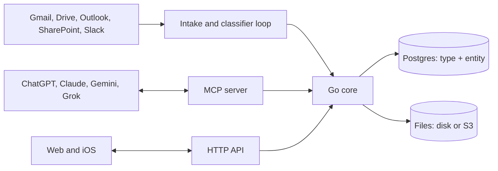

# ADR 0001: Archive architecture

- Status: Proposed
- Date: 2026-10-27
- Deciders: Marijn Brussel

## Summary

Archive is one Go binary on top of Postgres, with file bytes on disk or in S3. It stores everything as typed JSON entities, and exposes them over MCP so any AI app can read and write them. Agents do the work of getting data in and keeping it clean.

## Stack

- **Postgres 18** for all data, **Go** for the server, **a directory or S3** for file bytes.
- **One Dockerfile**: the image holds Postgres and the binary. The binary starts Postgres, creates the tables, and serves the API and MCP on one port. One `/data` volume holds everything.
- **Clients**: web and iOS clients will be rebuilt on the HTTP API; none ship today.

## Data model

Tables are named in the singular. Every id is a UUIDv7.

| Table | Holds |
|---|---|
| `type` | Type definitions: fields, field types, descriptions |
| `entity` | `id`, `type`, `space`, `data` (JSONB), `proposed`, `created_at`, `updated_at` |
| `file` | Metadata and extracted text for file entities; bytes live in the blob store |
| `source` | Connector config, schedule and sync state |
| `view` | Saved queries over entities: table, board or calendar, with a filter |
| `secret` | Encrypted values of secret fields |
| `user`, `space`, `token` | Who can see and change what |

Everything the user cares about is an entity: a house, a document, an email, a file. One GIN index covers JSONB queries and one full-text index covers search.

- **Built-in types**: money, phone, email, IBAN, date and the other common formats ship as a library, each with a validator and a normalizer, so the same thing is stored the same way whatever source it came from.
- **Validation**: every write is checked against its type in Go, on every surface.
- **Schema changes**: editing a type updates its row. Existing entities are not touched; if they need reshaping, an agent writes a migration and runs it through the `code` tool.

## MCP and API

The MCP server and the HTTP API call the same core functions.

| Tool | What it does |
|---|---|
| `types` | List types and their schemas |
| `define` | Create or change a type |
| `list` | List entities of a type, filtered by field |
| `get` | Read one entity |
| `search` | Full-text search over all entities |
| `create`, `update`, `delete` | Write entities, validated against the type |
| `code` | Run SQL against the database, for queries and migrations |
| `skills` | Fetch a skill from the skill library |

The API is the same set of verbs as REST under `/api`. Every request carries a user's session or token; remote MCP for app stores adds OAuth on top.

## Agent workflows

- **Intake and classifier loop**: a raw input (email, file, message) is classified into a type, extracted against that type's schema by an LLM, validated, and saved. Low-confidence results are saved with `proposed` set, so they stay out of normal lists until a person approves (clears the flag) or rejects (deletes) them.
- **Jev classifier**: a small model that picks the type for an input, so the expensive LLM only runs extraction.
- **Dataset preparation and training**: reviewed entities become labelled examples; Archive exports them per type and retrains Jev.
- **Skill library**: reusable agent instructions stored as entities of type `skill` and served over MCP.

LLMs are reached over one OpenAI-compatible endpoint.

## Connectors

Connectors pull from a platform and hand each item to the intake loop.

- **Google**: Gmail, Drive
- **Microsoft**: Outlook, SharePoint
- **Slack**

An email becomes an `email` entity with subject, body and attachments; each attachment becomes a `file` entity.

## Apps

Archive is listed in ChatGPT, Claude, Gemini and Grok as one remote MCP server. The apps read and write the user's entities through it.

## Users and permissions

- **Spaces**: every user gets a private space, and shared spaces can be made for a household or a team. Every entity belongs to one space.
- **Roles are Postgres roles**: users, space roles (`owner`, `admin`, `editor`, `viewer`) and tokens are real Postgres roles, and row-level security filters every query. A bug in one surface cannot leak another user's data, and plain SQL gets the same access as the app.
- **Tokens** belong to a user and can only narrow that user's rights. Agents get their own tokens.
- **Sign-in**: email magic links, passkeys, and Google or Microsoft sign-in.
- **Secret fields**: values of secret types such as `iban` or `us_ssn` are encrypted in the `secret` table and hidden from anyone not granted that type.

## Files

File bytes are content-addressed by SHA-256 in the `/data` volume or in S3. Uploads are resumable (tus). On upload, Archive pulls metadata, makes thumbnails and extracts text, so files are searchable and can go through the intake loop.

## Deployment

`install.sh` pulls the image and runs it with one volume on port 8080. The same image runs on any cloud; a Helm chart covers Kubernetes, and Terraform modules for AWS, GCP and Azure swap the bundled Postgres for the managed one. The `archive` Terraform provider manages types, sources, views, tokens and access rules as code.

## Not doing

These were in the earlier design and are cut to keep Archive small: raw, provenance, links, changes and proposals tables; spec versions and change review; confidence calibration; embeddings; IMAP and the external connector protocol. Any of them can come back when a real user needs it.
