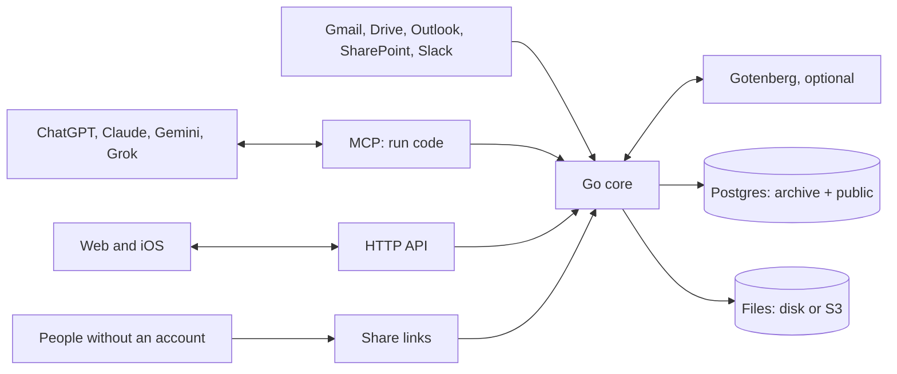

# ADR 0001: Archive architecture

- Status: Proposed
- Date: 2026-10-27
- Deciders: Marijn Brussel

## Summary

Archive is one Go binary on top of Postgres, with file bytes on disk or in S3. It stores each type as a real Postgres table, described by plain DDL files, and exposes them over MCP so any AI app can read and write them. Agents do the work of getting data in and keeping it clean, by writing code against Archive's SDK; Archive itself calls no LLM.



## Stack

- **Postgres 18** for all data, **Go** for the server, **a directory or S3** for file bytes.
- **One Dockerfile**: the image holds Postgres and the binary. The binary starts Postgres, brings Archive's own schema in line with `archive.sql`, and serves the API and MCP on one port. One `/data` volume holds everything.
- **Clients**: web and iOS clients will be rebuilt on the HTTP API; none ship today.
- **Gotenberg**, optional: a second container that renders office documents to PDF (see Documents).

## Data model

Two Postgres schemas. Tables are named in the singular, and every id is a UUIDv7.

| Schema | Holds |
|---|---|
| `archive` | Archive's own tables (`space`, `user`, `token`, `file`, `file_version`, `share`, `view`, `secret`) and the built-in types as domains and composite types (`archive.email`, `archive.iban`, `archive.money`) |
| `public` | One table per type. The table is the type and a row is the entity |

There is no `type` or `entity` table: Postgres already is that. Archive reads types, columns, foreign keys and `COMMENT ON` descriptions from the catalog.

Every type table carries the same columns and lines, written out in its DDL file, and a plan without them is rejected:

```sql
CREATE TABLE house (
  id         uuid PRIMARY KEY DEFAULT uuidv7(),
  space      uuid NOT NULL REFERENCES archive.space,
  created_at timestamptz NOT NULL DEFAULT now(),
  updated_at timestamptz NOT NULL DEFAULT now(),
  address    text NOT NULL,
  price      archive.money,
  owner      uuid REFERENCES person,
  search     tsvector GENERATED ALWAYS AS (to_tsvector('simple', coalesce(address, ''))) STORED
);
CREATE INDEX house_search ON house USING gin (search);
ALTER TABLE house ENABLE ROW LEVEL SECURITY;
ALTER TABLE house FORCE ROW LEVEL SECURITY;
CREATE POLICY member ON house USING (space = ANY (archive.my_spaces()));
COMMENT ON TABLE house IS 'A house you own or rent';
```

- **Built-in types**: Postgres enforces their format through domains; a Go normalizer per domain cleans messy input first, so the same thing is stored the same way whatever source it came from.
- **References** are foreign keys to the target table. **Lists** are arrays. There is no type inheritance.
- **Across tables**: search and "everything in a space" are a `UNION ALL` over the `public` tables that Archive generates from the catalog.

## Schema changes

The schema is declarative and DDL only, with no migrations folder. Archive ships `archive.sql`; the user's types live only in the database. `archive schema pull` and `archive.schema()` generate DDL from it on demand, one `<table>.sql` per table, by planning with pg-schema-diff from an empty database to the live one; `archive schema apply <dir>` and `archive.apply(files)` take the whole desired set back, so the files can be kept in a git repo. Nothing but the DDL itself is stored, and `apply(schema())` plans nothing.

1. **Plan**: [pg-schema-diff](https://github.com/dilame/pg-schema-diff) (the dilame fork, pinned in `go.mod`, since upstream lacks domains) compares the files with the live database and returns the statements to run, each with its hazards.
2. **Apply**: statements run with lock timeouts, indexes are built concurrently and foreign keys are added `NOT VALID` and then validated. A statement that deletes data is blocked unless the caller explicitly allows it.
3. **Renames** are not detected by the diff, so they are passed explicitly: `archive.apply(files, { renames: ["ALTER TABLE house RENAME COLUMN city TO town"] })` runs them first, in the same transaction, then plans the edited files, so no data is lost.

Archive's own schema goes through the same plan when `archive.sql` changed since the last apply, with the user's tables generated from the database, and is never allowed to delete data.

## Code mode

Agents get one MCP tool, `run`, which takes a TypeScript script and runs it inside Archive. Code is cheaper and more capable than many small tool calls: one script can query, loop, transform and write in a single turn.

- **Runtime**: esbuild strips the types and goja runs the JavaScript, both in the Go binary. No file or network access beyond the SDK; a timeout and caps on result and log size.
- **As the user**: the script runs as the calling user's Postgres role, so row-level security applies, and as one transaction, so a script that throws changes nothing.
- **SDK**: `archive.sql`, `list`, `get`, `create`, `update`, `delete`, `search`, `schema`, `apply` and `file`, the same operations as the HTTP API. Writes clean input by domain in Go before Postgres checks it.
- **Documentation**: the tool's description is the SDK's `.d.ts`, plus an interface per table generated from the catalog, so agents write against the real schema.

The same SDK runs from `POST /api/run` and `archive run script.ts`. The HTTP API offers the same operations as REST under `/api`. Every request carries a user's session or token; remote MCP for app stores adds OAuth on top.

## Agent workflows

These run in the agent, as code against the SDK, not inside Archive.

- **Intake and classification**: the agent reads new files and emails, decides their type, and writes rows.
- **Jev classifier**: a small model agents can use to pick the type for an input.
- **Dataset preparation and training**: rows become labelled examples, exported per table, to retrain Jev.
- **Skill library**: reusable agent instructions stored as rows of a `skill` table.

## Connectors

Connectors pull from a platform on a schedule and store each item as a file; agents turn them into rows.

- **Google**: Gmail, Drive
- **Microsoft**: Outlook, SharePoint
- **Slack**

An email is stored as an `.eml` file and each attachment as its own file.

## Apps

Archive is listed in ChatGPT, Claude, Gemini and Grok as one remote MCP server. The apps read and write the user's entities through it.

## Users and permissions

- **Spaces**: every user gets a private space, and shared spaces can be made for a household or a team. Every row belongs to one space.
- **Roles are Postgres roles**: users, space roles (`owner`, `admin`, `editor`, `viewer`) and tokens are real Postgres roles, and row-level security filters every query. A bug in one surface cannot leak another user's data, and plain SQL gets the same access as the app.
- **Tokens** belong to a user and can only narrow that user's rights. Agents get their own tokens.
- **Sign-in**: email magic links, passkeys, and Google or Microsoft sign-in.
- **Secret fields**: values of secret types such as `iban` or `us_ssn` are encrypted in the `secret` table and hidden from anyone not granted that type.

## Files

File bytes are content-addressed by SHA-256 in the `/data` volume or in S3. Uploads are resumable (tus). On upload, Archive pulls metadata, makes thumbnails and extracts the text of PDFs and HTML, so files are searchable and agents can read them.

- **Versions**: a file is a name, a space and its current bytes. Every save adds a row to `archive.file_version` (file, hash, size, saved by, saved at) and points `file.hash` at the new bytes. Old bytes stay, so any version can be opened or restored, and a save that changes nothing costs nothing.
- **Text and previews follow the current version**: each save extracts the text and makes the thumbnail again.

## Documents

Archive's own web and iOS apps are the editors; there is no embedded office suite. Every document is a file in a standard format: Markdown or plain text, docx, xlsx or pptx. There is no Archive-specific document format, so a document can always be downloaded and opened anywhere.

- **New documents** are made as an empty docx, xlsx or pptx (or a Markdown file) and are files like any other: they live in a space, have versions and can be shared.
- **Edits splice bytes; nothing is rebuilt.** docx, xlsx and pptx are zips of XML parts. One small Archive package, using only Go's standard library, edits all three:
  1. Parts an edit does not touch are copied raw with `zip.Writer.Copy`, so they stay byte-identical.
  2. For the part an edit does touch, `encoding/xml`'s decoder records the byte range of every paragraph, run, table, cell and shape.
  3. An edit replaces one byte range with a small new fragment, or inserts one, written with the prefixes the part already declares. Everything around it stays as it was, including namespaces, revision ids and extensions Archive has never heard of. The part is never re-encoded.
  4. The part is parsed again after the edit, to check it is still well-formed.
- **Markdown and text** are edited as text.
- **The model** Archive exposes is built from that index: paragraphs, runs, tables and comments for docx; sheets, cells and formulas for xlsx; slides, shapes and their text for pptx. Edits outside it are not possible, by design.
- **Text across runs**: Word splits a sentence into many runs. Replacing text finds it across runs and rewrites only those runs, keeping the first run's formatting. This is the core of the package.
- **Formulas without an engine**: a cell value is written as an inline string, so the shared strings are never touched. A formula is written with its cached value removed, and every xlsx edit marks the workbook to recalculate when it is opened, since any changed value can make other formulas stale. LibreOffice ignores that flag, so the render pass strips cached values from its own copy; the computed values it produces are stored as derived data, never written into the file.
- **Legacy and ODF files** (doc, xls, ppt, odt, ods, odp) are converted to OOXML once, on request, as a new file.

**One edit API for everyone**: `archive.read(id)` returns the model, and `archive.edit(id, edits)` applies a list of edits all or nothing: replace text, insert or delete a paragraph, set a table cell, set a cell, value or formula, append a row to an Excel table, replace a shape's text. Paragraph ids are positions in the version that was read; within one `edit` call they keep pointing at the paragraphs as read, even after inserts and deletes. Agents call them from code mode; the apps send the same edits over the API. `archive.file(id)` stays for metadata and plain text.

**Editing together**: clients send edits to the server, which applies them in order to the current file and sends them on to everyone else with the document open. The server's order decides conflicts, and it writes a new version when editing pauses. This needs no CRDT and no second copy of the document, at the cost of offline editing.

**Rendering**: Gotenberg (MIT), a Go service around LibreOffice, turns a docx, xlsx or pptx into a PDF once per version, and computes the values of formulas. Previews, page images and thumbnails come from that PDF; search text comes from Archive's own parsing. The rule: Archive writes only the bytes it changes, and LibreOffice only makes derived output. Gotenberg is an optional container in `compose.yaml` and the Helm chart, set with `ARCHIVE_GOTENBERG_URL`; without it, documents have no previews, but can still be edited and searched. LibreOffice is used to render and to convert legacy files, never to save users' files, since its OOXML output can lose Word-only features.

**Not chosen**:
- An Archive-specific document format (for example ProseMirror JSON with Yjs): it would make every download a conversion, and Office files a second kind of document.
- Collabora and ONLYOFFICE: their value is the editor UI, which Archive does not use, and running them in a closed SaaS needs paid editions.
- ONLYOFFICE Document Builder: AGPL or a paid edition.
- Office libraries (excelize, go-docx, unioffice): they load a document into their own structures and write it back out, which loses what they do not model, and some are AGPL or commercial. A formula engine (excelize's, IronCalc) is not needed while LibreOffice computes values for reading.
- Aspose: faithful but commercial; it stays the option for customers whose complex files need more than patching.

Slides are the weakest area: no good open-source pptx engine exists, so pptx edits start with text, and new slide layouts come later.

## Sharing

A user can share a file with people who have no Archive account, through a link. Shares are rows, not signed URLs, so they can be listed and revoked and their use is visible.

```
archive.share: id, file, token_hash, access (view | download), emails, password_hash,
               expires_at, revoked_at, created_by, created_at, last_used_at, uses
```

- **The link** is `/s/<token>`, with 32 random bytes as the token; Archive stores only its hash. It opens a public page that previews the file (the PDF rendition for docx, xlsx and pptx, the browser for PDFs, images and text), with a download button when access is `download`.
- **Who can open it**: anyone with the link, optionally behind a password; or only the listed email addresses, which get a one-time code by email, sent the same way as sign-in links. A share can expire and can be revoked at any time.
- **The current version**: a share points at the file, so it always shows the latest version. GPS data is removed from shared photos.
- **Who can share**: editors of the file's space. Owners and admins of the space see and revoke every share in it.
- **Access**: the share page reads through a system role that can see only the shared file, never anything else in the space.
- **Surfaces**: `archive.share(fileId, { access, emails, password, expires })` returns the link, `archive.shares()` lists them and `archive.unshare(id)` revokes one; the same as `/api/files/{id}/shares` and `archive share` on the command line.

Short signed links stay for the app's own downloads, such as image previews; anything handed to another person is a share. Guests editing through a share, and sharing a folder or a collection of files, come later.

## Deployment

`install.sh` pulls the image and runs it with one volume on port 8080, with Gotenberg as an optional second container. The same image runs on any cloud; a Helm chart covers Kubernetes, and Terraform modules for AWS, GCP and Azure swap the bundled Postgres for the managed one. The `archive` Terraform provider manages the schema DDL, views, tokens and access rules as code.

## Not doing

These were in the earlier design and are cut to keep Archive small: raw, provenance, links, changes, proposals, type and entity tables; JSONB records; spec versions and change review; type inheritance; built-in LLM calls, intake, confidence scoring and the review queue; OCR and transcription; confidence calibration; embeddings; IMAP and the external connector protocol. Any of them can come back when a real user needs it.
