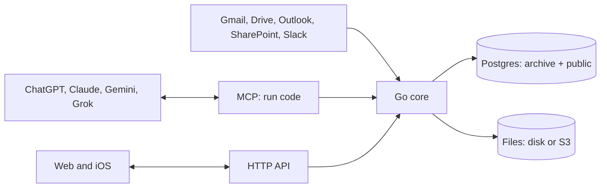

# ADR 0001: Archive architecture

- Status: Proposed
- Date: 2026-10-27
- Deciders: Marijn Brussel

## Summary

Archive is one Go binary on top of Postgres, with file bytes on disk or in S3. It stores each type as a real Postgres table, described by plain DDL files, and exposes them over MCP so any AI app can read and write them. Agents do the work of getting data in and keeping it clean, by writing code against Archive's SDK; Archive itself calls no LLM.



## Stack

- **Postgres 18** for all data, **Go** for the server, **a directory or S3** for file bytes.
- **One Dockerfile**: the image holds Postgres and the binary. The binary starts Postgres, brings the schema in line with the DDL, and serves the API and MCP on one port. One `/data` volume holds everything.
- **Clients**: web and iOS clients will be rebuilt on the HTTP API; none ship today.

## Data model

Two Postgres schemas. Tables are named in the singular, and every id is a UUIDv7.

| Schema | Holds |
|---|---|
| `archive` | Archive's own tables (`space`, `user`, `token`, `file`, `source`, `view`, `secret`) and the built-in types as domains and composite types (`archive.email`, `archive.iban`, `archive.money`) |
| `public` | One table per type. The table is the type and a row is the entity |

There is no `type` or `entity` table: Postgres already is that. Archive reads types, columns, foreign keys and `COMMENT ON` descriptions from the catalog.

Every type table carries the same columns and lines, written out in its DDL file, and a plan without them is rejected:

```sql
CREATE TABLE house (
  id         uuid PRIMARY KEY DEFAULT uuidv7(),
  space      uuid NOT NULL REFERENCES archive.space,
  created_at timestamptz NOT NULL DEFAULT now(),
  updated_at timestamptz NOT NULL DEFAULT now(),
  address    text NOT NULL,
  price      archive.money,
  owner      uuid REFERENCES person,
  search     tsvector GENERATED ALWAYS AS (to_tsvector('simple', coalesce(address, ''))) STORED
);
CREATE INDEX house_search ON house USING gin (search);
ALTER TABLE house ENABLE ROW LEVEL SECURITY;
ALTER TABLE house FORCE ROW LEVEL SECURITY;
CREATE POLICY member ON house USING (space = ANY (archive.my_spaces()));
COMMENT ON TABLE house IS 'A house you own or rent';
```

- **Built-in types**: Postgres enforces their format through domains; a Go normalizer per domain cleans messy input first, so the same thing is stored the same way whatever source it came from.
- **References** are foreign keys to the target table. **Lists** are arrays. There is no type inheritance.
- **Across tables**: search and "everything in a space" are a `UNION ALL` over the `public` tables that Archive generates from the catalog.

## Schema changes

The schema is declarative and DDL only, with no migrations folder. Archive ships `archive.sql`; the user's types are `*.sql` files in `/data/schema`, synced with a git repo through `archive schema pull` and `push`.

1. **Plan**: [pg-schema-diff](https://github.com/dilame/pg-schema-diff) (the dilame fork, pinned in `go.mod`, since upstream lacks domains) compares the files with the live database and returns the statements to run, each with its hazards.
2. **Apply**: statements run with lock timeouts, indexes are built concurrently and foreign keys are added `NOT VALID` and then validated. A statement that deletes data is blocked unless the caller explicitly allows it.
3. **Renames** are not detected by the diff, so they are passed explicitly: `archive.apply(files, { renames: ["ALTER TABLE house RENAME COLUMN city TO town"] })` runs them first, in the same transaction, then plans the edited files, so no data is lost.

Archive's own schema goes through the same plan on every start, and is never allowed to delete data.

## Code mode

Agents get one MCP tool, `run`, which takes a TypeScript script and runs it inside Archive. Code is cheaper and more capable than many small tool calls: one script can query, loop, transform and write in a single turn.

- **Runtime**: esbuild strips the types and goja runs the JavaScript, both in the Go binary. No file or network access beyond the SDK; a timeout and caps on result and log size.
- **As the user**: the script runs as the calling user's Postgres role, so row-level security applies, and as one transaction, so a script that throws changes nothing.
- **SDK**: `archive.sql`, `list`, `get`, `create`, `update`, `delete`, `search`, `schema`, `apply` and `file`, the same operations as the HTTP API. Writes clean input by domain in Go before Postgres checks it.
- **Documentation**: the tool's description is the SDK's `.d.ts`, plus an interface per table generated from the catalog, so agents write against the real schema.

The same SDK runs from `POST /api/run` and `archive run script.ts`. The HTTP API offers the same operations as REST under `/api`. Every request carries a user's session or token; remote MCP for app stores adds OAuth on top.

## Agent workflows

These run in the agent, as code against the SDK, not inside Archive.

- **Intake and classification**: the agent reads new files and emails, decides their type, and writes rows.
- **Jev classifier**: a small model agents can use to pick the type for an input.
- **Dataset preparation and training**: rows become labelled examples, exported per table, to retrain Jev.
- **Skill library**: reusable agent instructions stored as rows of a `skill` table.

## Connectors

Connectors pull from a platform on a schedule and store each item as a file; agents turn them into rows.

- **Google**: Gmail, Drive
- **Microsoft**: Outlook, SharePoint
- **Slack**

An email is stored as an `.eml` file and each attachment as its own file.

## Apps

Archive is listed in ChatGPT, Claude, Gemini and Grok as one remote MCP server. The apps read and write the user's entities through it.

## Users and permissions

- **Spaces**: every user gets a private space, and shared spaces can be made for a household or a team. Every row belongs to one space.
- **Roles are Postgres roles**: users, space roles (`owner`, `admin`, `editor`, `viewer`) and tokens are real Postgres roles, and row-level security filters every query. A bug in one surface cannot leak another user's data, and plain SQL gets the same access as the app.
- **Tokens** belong to a user and can only narrow that user's rights. Agents get their own tokens.
- **Sign-in**: email magic links, passkeys, and Google or Microsoft sign-in.
- **Secret fields**: values of secret types such as `iban` or `us_ssn` are encrypted in the `secret` table and hidden from anyone not granted that type.

## Files

File bytes are content-addressed by SHA-256 in the `/data` volume or in S3. Uploads are resumable (tus). On upload, Archive pulls metadata, makes thumbnails and extracts the text of PDFs, HTML and email, so files are searchable and agents can read them.

## Deployment

`install.sh` pulls the image and runs it with one volume on port 8080. The same image runs on any cloud; a Helm chart covers Kubernetes, and Terraform modules for AWS, GCP and Azure swap the bundled Postgres for the managed one. The `archive` Terraform provider manages the schema DDL, sources, views, tokens and access rules as code.

## Not doing

These were in the earlier design and are cut to keep Archive small: raw, provenance, links, changes, proposals, type and entity tables; JSONB records; spec versions and change review; type inheritance; built-in LLM calls, intake, confidence scoring and the review queue; OCR and transcription; confidence calibration; embeddings; IMAP and the external connector protocol. Any of them can come back when a real user needs it.
