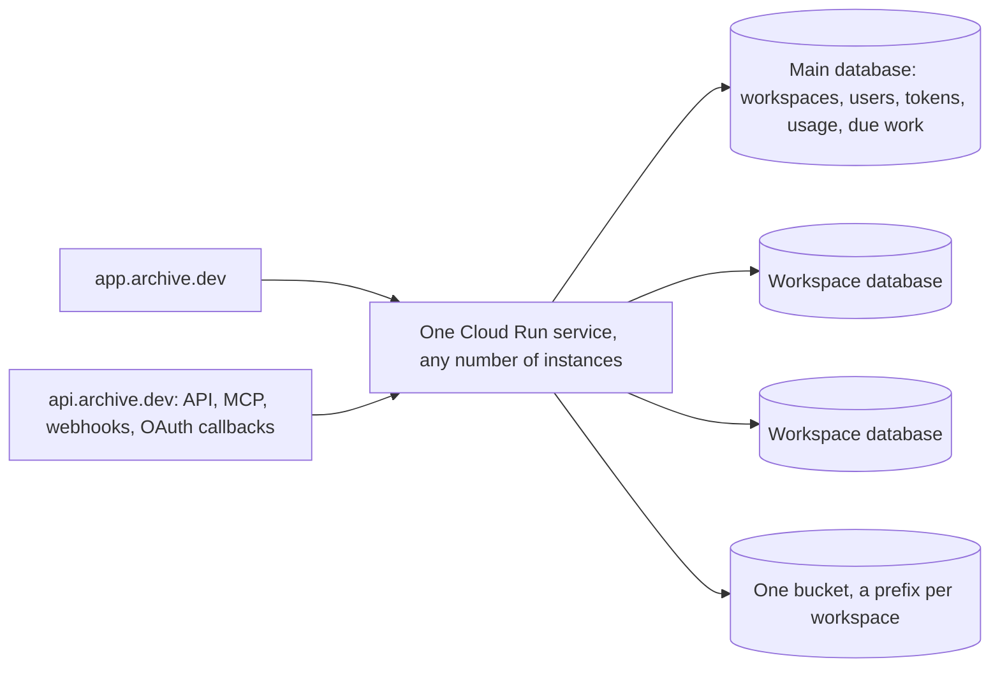

# ADR 0003: Hosting app.archive.dev

- Status: Accepted
- Date: 2026-10-30
- Deciders: Marijn Brussel

## Summary

app.archive.dev is Archive hosted by Mulholland, with self-serve signup. It runs the same image from the same open repo as every self-hosted Archive. There is no private repo, no hosted build and no mode switch. What makes it the hosted version is its environment variables (the API keys filled in, Stripe, its two domains) and rows in its database (workspaces, plans, the signup setting).

To get there, Archive serves many workspaces by default. A workspace is one customer's Archive: its own Postgres database, holding its tables, spaces, files and workflows. People are not per workspace: each has one identity, which can belong to several workspaces. A self-hosted install is the same code with one workspace.

## Workspaces

- **A database per workspace.** Each workspace's types are its own tables with their own columns, policies and schema changes (ADR 0001), so workspaces cannot share tables with a `workspace_id` column. Every workspace gets its own database on the same Postgres server: the bundled one, or Cloud SQL.
- **Roles are prefixed per workspace.** Postgres roles are server-wide, so each workspace's roles carry its own prefix.
- **The main database** is the one `DATABASE_URL` (or the bundled Postgres) points to. It is also the first workspace's database. In its `archive` schema it adds:

| Table | Holds |
|---|---|
| `archive.workspace` | id, name, database, role prefix, data key (encrypted with `ARCHIVE_SECRET_KEY`), plan, created_at |
| `archive.user` | every person once: email, name, passkeys and OIDC links, and the workspaces they belong to (`workspaces uuid[]`, GIN-indexed) |
| `archive.token` | sessions, sign-in links and API tokens, by hash; an API token also names its one workspace |
| `archive.usage` | per workspace and day: runs, workflow runs, AI tokens, stored bytes |
| `archive.due` | the next time each workspace has background work |
| `archive.setting` | instance settings, such as whether signup is open |

- **Each workspace has its own data key**, wrapped by `ARCHIVE_SECRET_KEY`, for its secret fields and file links.
- **Files** go to the same blob store under a prefix per workspace.

## Hosts

- **app.archive.dev** serves the web app and sign-in.
- **api.archive.dev** serves the HTTP API, MCP, workflow webhooks, the Stripe webhook, and every OAuth redirect URL: connectors (ADR 0002) and sign-in with Google and Microsoft. These are the URLs registered and approved with each vendor, so they never change and don't depend on the workspace.
- `ARCHIVE_URL` is the app's address. A new `ARCHIVE_API_URL` is the API's, and defaults to `ARCHIVE_URL`, so a self-hosted install keeps using one host for everything.
- Both hosts point at the same Cloud Run service. No subdomain per workspace, no wildcard certificates.

## Finding the workspace

Without subdomains, every request names its workspace, and secrets stay plain `arc_<secret>`:

- **Every secret is checked in the main database**, by one indexed lookup of its hash in `archive.token`. An API or agent token belongs to a user and one workspace, so it names that workspace itself, and a request naming another is refused.
- **The web app** holds one session for the person, in its cookie, and names the current workspace on each request in `Archive-Workspace`, the way it already names the current space; the server checks that the person belongs to it. The space switcher is a workspace and space switcher, and "Add workspace" creates a new one.
- **Sign-in** looks the person up in `archive.user`: by email for a magic link or OIDC, by user id for a passkey. One link, one passkey per device and one session reach all their workspaces.
- **Webhook URLs** carry it: `api.archive.dev/hooks/run/<workspace>/<token>`.
- **OAuth callbacks** carry it in `state`, so one fixed callback URL serves every workspace.

## Serving many workspaces

- **Open on first use.** An instance opens a workspace (its connection pool, table list and data key) on its first request, and closes it after it has been idle for a while. Pools are small. PgBouncer in front of Cloud SQL keeps the total number of connections bounded. Schema changes take a session-level advisory lock, so they connect to Postgres directly, not through PgBouncer.
- **Schema upgrades.** After a deploy, an instance upgrades the main database first. Each workspace is upgraded when it is next opened, under the existing advisory lock and revision check. A background pass upgrades idle workspaces, so first requests rarely wait.
- **Background work from one queue.** Workflows (schedules and table triggers) and pending files write their next due time to `archive.due`. Instances claim due rows with `FOR UPDATE SKIP LOCKED`, open that workspace and do the work. No instance polls every workspace. Table triggers are checked only in workspaces that have them, backing off while their tables are quiet.
- **Limits per workspace**: concurrent runs, open connections and memory, so one busy workspace cannot starve the others on a shared instance.

## Signup and billing

- **Signup** is an instance setting in `archive.setting`, off by default. An instance admin turns it on. On app.archive.dev it is on. Signing up creates the database, applies the schema, adds the `archive.workspace` row and makes the person its owner, adding the workspace to their `archive.user` row.
- **Admins can also create workspaces** for other people, which is how a self-hosted install hosts several organizations without opening signup.
- **Billing** works when `ARCHIVE_STRIPE_KEY` is set, like SMTP works when `ARCHIVE_SMTP_URL` is. Plans and their limits are rows. Stripe Checkout starts a subscription, and Stripe's webhook at `api.archive.dev/stripe` updates the workspace's plan. Without a key, workspaces have no limits.
- **AI usage** is counted in `archive.usage`: the chat agent records the tokens of every reply. The shared `ANTHROPIC_API_KEY` serves every workspace. A workspace can bring its own key in a setting.

## Infrastructure

`apps/terraform/gcp` deploys app.archive.dev exactly as it deploys anyone's Archive: one Cloud Run service with both domains mapped, Cloud SQL with PgBouncer, a bucket, and the secrets as environment variables. Mulholland's values (domains, keys, Stripe) are Terraform variables, not code.

## How it was built

Built as decided; [ADR 0001](0001-architecture.md#workspaces) describes the result. Where the build differs from the above, or chose where it was silent:

- **One `archive.sql` for every database.** The instance tables are part of Archive's schema, so they exist, empty, in every workspace's database too; only the main database's are used. One schema keeps one revision hash and one upgrade path.
- **More instance tables.** Plans are rows of `archive.plan` (Stripe price, monthly runs, workflow runs, AI tokens, stored bytes, concurrent runs; null is no limit), and the `plan` setting is the plan new workspaces start on. `archive.workspace` also holds a short id, the blob prefix, the Stripe customer and subscription, and the workspace's own Anthropic key, sealed with its data key.
- **A short workspace id.** URLs and the `Archive-Workspace` header carry an 8-character id (`a`-`z` and `2`-`9`) rather than the UUID. Every workspace gets the role prefix `w<id>`, the blob prefix `<id>/` and its own data key; new workspaces get the database `archive_<id>`, and workspace one lives in the main database.
- **Both hosts answer every route.** The server does not look at the host. The URLs it hands out use the right one: sign-in links `ARCHIVE_URL`; webhooks, file links, the Stripe webhook and OIDC redirects `ARCHIVE_API_URL`. The web app on app.archive.dev calls `/api` on its own host, so its cookie stays first-party.
- **One identity per person.** `archive.user` and `archive.token` live in the main database only; a workspace database keeps its data and the Postgres roles row-level security needs, and its rows refer to people by their global user id, with no foreign key across databases. Adding someone to a workspace adds it to their `workspaces` and creates their role (`w<id>_u_<user>`) and personal space there once; removing them drops that role and their tokens, chats and workflows there, and keeps the personal space for when they come back. A session works in every workspace the person is in, and the server picks the first one when a request names none. The sign-in screen never tells anyone which workspaces an email belongs to. OIDC's callback on the API host redirects to `ARCHIVE_URL/auth/oidc/done` with a one-time link that only works in the browser that started (a cookie bound into the encrypted `state`). A passkey's user handle is the user id.
- **Instance admins** are the admins of workspace one.
- **Limits per workspace** are concurrent runs (8, or the plan's), and small pools that close when idle. Memory is not limited per workspace. Plan limits count the calendar month, not the Stripe billing period. A workspace with no plan, like workspace one, has no limits; AI tokens on a workspace's own key are counted but not limited.
- **The pooler** is Cloud SQL's managed connection pooling, which the Google provider supports, rather than PgBouncer: PgBouncer would need every workspace's authenticator password. It needs Enterprise Plus and a private network, so it is the module's `connection_pooling` variable, off by default. `DATABASE_DIRECT_URL` is the direct connection for schema changes and creating databases, and Archive sets each database's default `search_path` and `timezone` so the pooler can ignore those startup parameters.
- **Workspace one stays open** in every instance; other workspaces close after 10 idle minutes.

## Not doing

- A private repo, a hosted build, or code that only runs on app.archive.dev.
- Feature flags or modes: a single-workspace install is the same code with one row.
- Shared tables with a `workspace_id` column.
- A Cloud Run service, database server or subdomain per workspace.
- A proxy for AI usage: usage is counted where the calls are made.

## Open questions

- **Serving the web app.** The image serves the API and sign-in but not `apps/web`, which app.archive.dev also needs, from the image or a static host on the same domain.
- **Billing in the web app.** Plans, checkout, settings and admin are API and CLI only so far; there is no Stripe customer portal link.

- **License.** The repo has no LICENSE yet. AGPL-3.0 makes anyone offering Archive as a service publish their changes. FSL forbids competing hosted offerings for two years, after which each release becomes Apache 2.0.
- **MCP sign-in for AI apps.** Claude and ChatGPT connect MCP servers through OAuth. api.archive.dev would need to be an OAuth authorization server, and the person would pick a workspace while approving.
- **Deleting and exporting a workspace**: drop its database and blob prefix, and offer a `pg_dump` plus files first.
