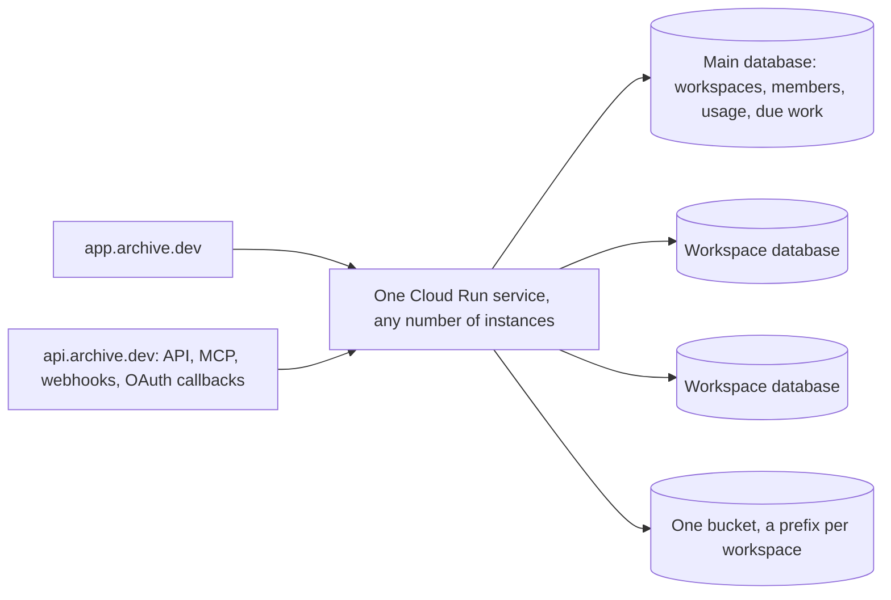

# ADR 0003: Hosting app.archive.dev

- Status: Proposed
- Date: 2026-10-30
- Deciders: Marijn Brussel

## Summary

app.archive.dev is Archive hosted by Mulholland, with self-serve signup. It runs the same image from the same open repo as every self-hosted Archive. There is no private repo, no hosted build and no mode switch. What makes it the hosted version is its environment variables (the API keys filled in, Stripe, its two domains) and rows in its database (workspaces, plans, the signup setting).

To get there, Archive serves many workspaces by default. A workspace is one customer's Archive: its own Postgres database, holding its tables, users, spaces, files and workflows. A self-hosted install is the same code with one workspace.

## Workspaces

- **A database per workspace.** Each workspace's types are its own tables with their own columns, policies and schema changes (ADR 0001), so workspaces cannot share tables with a `workspace_id` column. Every workspace gets its own database on the same Postgres server: the bundled one, or Cloud SQL.
- **Roles are prefixed per workspace.** Postgres roles are server-wide, so each workspace's roles carry its own prefix, as `ARCHIVE_INSTANCE` does today.
- **The main database** is the one `DATABASE_URL` (or the bundled Postgres) points to. It is also the first workspace's database, so an existing install becomes workspace one in place, with nothing copied. In its `archive` schema it adds:

| Table | Holds |
|---|---|
| `archive.workspace` | id, name, database, role prefix, data key (encrypted with `ARCHIVE_SECRET_KEY`), plan, created_at |
| `archive.member` | email and workspace, kept in step with each workspace's users, so sign-in can find someone's workspaces |
| `archive.usage` | per workspace and day: runs, workflow runs, AI tokens, stored bytes |
| `archive.due` | the next time each workspace has background work |
| `archive.setting` | instance settings, such as whether signup is open |

- **Each workspace has its own data key**, wrapped by `ARCHIVE_SECRET_KEY`, for its secret fields and sign-in secrets.
- **Files** go to the same blob store under a prefix per workspace.

## Hosts

- **app.archive.dev** serves the web app and sign-in.
- **api.archive.dev** serves the HTTP API, MCP, workflow webhooks, the Stripe webhook, and every OAuth redirect URL: connectors (ADR 0002) and sign-in with Google and Microsoft. These are the URLs registered and approved with each vendor, so they never change and don't depend on the workspace.
- `ARCHIVE_URL` is the app's address. A new `ARCHIVE_API_URL` is the API's, and defaults to `ARCHIVE_URL`, so a self-hosted install keeps using one host for everything.
- Both hosts point at the same Cloud Run service. No subdomain per workspace, no wildcard certificates.

## Finding the workspace

Without subdomains, every request names its workspace:

- **Tokens and sign-in secrets carry it**: `arc_<workspace>_<secret>`. The server opens that workspace and checks the secret there. Tokens in today's format, `arc_<secret>`, belong to workspace one, so existing tokens keep working.
- **The web app** holds one session per workspace the person is signed in to, in its cookie, and names the current one on each request, the way it already names the current space. The space switcher becomes a workspace and space switcher.
- **Sign-in** looks up the email in `archive.member`. With one workspace it signs in there. With several, the person picks one, and can add the others to the same browser.
- **Webhook URLs** carry it: `api.archive.dev/hooks/run/<workspace>/<token>`.
- **OAuth callbacks** carry it in `state`, so one fixed callback URL serves every workspace.

## Serving many workspaces

- **Open on first use.** An instance opens a workspace (its connection pool, table list and data key) on its first request, and closes it after it has been idle for a while. Pools are small. PgBouncer in front of Cloud SQL keeps the total number of connections bounded. Schema changes take a session-level advisory lock, so they connect to Postgres directly, not through PgBouncer.
- **Schema upgrades.** After a deploy, an instance upgrades the main database first. Each workspace is upgraded when it is next opened, under the existing advisory lock and revision check. A background pass upgrades idle workspaces, so first requests rarely wait.
- **Background work from one queue.** Workflows (schedules and table triggers) and pending files write their next due time to `archive.due`. Instances claim due rows with `FOR UPDATE SKIP LOCKED`, open that workspace and do the work. No instance polls every workspace. Table triggers are checked only in workspaces that have them, backing off while their tables are quiet.
- **Limits per workspace**: concurrent runs, open connections and memory, so one busy workspace cannot starve the others on a shared instance.

## Signup and billing

- **Signup** is an instance setting in `archive.setting`, off by default. An instance admin turns it on. On app.archive.dev it is on. Signing up creates the database, applies the schema, makes the person its owner and adds the `archive.workspace` and `archive.member` rows.
- **Admins can also create workspaces** for other people, which is how a self-hosted install hosts several organizations without opening signup.
- **Billing** works when `ARCHIVE_STRIPE_KEY` is set, like SMTP works when `ARCHIVE_SMTP_URL` is. Plans and their limits are rows. Stripe Checkout starts a subscription, and Stripe's webhook at `api.archive.dev/stripe` updates the workspace's plan. Without a key, workspaces have no limits.
- **AI usage** is counted in `archive.usage`: the chat agent records the tokens of every reply. The shared `ANTHROPIC_API_KEY` serves every workspace. A workspace can bring its own key in a setting.

## Infrastructure

`apps/terraform/gcp` deploys app.archive.dev exactly as it deploys anyone's Archive: one Cloud Run service with both domains mapped, Cloud SQL with PgBouncer, a bucket, and the secrets as environment variables. Mulholland's values (domains, keys, Stripe) are Terraform variables, not code.

## Not doing

- A private repo, a hosted build, or code that only runs on app.archive.dev.
- Feature flags or modes: a single-workspace install is the same code with one row.
- Shared tables with a `workspace_id` column.
- A Cloud Run service, database server or subdomain per workspace.
- A proxy for AI usage: usage is counted where the calls are made.

## Open questions

- **License.** The repo has no LICENSE yet. AGPL-3.0 makes anyone offering Archive as a service publish their changes. FSL forbids competing hosted offerings for two years, after which each release becomes Apache 2.0.
- **MCP sign-in for AI apps.** Claude and ChatGPT connect MCP servers through OAuth. api.archive.dev would need to be an OAuth authorization server, and the person would pick a workspace while approving.
- **Deleting and exporting a workspace**: drop its database and blob prefix, and offer a `pg_dump` plus files first.
