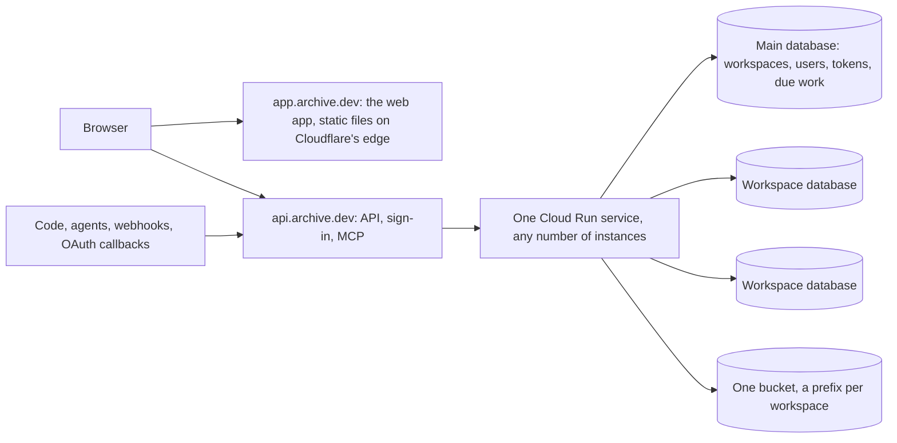

# ADR 0003: Hosting app.archive.dev

- Status: Accepted
- Date: 2026-10-30
- Deciders: Marijn Brussel

## Summary

app.archive.dev is Archive hosted by Mulholland. It runs the same image from the same open repo as every self-hosted Archive. There is no private repo, no hosted build and no mode switch. What makes it the hosted version is its environment variables (the API keys filled in, the sign-in providers, its two domains) and rows in its database (workspaces).

To get there, Archive serves many workspaces by default. A workspace is one customer's Archive: its own Postgres database, holding its tables, spaces, files and workflows. People are not per workspace: each has one identity, which can belong to several workspaces. A self-hosted install is the same code with one workspace.

## Workspaces

- **A database per workspace.** Each workspace's types are its own tables with their own columns, policies and schema changes (ADR 0001), so workspaces cannot share tables with a `workspace_id` column. Every workspace gets its own database on the same Postgres server: the bundled one, or Cloud SQL.
- **Roles are prefixed per workspace.** Postgres roles are server-wide, so each workspace's roles are prefixed by its id.
- **The main database** is the one `DATABASE_URL` (or the bundled Postgres) points to. It is also the first workspace's database. In its `archive` schema it adds:

| Table | Holds |
|---|---|
| `archive.workspace` | id (a UUIDv7), name, data key (encrypted with `ARCHIVE_SECRET_KEY`), its own Anthropic key, created_at |
| `archive.user` | every person once: email, name, passkeys and OIDC links, and the workspaces they belong to (`workspaces uuid[]`, GIN-indexed) |
| `archive.token` | sessions and API tokens, by hash; an API token also names its one workspace |
| `archive.due` | the next time each workspace has background work |

- **Each workspace has its own data key**, wrapped by `ARCHIVE_SECRET_KEY`, for its secret fields and file links.
- **Files** go to the same blob store under the prefix `<id>/`.

The workspace's id is a UUIDv7, used everywhere: its database is `archive_<id>`, its roles are prefixed `"<id>_"`, its blobs live under `<id>/`, and webhook and file-link URLs, the `-workspace` flag and the `Archive-Workspace` header all carry it. There is no separate short id. Every generated identifier is quoted.

### Why a database, not one schema per workspace

One shared database with a schema per workspace was tried, because it needs one connection pool instead of a pool per workspace, and an empty schema costs kilobytes of catalog rows where `CREATE DATABASE` copies a template of about 8 MB. It was dropped because it could not isolate tenants on our managed hosts:

- **No superuser.** On Cloud SQL and AlloyDB, Archive's database role has CREATEROLE, CREATEDB and LOGIN and owns nothing in `pg_catalog`. Hiding one schema's objects from another needs revoking `SELECT` on the catalog tables and `EXECUTE` on `set_config`, plpgsql and advisory-lock functions from `PUBLIC`. Those revokes require ownership of `pg_catalog`; on Cloud SQL the plpgsql revoke errors and the function revokes are silent no-ops.
- **Catalog leaks that cannot be closed.** Even with the revokes, `16384::regclass`, `::regrole`, `::regnamespace` and the `pg_get_*` and `obj_description` functions name objects in any schema by OID. Their output functions cannot be revoked and the casts cannot be dropped (`DROP CAST` is refused as required by the system), so one tenant's SQL can still enumerate another's table, column and index names.
- **A role-switch hole.** A single shared login role, needed because connections cannot cross schemas cheaply otherwise, can `SET ROLE` into any workspace's roles, reaching another tenant's rows.

A database per workspace sidesteps all three: Postgres keeps each database's catalog private, and a per-workspace login that can connect only to its own database closes the role-switch hole, with no superuser-only revoke anywhere.

### Growing past one server

A workspace is a database of about a hundred catalog objects; a few thousand per Postgres server is comfortable before `pg_database` and shared-catalog contention matter. Past that, or for a customer who needs it: give `archive.workspace` a server column and route each workspace's connections by it; move a workspace with `pg_dump` of its database plus its `archive` rows; put big customers on a server of their own. Sharding across servers is not built.

## Hosts

- **app.archive.dev** serves only the web app, as static files from Cloudflare's edge.
- **api.archive.dev** serves the HTTP API, sign-in, MCP, workflow webhooks and every OAuth redirect URL: connectors (ADR 0002) and sign-in with Google and Microsoft. These are the URLs registered and approved with each vendor, so they never change and don't depend on the workspace. The web app calls it directly.
- `ARCHIVE_URL` is the app's address. A new `ARCHIVE_API_URL` is the API's, and defaults to `ARCHIVE_URL`, so a self-hosted install keeps using one host for everything: the binary serves the web app it embeds and the API side by side.
- Only api.archive.dev reaches the Cloud Run service. No subdomain per workspace, no wildcard certificates.

## Finding the workspace

Without subdomains, every request names its workspace, and secrets stay plain `arc_<secret>`:

- **Every secret is checked in the main database**, by one indexed lookup of its hash in `archive.token`. An API or agent token belongs to a user and one workspace, so it names that workspace itself, and a request naming another is refused.
- **The web app** holds one session for the person, in its cookie, and names the current workspace on each request in `Archive-Workspace`, the way it already names the current space; the server checks that the person belongs to it. The space switcher is a workspace and space switcher.
- **Sign-in** looks the person up in `archive.user`: by the provider's account once linked, and on the first sign-in by the verified email they were invited under; by user id for a passkey. One passkey per device and one session reach all their workspaces.
- **Webhook and file-link URLs** carry it: `api.archive.dev/hooks/run/<workspace>/<token>`.
- **OAuth callbacks** carry it in `state`, so one fixed callback URL serves every workspace.

## Serving many workspaces

- **Open on first use.** An instance opens a workspace (its small connection pool, table list and data key) on its first request, and closes it after it has been idle for a while. Each open workspace keeps a few connections; no pooler sits in front of Postgres.
- **Schema upgrades.** After a deploy, an instance upgrades the main database first. Each workspace is upgraded when it is next opened, under the existing advisory lock and revision check. Nothing at startup touches the other workspaces, so a cold start stays fast however many there are.
- **Background work from one queue, pushed.** Workflows (schedules and table triggers) and pending files write their next due time to `archive.due` in the main database. Each sooner time schedules a Cloud Tasks task for exactly then, which calls `/tasks` on the API host; that request claims the due row with `FOR UPDATE SKIP LOCKED`, opens that workspace and does the work. Nothing polls or ticks.
- **Limits per workspace**: concurrent runs, so one busy workspace cannot starve the others on a shared instance.

## Invites

- **Invite-only.** There is no signup. Instance admins create and delete workspaces for other people (`archive workspace add|delete`), naming each one's first owner; creating one makes the database, applies the schema, adds the `archive.workspace` row and adds the owner to it. Workspace admins invite the rest by email. A provider sign-in only finds people who were invited, by the verified email they were invited under. Deleting a workspace drops its database and its roles.
- **AI keys**: the shared `ANTHROPIC_API_KEY` serves every workspace. A workspace can bring its own key in a setting.

## Infrastructure

`apps/terraform/gcp` deploys app.archive.dev exactly as it deploys anyone's Archive: one Cloud Run service, Cloud SQL reached directly over its socket, a bucket, and the secrets as environment variables. Mulholland's values (domains, keys) are Terraform variables, not code.

- **It scales to zero.** No instance is kept warm and CPU is only allocated during requests, with a startup boost. A cold start connects, checks the main schema's revision and listens; workspaces open on first use.
- **Cloud Tasks wakes it.** A queue holds one task per due time, calling `/tasks` with an OIDC token for a service account of its own; the handler checks Google's signature, the audience and that account's email. The runtime account may only enqueue on that queue and act as that account.
- **It costs about $10 a month** when idle, nearly all of it the `db-f1-micro` Cloud SQL instance; Cloud Run, Cloud Tasks and the bucket stay within their free tiers at low traffic.

- **The service's domain is a Cloud Run domain mapping behind Cloudflare's proxy.** Cloud Run picks the service by Host header, so a plain CNAME to run.app cannot reach it. The domain mapping makes Google route the domain to the service and issue its certificate; the domain is a proxied CNAME to `ghs.googlehosted.com`, so Cloudflare's protection sits in front with no Worker in the path. Google renews the certificate over plain HTTP, so the zone keeps "Always Use HTTPS" off and SSL on Full. Terraform verifies the zone with Google first (a TXT record and the Site Verification API) and creates the mapping as its own `archive-verify` service account, which the applying account impersonates; gcloud's sign-ins cannot ask for the Site Verification scope, so a service account is the only owner Terraform can be without a browser. A Google load balancer would be the production-grade route at about $18 a month, and a rewriting Worker would put routing on Cloudflare; the mapping is free, though Google calls it preview. The run.app address stays reachable without Cloudflare. Without domains the run.app address is the app's; with only `app_domain`, that one domain is the mapping, like a self-hosted install.
- **The web app is static files on a Worker of its own.** With both domains, app.archive.dev is a Worker with static assets: `apps/web` built with `VITE_ARCHIVE_API=https://api.archive.dev`, unknown paths fall back to `index.html`, and the hashed files under `assets/` are cached for a year. The first page loads from the edge in milliseconds while Cloud Run may still be waking from zero, so a cold start shows as the first API call taking longer, not as a blank tab.
- **No forwarding from the app's host.** app.archive.dev does not pass `/api` or `/auth` on to the service. Forwarding would keep one origin, but every API call would cross a Worker and the app's host would be the API again. Instead the web app calls api.archive.dev itself.
- **CORS and a same-site cookie.** When `ARCHIVE_URL`'s origin differs from `ARCHIVE_API_URL`'s, `/api` and `/auth` answer preflights and allow exactly `ARCHIVE_URL`'s origin, with credentials, the methods the API uses and the `Content-Type`, `Archive-Workspace` and `Archive-Space` headers; any other origin gets no CORS headers, and `/mcp`, `/hooks`, `/tasks` and signed `/files` links stay as they were. The session cookie is the API host's own: host-only, `HttpOnly`, `Secure` over https and `SameSite=Lax`. app. and api. are the same site, so the browser sends it with the app's `credentials: 'include'` calls, file links and images; it counts as first-party. A provider's callback on the API sets it and redirects to `ARCHIVE_URL`. Passkeys keep `ARCHIVE_URL`'s host as their RP ID; their ceremony cookie lives on the API host the same way.
- **Terraform owns the app's Worker, CI deploys its files.** Terraform creates the Worker with a placeholder that answers 503, its custom domain, a Cloudflare token that may only edit Workers scripts in the account, and the repository's Actions secret and variables for it. After each API deploy on main, the image workflow builds the web app for the API's address and runs `wrangler deploy` with `apps/web/wrangler.jsonc`: API first, then app, so a new app never calls an older API. Terraform ignores the Worker's content after creating it, since its provider would otherwise hash a local build on every plan and roll the files back.
- **The image comes through Artifact Registry.** Cloud Run cannot pull from ghcr.io, so a remote repository mirrors it. The ghcr.io package has to be public.
- **Every image on main deploys itself.** The image workflow updates the service to that commit's image through workload identity federation. Terraform makes that identity and sets the repository's Actions variables naming it, and ignores the image after creating the service.
- **Everything is in Terraform**, with its state kept locally where it runs. The Cloudflare account and zone are looked up from the zone's name.

## How it was built

Built as decided; [ADR 0001](0001-architecture.md#workspaces) describes the result. Where the build differs from the above, or chose where it was silent:

- **One `archive.sql` for every database.** The instance tables are part of Archive's schema, so they exist, empty, in every workspace's database too; only the main database's are used. One schema keeps one revision hash and one upgrade path.
- **Billing was removed.** Plans with monthly limits, usage counting in `archive.usage`, Stripe Checkout and the Stripe webhook were built, then removed: instance admins make the workspaces, so there is nothing to sell or meter.
- **The workspace id is a UUIDv7.** There is no short id. The database is `archive_<id>`, the roles are prefixed `"<id>_"` (quoted, since a UUID is not a bare identifier), the blobs live under `<id>/`, and URLs and the `Archive-Workspace` header carry it. Workspace one lives in the main database (`DATABASE_URL`). Role names fit Postgres's 63-byte limit: a user or token role is `<id>_u<base64url>` / `<id>_t<base64url>`, and a space is `<id>_s<random>_<level>`.
- **Two walls of isolation, neither needing a superuser.** A workspace's roles can CONNECT only to its own database (its authenticator is granted CONNECT there and `PUBLIC` is revoked), and its authenticator's password derives from that workspace's own data key, so no shared login can reach another workspace. Postgres keeps each database's `pg_class`, `pg_attribute` and the rest to itself, so one workspace's raw SQL and psql cannot see another's table names, columns, comments, view definitions or rows. Within a database, row-level security and the space roles filter further. A workspace's authenticator is a member only of that workspace's roles, so `SET ROLE` or `set_config('role', …)` into another workspace's role is refused by Postgres. All of this works where Archive's database role has only CREATEROLE, CREATEDB and LOGIN, as on Cloud SQL and AlloyDB.
- **Still shared across workspaces:** `pg_roles` and `pg_database` are server-wide, so a workspace's SQL can see that other databases and roles exist. Both are only UUIDs (`archive_<id>`, `"<id>_…"`), so they reveal counts, not names or data.
- **The service answers every route on any host.** It does not look at the host. The URLs it hands out use the right one: where sign-in returns and passkeys `ARCHIVE_URL`; the API, webhooks, file links and sign-in redirects `ARCHIVE_API_URL`. The web app on app.archive.dev calls api.archive.dev, whose own same-site cookie holds the session.
- **One identity per person.** `archive.user` and `archive.token` live in the main database only; a workspace database keeps its data and the Postgres roles row-level security needs, and its rows refer to people by their global user id, with no foreign key across databases. Adding someone to a workspace adds it to their `workspaces` and creates their role (`<id>_u<user>`) and personal space there once; removing them drops that role and their tokens, chats and workflows there, and keeps the personal space for when they come back. A session works in every workspace the person is in, and the server picks the first one when a request names none. The sign-in screen never tells anyone which workspaces an email belongs to. A provider's callback on the API host checks that it is the browser that started (a cookie bound into the encrypted state), sets the session cookie and redirects to `ARCHIVE_URL`. A passkey's user handle is the user id.
- **The archive tables the system writes** (`space`, `file`, `secret`) have row-level security enabled but not forced, so the role that owns them — the one `DATABASE_URL` connects as, never a tenant — bypasses it for background work and admin cleanup, while tenant roles stay filtered by the policies. This replaces relying on a superuser to bypass, which Cloud SQL does not offer. Customer tables keep forced row-level security, so removing a space deletes their rows as the removing owner's role: the system role grants itself that role inside the transaction, sets it for the deletes, and revokes it before committing. No other system work touches customer tables.
- **Instance admins** are the admins of workspace one, which cannot be deleted.
- **Limits per workspace** are concurrent runs (8) and small pools that close when idle. Memory is not limited per workspace.
- **No pooler.** Each instance holds a small pool per open workspace and talks to Postgres directly; `DATABASE_DIRECT_URL` stays available for a deployment that puts a transaction pooler in `DATABASE_URL`, since creating databases and schema changes need a direct session. Archive sets each database's default `search_path` and `timezone`.
- **Workspace one stays open** in every instance; other workspaces close after 10 idle minutes.

## Not doing

- A private repo, a hosted build, or code that only runs on app.archive.dev.
- Feature flags or modes: a single-workspace install is the same code with one row.
- Shared tables with a `workspace_id` column, or one shared database with a schema per workspace (see above).
- A Cloud Run service, database server or subdomain per workspace.

## Open questions

- **License.** The repo has no LICENSE yet. AGPL-3.0 makes anyone offering Archive as a service publish their changes. FSL forbids competing hosted offerings for two years, after which each release becomes Apache 2.0.
- **MCP sign-in for AI apps.** Claude and ChatGPT connect MCP servers through OAuth. api.archive.dev would need to be an OAuth authorization server, and the person would pick a workspace while approving.
- **Deleting and exporting a workspace**: drop its database and blob prefix, and offer a `pg_dump` plus files first.
